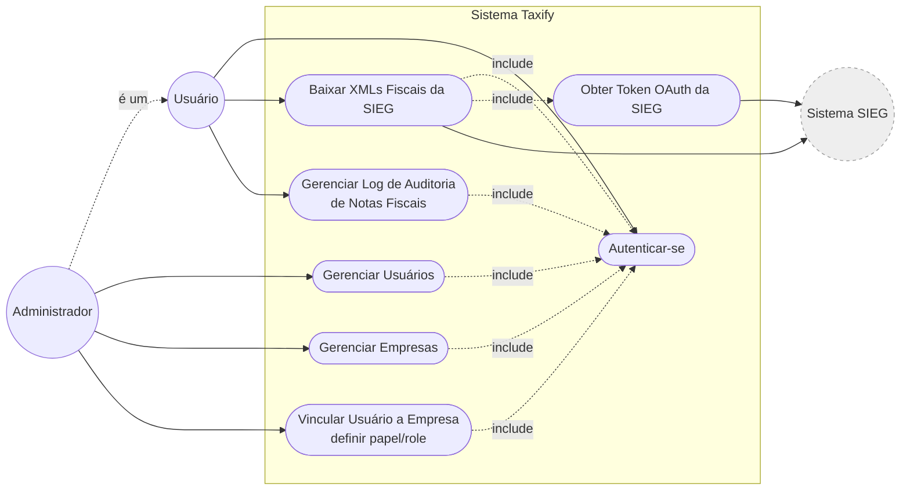
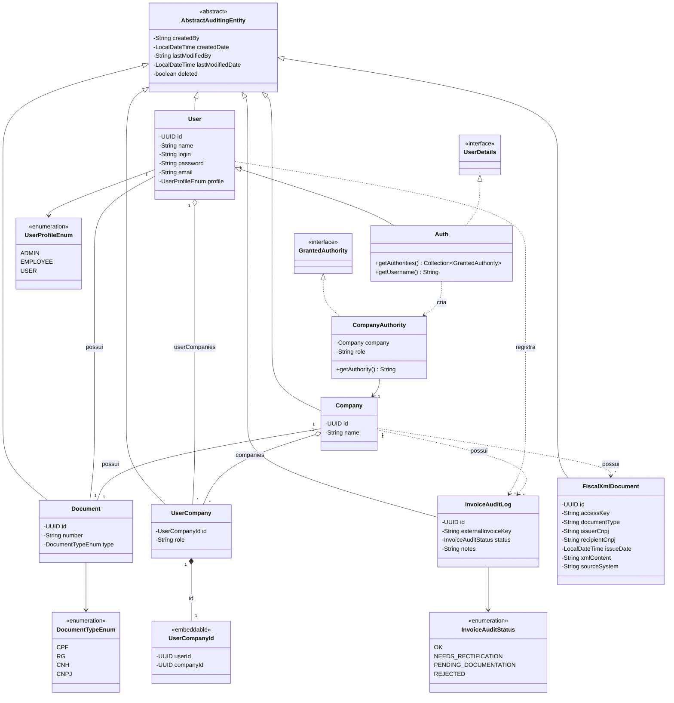

# Taxify - Diagramas

## Diagrama de Casos de Uso

Mermaid não possui um tipo nativo de diagrama de casos de uso, então ele é
representado abaixo como um fluxograma (atores em círculo, casos de uso em
elipse, dentro do limite do sistema).

## Diagrama de Classes (Domínio)

