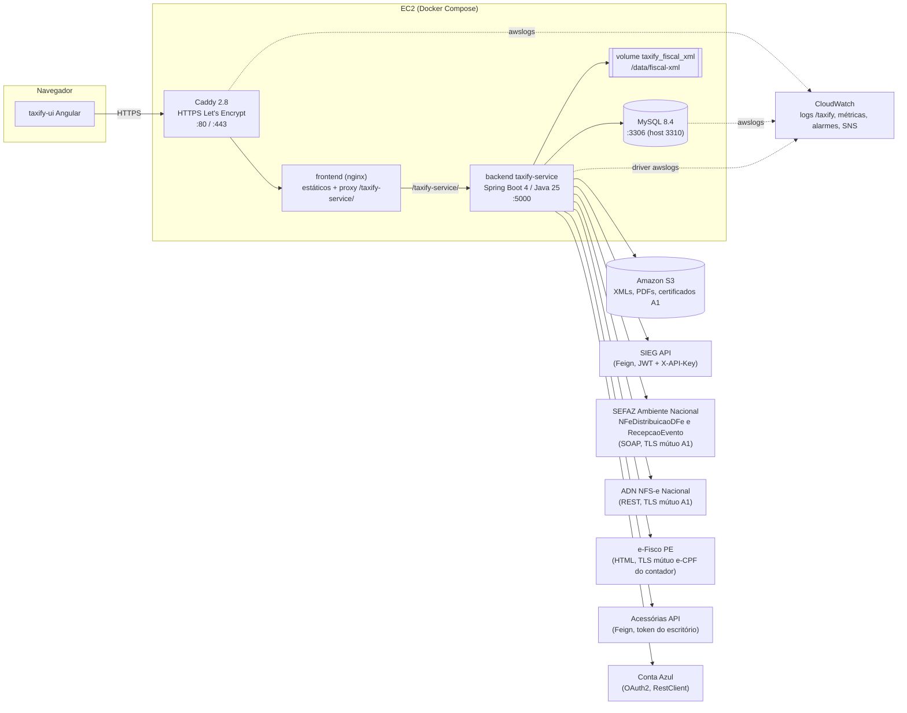

# Arquitetura técnica: backend e infra (taxify-service), como está construída

## Status

**Documento retroativo.** Descreve o backend e a infraestrutura como estão no `master` em 2026-11-26 (HEAD `77b7680`). Não propõe mudança. Os riscos e as dúvidas estão nas seções 11 e 12.

- Fontes: `pom.xml`, `Dockerfile`, `docker-compose.yml`, `docker-compose.aws.yml`, `Caddyfile`, `Jenkinsfile`, `monitoring/`, `scripts/`, `src/main/resources/`, `src/main/java/` (todos os pacotes), `src/test/` e `git log` (83 commits, de 2026-09-11 a 2026-11-24).
- A cópia de trabalho tem alterações que ainda não foram commitadas em `docker-compose.aws.yml` e `src/main/resources/application-default.yaml`. Quando a diferença importa, o texto avisa.
- Valores secretos, hosts e IPs reais foram omitidos de propósito. Onde aparece `<omitido>`, o valor existe no arquivo citado.

---

## 1. Visão geral

O taxify-service é um monólito Spring Boot (um único JAR e um único processo) que:

- expõe uma API REST em `/taxify-service/api/v1/...` (`application.yaml:6`, `constants/AppConstants.java:8-10`), consumida pelo taxify-ui (Angular);
- captura documentos fiscais: NF-e pelo SIEG e pela SEFAZ (NFeDistribuicaoDFe), NFS-e pelo SIEG e pelo Ambiente Nacional (ADN), e extratos e certidões pelo e-Fisco PE;
- guarda os XMLs num volume local ou no S3 e os metadados no MySQL;
- roda as rotinas agendadas dentro do mesmo processo (`@EnableScheduling` em `TaxifyApplication.java:19`).

Notas sobre o diagrama:
- Na EC2, só o Caddy publica portas (80/443). O backend e o front ficam sem porta publicada (`docker-compose.aws.yml:17-23`). O MySQL **continua** publicado em 3310 (ver R-04).
- O diagrama do `README.md` ainda mostra o nginx como entrada e não mostra Caddy, S3, SEFAZ, ADN, e-Fisco nem Conta Azul. Está desatualizado.

---

## 2. Stack e dependências principais

| Item | Versão | Onde |
|---|---|---|
| Java | 25 (Temurin 25 JDK no build, JRE no runtime) | `pom.xml:30`, `Dockerfile:1,15` |
| Spring Boot | 4.1.1 (parent) | `pom.xml:7` |
| Spring Framework / Security | 7.0.9 / 7.1.1 | JAR em `target/` (build local) |
| Spring Cloud (OpenFeign) | BOM 2025.1.2; openfeign-core 5.0.2, feign-core 13.6.1 | `pom.xml:114`, JAR |
| Hibernate ORM | 7.4.5.Final | JAR |
| Flyway (+ flyway-mysql) | 12.4.0 | `pom.xml:66-73`, JAR |
| MySQL Connector/J | 9.7.0 (runtime) | `pom.xml:74-78`, JAR |
| MySQL (servidor) | imagem `mysql:8.4` | `docker-compose.yml:3` |
| HikariCP | 7.0.2 | JAR |
| Tomcat embutido | 11.0.24 | JAR |
| Jackson | 3.1.5 (`tools.jackson`, usado no código) e 2.21.5 (transitivo) | JAR, `service/job/IntegrationJobRunner.java:17-18` |
| OAuth2 Resource Server / Nimbus JOSE | nimbus-jose-jwt 10.9.1 | `pom.xml:52-55`, `config/SecurityConfig.java:5-10` |
| springdoc-openapi (Swagger UI) | 3.1.0 | `pom.xml:42-46` |
| AWS SDK v2 (S3) | BOM 2.31.0 | `pom.xml:31,62-65,117-122` |
| OpenPDF (DANFE e relatórios em PDF) | 2.0.3 | `pom.xml:94-98` |
| Apache PDFBox (leitura do PDF do e-Fisco) | 3.0.3 | `pom.xml:101-105` |
| Actuator | gerenciado pelo Boot | `pom.xml:56-59` |
| Caddy | 2.8 | `docker-compose.aws.yml:26` |

Os testes usam `spring-boot-starter-data-jpa-test` e `spring-boot-starter-webmvc-test` (`pom.xml:79-88`), que trazem JUnit 5, Mockito e AssertJ. Não há Testcontainers nem H2.

---

## 3. Camadas, pacotes, padrões e convenções

### 3.1 Pacotes (`src/main/java/br/com/cshub/taxify/`)

| Pacote | Papel | Qtde. de classes |
|---|---|---|
| `rest/` | Controllers (`@RestController`), um por recurso | 26 + `rest/exception/GlobalExceptionHandler` |
| `service/` (+ `assessment`, `audit`, `certidao`, `fiscalcheck`, `fronteira`, `job`, `pendency`, `report`, `retention`) | Regras de negócio, schedulers e geração de PDF | 54 + 51 nos subpacotes |
| `validation/` | Validações do CRUD genérico (com checagem de tenant) | 10 |
| `repository/` | Spring Data JPA (`AbstractJpaRepository` = `JpaRepository` + `JpaSpecificationExecutor`) | 34 |
| `domain/` | Entidades JPA, todas herdando de `AbstractAuditingEntity` | ~45 |
| `dto/` | Records de entrada e saída | ~95 |
| `mapper/` | Conversão manual entidade ↔ DTO (`AbstractMapper`) | 10 |
| `search/` | `Specification`s dinâmicas por filtro | 12 |
| `common/` | CRUD genérico, tenant, usuário atual, cifra, helpers | 18 |
| `security/` | `@RequiresPermission`, `@AdminOnly` e o `AuthorizationManager` | 3 |
| `config/` | Segurança, CORS, i18n, auditoria JPA, pool de jobs, backfills de startup | 11 |
| `integration/` (`acessorias`, `billing`, `contaazul`, `efisco`, `fiscalxml`, `nfse`, `sefaz`, `sieg`, `storage`) | Clientes externos, parsers de XML e storage | 64 |
| `enumerated/` | Enums de domínio (perfis, permissões, serviços de plano etc.) | 26 |
| `exception/` | Exceções de negócio mapeadas para HTTP | 7 |
| `db/migration/` (fora do pacote base) | Migrations Flyway em Java | 56 + `TableMigration` |

Fluxo de uma requisição: `rest/` → `service/` → `validation/` → `repository/`, com `mapper/` e `search/` ao lado (`README.md`, seção Arquitetura).

### 3.2 CRUD genérico (`common/`)

- `AbstractCrudResource<ID, M, F>` (`common/AbstractCrudResource.java:26-54`): expõe `GET /` (paginado + filtro `F`), `GET /{id}`, `POST`, `PUT /{id}` e `DELETE /{id}`. O `DELETE` é soft delete.
- `AbstractCrudService<E, ID, M, F>` (`common/AbstractCrudService.java`):
  - `findAll(pageable, filter)` monta a `Specification` a partir do filtro, esconde os excluídos (a menos que o filtro peça `active`) e aplica `restrictQuery` (`:53-65`);
  - `create` e `update` chamam a validação na ordem `checkOwnerFieldsToCreate`/`checkUpdateConsistence` → `checkMandatoryFields` → `checkRelations` → `checkValidationsExtras` (`:88-112`);
  - `findCheckById` busca o registro não excluído e chama `checkAccess` (`:120-126`); `delete` marca `deleted=true` (`:128-133`);
  - os pontos de extensão são `restrictQuery` e `checkAccess` (`:72-86`).
- `FirmScopedCrudService` (`common/FirmScopedCrudService.java:40-52`): para entidades do escritório (usuários, planos, o próprio escritório). Filtra pelo `accountingFirm` do usuário.
- `CompanyScopedCrudService` (`common/CompanyScopedCrudService.java:41-54`): para entidades de uma empresa cliente (assinaturas, regras fiscais, cobranças). Filtra por escritório **e**, para quem não é ADMIN, pela carteira (`UserCompany`).
- `AbstractCrudValidation` (`common/AbstractCrudValidation.java`): cada validação concreta sobrescreve `checkExist` para chamar `tenantAccessService.assertCompanyAccess` ou `assertSameFirm` (ex.: `validation/ProductFiscalRuleValidation.java:37-41`). **O `update` só fica isolado por tenant por causa desse override**: `AbstractCrudService.update` não chama `checkAccess`.
- `AbstractCrudService.findAll(Pageable)` sem filtro (`:42-46`) **não** aplica `restrictQuery`. Hoje nenhum endpoint o usa (o `GET` sem filtro em `AbstractCrudResource.java:20-24` está comentado), mas é uma armadilha (R-10).

Serviços que usam o CRUD genérico: `AccountingFirmService`, `BillingChargeService`, `CompanyService`, `InvoiceAuditLogService`, `PlanService`, `ProductFiscalRuleService`, `SubscriptionService`, `UserCompanyService` e `UserService`. O resto (notas, apuração, Fronteira, pendências etc.) são serviços próprios com endpoints específicos.

### 3.3 Specifications (`search/`)

- `SearchCriteriaUtil.buildCriteria(filter)` lê os componentes de um **record** de filtro por reflexão. Cada campo não vazio vira um `SearchCriteria(chave, "and", valor)`. O campo `active` vira `deleted = !active` (`search/SearchCriteriaUtil.java`). Filtros que não são record são ignorados (o trecho de JavaBean está comentado).
- `AbstractsSpecification.listAllByCriteria` gera os predicados e o `orderBy` (`search/AbstractsSpecification.java:29-36`). Cada subclasse acrescenta predicados próprios em `addExtrasPredicates` (ex.: busca por nome/CNPJ e UF em `search/CompanySpecification.java`).
- Convenção: o filtro de um recurso novo é um record com os nomes dos campos da entidade. Um campo que não é atributo direto precisa de tratamento em `addExtrasPredicates`.

### 3.4 Mappers

São manuais, sem MapStruct. Cada um estende `AbstractMapper<E, M>`, com `toEntity`, `toModel` e `merge(source, target)` (`common/AbstractMapper.java`). O `merge` é usado em `checkUpdateConsistence` para copiar os campos editáveis para a entidade persistida (ex.: `validation/SubscriptionValidation.java:52-63`). Os ids trafegam como `String` (UUID) nos DTOs (`mapper/PlanMapper.java`).

### 3.5 Validações e erros

- Exceções de negócio → HTTP (`rest/exception/GlobalExceptionHandler.java:38-114`): `ResourceNotFoundException` → 404, `ConflictException` → 409, `BadRequestException` → 400, `UnauthorizedException` → 401, `Sieg/Acessorias/ContaAzulIntegrationException` → 502, `BadCredentials`/`InternalAuthenticationService` → 403, `AccessDeniedException` → 403 e qualquer outra `Exception` → 500 com `exception.getMessage()` no corpo (R-11).
- Mensagens em i18n: `src/main/resources/i18n/{errors,fields,messages}_{pt,en}.properties`, carregadas por `WebMvcConfig.messageSource` (`config/WebMvcConfig.java:26-35`). O locale padrão é pt-BR e pode ser trocado pelo parâmetro `?language=` (`:37-48`). O código lê as mensagens por `MessageService.getMessage("error.x.y")`.
- Bean Validation: o `@Valid` fica nos `@RequestBody` do CRUD (`AbstractCrudResource.java:39,45`).

### 3.6 Eventos

- `ProductFiscalRuleService.create/update` publica um `ProductFiscalRuleSavedEvent` (`service/ProductFiscalRuleService.java:36-58`). O `ProductFiscalRuleRectificationListener` (`@TransactionalEventListener(AFTER_COMMIT, fallbackExecution = true)`, `service/ProductFiscalRuleRectificationListener.java:39-45`) retifica, numa thread virtual, as notas do produto dentro do lookback.
- `@EventListener(ApplicationReadyEvent)`: `FiscalXmlTaxDetailBackfill` (`config/FiscalXmlTaxDetailBackfill.java:68`) e `FiscalXmlStorageMigration` (`integration/storage/FiscalXmlStorageMigration.java:41`).
- Listeners nativos do Hibernate (`PostInsert/PostUpdate/PostDelete`) em `TaxAssessmentCacheInvalidator` (ver 3.7).

### 3.7 Cache e invalidação

Não há `@EnableCaching` nem Spring Cache. Existe um único cache, em memória:

- `TaxAssessmentCache` (`service/assessment/TaxAssessmentCache.java`): guarda o cálculo da apuração por (empresa, mês) num `ConcurrentHashMap`, com TTL de 5 min (`:27`) e no máximo 20.000 entradas (`:29`). Cada empresa tem uma versão, e um cálculo começado antes de uma mudança não é gravado.
- `TaxAssessmentCacheInvalidator` (`service/assessment/TaxAssessmentCacheInvalidator.java`): registra-se nos eventos do Hibernate e descarta as entradas da empresa quando se grava `FiscalXmlDocument`, `FiscalXmlDocumentItem`, `Company` ou `CompanyTaxRegime`. Descarta na hora e de novo depois do commit (uma passada por transação). **Escritas por SQL nativo, `@Modifying` ou JDBC não disparam a invalidação** e dependem do TTL.
- Cache por requisição: `CurrentUserService` lê o usuário uma vez por request HTTP e guarda nos atributos da requisição (`common/CurrentUserService.java:34-47`).
- O token do SIEG fica em memória por 55 min (`integration/sieg/SiegTokenService.java:25,43-48`).

Todos esses caches são por JVM. Com mais de uma instância, deixariam de ser coerentes (R-08).

### 3.8 Convenções que um dev novo precisa seguir

1. **Toda entidade** estende `AbstractAuditingEntity` (`created_by`, `created_date`, `last_modified_by`, `last_modified_date`, `deleted`) e usa id UUID (`@GeneratedValue(strategy = UUID)` + `@JdbcTypeCode(VARCHAR)`, coluna `varchar(36)`).
2. **Exclusão é soft delete.** Não há `@SQLRestriction`: toda query precisa filtrar `deleted = false` explicitamente (métodos `...AndDeletedIsFalse`, `notDeleted()`).
3. **Tenant**: dado de empresa passa por `TenantAccessService.assertCompanyAccess` e lista passa por `restrictToUserCompanies`/`accessibleCompanyIds`. Outro tenant responde **404**, nunca 403 (`common/TenantAccessService.java:59-68`).
4. **Autorização no controller**, com `@RequiresPermission(value = leitura, write = escrita)` ou `@AdminOnly` na classe ou no método. Existe um teste que falha se algum endpoint ficar sem regra (`PermissionAuthorizationManagerTest`).
5. **Dinheiro é `BigDecimal`**, gravado em `decimal(15,2)`/`decimal(19,2)`; percentuais e alíquotas em `decimal(7,4)`/`decimal(9,4)` (seção 5.4).
6. **Schema só por migration Java** em `db/migration`, com o próximo número livre (seção 5.1). O Hibernate roda em `validate`.
7. **Chamada externa sempre com timeout explícito** (`common/RestClients.java:14`, `HttpClient.connectTimeout`, `spring.cloud.openfeign.client.config`).
8. **Rotina agendada nova**: `enabled` + `cron` em propriedade com padrão, guarda contra execução em paralelo (`AtomicBoolean` ou claim no banco) e falha isolada por empresa (try/catch por item).
9. **Log**: só ids (empresa, documento, escritório). Nada de CNPJ, nome, chave de acesso ou HTML/corpo com dado de cliente (seção 4.8).

---

## 4. Segurança

### 4.1 Autenticação: JWT RSA

- Login: `POST /api/v1/auth` com `auth = base64(login:senha)` (`service/AuthService.java:32-47`). Autentica pelo `AuthenticationManager` (senha com BCrypt, `config/SecurityConfig.java:96-99`) e devolve o JWT.
- Emissão (`service/TokenService.java:29-56`): RS256 com o par `jwt.key.private/public` = `classpath:app.key` / `classpath:app.pub` (`application.yaml:59-62`, `SecurityConfig.java:42-45,101-111`). Validade de **2 horas** (`TokenService.java:31`). Claims: `iss=taxify-service`, `sub=login`, `authorities` (perfil + permissões), `userId`, `profile`, `accessProfiles`, `permissions`, `tenantId` e `platformAdmin`.
- Validação: resource server com `NimbusJwtDecoder.withPublicKey` (`SecurityConfig.java:73-76,101-104`). O claim `authorities` é lido sem prefixo (`:86-94`).
- Sessão stateless, CSRF desligado (`SecurityConfig.java:53-54`). **`httpBasic` também está ligado** (`:72`): qualquer endpoint aceita `Authorization: Basic` (R-09).
- `iat`/`exp` são calculados com `LocalDateTime.now()` convertido com offset fixo `-03:00` (`TokenService.java:30,39-40`). Num container em UTC (o compose não define `TZ`), o instante sai 3 h adiantado. Na prática o token vale cerca de 5 h e nasce com `iat` no futuro (R-07).
- A senha é separada com `split(":")` (`AuthService.java:33`), então uma senha que contém `:` é truncada.

### 4.2 Rotas públicas

`SecurityConfig.java:55-70`: `POST /auth`, `POST /users` (anônimo = cadastro público de escritório; ou ADMIN incluindo colega), `/v3/api-docs/**`, `/swagger-ui*` e `/actuator/health`. Todo o resto exige autenticação.

### 4.3 Perfis e permissões

- Tipo de usuário (`enumerated/UserProfileEnum.java:4-6`): `ADMIN`, `EMPLOYEE` e `USER`. O ADMIN passa em qualquer checagem (`security/PermissionAuthorizationManager.java` → `Requirement.isSatisfiedBy`).
- Permissões (`enumerated/Permission.java:15-36`), por módulo:
  - REGISTRY: `COMPANIES_VIEW`
  - FISCAL: `INVOICES_VIEW`, `INVOICES_SYNC`, `INVOICES_RECTIFY`, `INVOICES_AUDIT`, `FISCAL_RULES_VIEW`, `FISCAL_RULES_MANAGE`, `TAX_ASSESSMENT_VIEW`, `TAX_ASSESSMENT_CLOSE`
  - FINANCIAL: `PLANS_VIEW`, `SUBSCRIPTIONS_VIEW`, `SUBSCRIPTIONS_MANAGE`, `BILLING_VIEW`, `BILLING_SYNC`, `BILLING_MANAGE`
- Perfis de acesso (`enumerated/AccessProfile.java:32-45`). Um usuário pode ter vários, e as permissões se somam:

| Perfil | Permissões |
|---|---|
| `FISCAL` | COMPANIES_VIEW, INVOICES_VIEW/SYNC/RECTIFY/AUDIT, FISCAL_RULES_VIEW/MANAGE, TAX_ASSESSMENT_VIEW/CLOSE |
| `ACCOUNTING` | COMPANIES_VIEW, INVOICES_VIEW, FISCAL_RULES_VIEW, TAX_ASSESSMENT_VIEW |
| `FINANCIAL` | COMPANIES_VIEW, PLANS_VIEW, SUBSCRIPTIONS_VIEW/MANAGE, BILLING_VIEW/SYNC/MANAGE |
| `PAYROLL` | COMPANIES_VIEW |
| `MANAGEMENT` | COMPANIES_VIEW, INVOICES_VIEW, FISCAL_RULES_VIEW, TAX_ASSESSMENT_VIEW, PLANS_VIEW, SUBSCRIPTIONS_VIEW, BILLING_VIEW |

- Mecanismo: `MethodSecurityConfig` (`config/MethodSecurityConfig.java:27-42`) cria um interceptor na ordem do `@PreAuthorize` para qualquer classe ou método anotado com `@RequiresPermission` ou `@AdminOnly`. A regra (`PermissionAuthorizationManager.requirementFor`) é: anotação do método > `@AdminOnly` da classe (ou só nas escritas, com `writeOnly`) > `@RequiresPermission` da classe (`value` para GET/HEAD/OPTIONS e `write` para o resto). Um mapping sem método HTTP conta como escrita. Endpoint sem anotação exige só login.
- Serviços liberados por plano (`enumerated/PlanServiceEnum.java:9-22`): `FISCAL_XML_IMPORT`, `INVOICE_AUDIT`, `SIEG_INTEGRATION`, `MULTI_USER_ACCESS`, `REPORTS`, `SEFAZ_INTEGRATION`, `SEFAZ_MANIFESTATION` e `NFSE_NATIONAL_INTEGRATION`. Isso **não** é authority: os schedulers e serviços checam o plano vigente da empresa.

### 4.4 Isolamento multi-tenant

- O tenant é o `AccountingFirm`. `TenantAccessService` (`common/TenantAccessService.java`):
  - `assertSameFirm` → 404 se o escritório for outro (`:64-68`);
  - `getRestrictedUserId` → quem não é ADMIN fica limitado à carteira (`:74-78`);
  - `assertCompanyAccess` = mesmo escritório **e** (ADMIN ou vínculo em `UserCompany`) (`:113-118`);
  - `restrictToUserCompanies` acrescenta `EXISTS (user_company ...)` nas listas (`:125-142`);
  - `accessibleCompanyIds`/`filterAccessible` buscam a carteira numa consulta só (`:84-101`).
- **Contexto sem usuário = sem restrição** (`:30-33,48-57`). É o caminho dos schedulers. A mesma coisa acontece numa requisição autenticada cujo usuário não é encontrado: `CurrentUserService.loadCurrentUser` devolve vazio se o login foi excluído (soft delete) ou se deu exceção (`common/CurrentUserService.java:57-67`). Nesse caso um JWT ainda válido de um usuário excluído passa sem filtro de tenant (R-02).
- O `tenantId` do token **não** é usado na autorização. O escritório vem sempre do usuário no banco.

### 4.5 Admin da plataforma (CS Hub)

`PlatformAdminService` (`common/PlatformAdminService.java`): é admin da plataforma quem tem login em `taxify.platform.admin-logins` (`PLATFORM_ADMIN_LOGINS`, separados por vírgula, sem diferenciar maiúsculas) **e** perfil ADMIN (`:38-40`). Só ele altera as regras gerais, que valem para todos os escritórios: a tabela de ICMS da Fronteira e as regras da auditoria (`assertCanManageGlobalRules`, `:49-53`, que devolve 403). O claim `platformAdmin` vai no token só para o front (`TokenService.java:50`). Com a lista vazia (padrão do `application.yaml:148`), ninguém altera. O compose define o padrão `admin` (`docker-compose.yml`, `PLATFORM_ADMIN_LOGINS`). O login é único na plataforma, mas qualquer escritório que se cadastre com um login da lista e seja ADMIN vira admin da plataforma, se esse login estiver livre (R-12).

### 4.6 Certificados A1 e `CERT_ENCRYPTION_KEY`

- `SecretCipher` (`common/SecretCipher.java`) usa AES-256-GCM, IV aleatório de 12 bytes e tag de 128 bits. A chave é `taxify.secrets.key` = `CERT_ENCRYPTION_KEY` (32 bytes em base64, `:32-42`). É opcional: sem ela, `isConfigured()` = false.
- Certificado da empresa (e-CNPJ) em `CompanyCertificateService` e certificado do contador (e-CPF, para o e-Fisco) em `FirmCertificateService`:
  - o `.pfx` vai para o storage em `certificados/{id}-{timestamp}{sufixo}` (`integration/sieg/FiscalXmlFileStorage.java:84-85`); quando há chave, vai cifrado e com sufixo próprio (`service/CompanyCertificateService.java:109-116`, `service/FirmCertificateService.java:77-84`);
  - a senha vai para o banco com o prefixo `enc:` (cifrada) ou o de texto puro (`CompanyCertificateService.java:126,178-190`);
  - sem chave, o backend registra `WARN ... WITHOUT encryption` e grava sem cifra (`:111`, `FirmCertificateService.java:79`). Nesse caso o `.pfx` fica só com a criptografia do bucket e a senha fica **em texto no banco**;
  - se a chave se perder, os certificados cifrados precisam ser reenviados. Trocar a chave quebra a leitura (`SecretCipher.java:66-67`).
- O A1 é aberto como PKCS12 e vira `SSLContext` para TLS mútuo com SEFAZ, ADN e e-Fisco (`integration/sefaz/A1Certificate.java:39,53`).

### 4.7 Segredos

- Em tempo de execução, os segredos vêm de variáveis de ambiente (seção 8). O `application.yaml:9` também importa `optional:file:.env[.properties]` do diretório corrente.
- O `.env` está no `.gitignore`. O `.env.example` traz só as chaves, sem valores.
- **Estão versionados no git**:
  - `src/main/resources/app.key`, a chave privada RSA do JWT, que também vai para dentro da imagem Docker (R-01);
  - `src/main/resources/application-default.yaml`, com credenciais reais (senha do banco, client secret do SIEG e, na cópia de trabalho, client secret da Conta Azul e o host da EC2). O `Dockerfile:10` apaga esse arquivo antes do build, então ele não entra na imagem, mas está no histórico do git (R-01);
  - `application.yaml:71` tem como padrão do `CONTA_AZUL_REDIRECT_URI` o hostname público da EC2;
  - `src/test/resources/certificates/a1-teste.pfx`, um certificado de teste (conferir se é sintético; ver P-05).
- Os tokens de integração do escritório (X-API-Key do SIEG, token da Acessórias, access/refresh token da Conta Azul) ficam **em texto** em `firm_integrations` (`domain/billing/FirmIntegration.java:63-71`). O `SecretCipher` só é usado para os certificados (R-05).

### 4.8 CORS

`CorsFilter` (`config/CorsFilter.java`), com `HIGHEST_PRECEDENCE`: `Access-Control-Allow-Origin: *` (`:21`), métodos GET/POST/PUT/DELETE/OPTIONS e headers explícitos, incluindo `Authorization`. Responde 200 a qualquer `OPTIONS`. Também imprime `"Hello Sleuth"` no stdout a cada requisição (`:29`), o que vira uma linha de log no CloudWatch por request. O `WebMvcConfig` não configura CORS, de propósito (`config/WebMvcConfig.java:18-19`). Em produção o front e a API estão na mesma origem (via nginx), então o `*` só amplia a superfície.

### 4.9 LGPD em logs

- Prática geral: os logs dos serviços e schedulers usam ids (empresa, documento, escritório). Exemplos: `FiscalXmlSyncScheduler`, `SefazDistScheduler`, `FiscalXmlRectificationScheduler`.
- Exceções encontradas:
  - `EfiscoClient.logDiagnostic` (`integration/efisco/EfiscoClient.java:207-213`) grava em `WARN` o **HTML inteiro** das telas do e-Fisco, em pedaços de 8.000 caracteres, quando a página não é a esperada. Essas telas trazem IE, razão social e valores do contribuinte, e o texto vai para o CloudWatch (R-03);
  - corpos de erro de terceiros: SIEG (`integration/sieg/SiegClient.java:76`), Acessórias (`integration/acessorias/AcessoriasClient.java:109`) e Conta Azul (`integration/contaazul/ContaAzulOAuthClient.java:87`, corpo inteiro da resposta do endpoint de token);
  - `ProductFiscalRuleRectificationListener.java:65-66` registra o código do produto;
  - o `GlobalExceptionHandler` devolve `exception.getMessage()` ao cliente em erros 500.
- O CloudWatch guarda os logs para sempre, a menos que alguém configure a retenção manualmente (`monitoring/README.md`, seção 3, que sugere 14 dias).

---

## 5. Persistência

### 5.1 Migrations

- Flyway com `locations: classpath:db/migration`, `baseline-on-migrate: true` e `baseline-version: 0` (`application.yaml:30-34`). Os bancos criados antes do Flyway são baselined em 0 e rodam todas as migrations.
- O Hibernate roda em `ddl-auto: ${JPA_DDL_AUTO:validate}` (`application.yaml:40`) e `unique_constraint_strategy: SKIP` (`:44-45`).
- **Todas as migrations são classes Java**, sem SQL: `src/main/java/db/migration/V1__AccountingFirms` até `V56__CertidoesEstaduais`. A numeração é sequencial e sem lacunas. O nome segue `V<n>__<Tabela ou Assunto>`.
- Padrão `TableMigration` (`db/migration/TableMigration.java`): **uma tabela por migration**, declarada uma vez e aplicada ao que o banco já tem.
  - No construtor: `super("tabela")`, `column(nome, definição)`, `primaryKey(...)` (padrão `id`), `index(...)`, `unique(...)`, `foreignKey(nome, coluna, tabelaReferenciada)` e `ordinalEnum(...)` (`:52-81`).
  - Tabela inexistente → `CREATE TABLE` com todas as colunas, `ENGINE=InnoDB` (`:102-110`).
  - Tabela existente → acrescenta as colunas que faltam. Uma coluna `NOT NULL` numa tabela com linhas recebe `DEFAULT 0` se for numérica/bit; se não for, é criada **nullable**, com um WARN (`:124-141`). Também converte `ENUM` do MySQL e enum ORDINAL para `VARCHAR` (`:143-164`).
  - Índices, UKs e FKs só são criados se não existirem. Um índice com as mesmas colunas e outro nome é renomeado (`:166-193`).
  - **Uma UK ou FK que falha (duplicatas, órfãos) é só registrada em log e ignorada**, sem derrubar o deploy (`:27-28,190-192,209-211`). A próxima execução não tenta de novo, porque a migration já fica marcada como aplicada no Flyway (R-13).
  - `beforeKeys()` é o gancho para ajustes da tabela (`:83-85`).
- Para alterar uma tabela existente, cria-se uma **nova** migration com o mesmo nome de tabela e só as colunas ou índices novos. Exemplos: `V48__FiscalXmlItemSimplesCredit` (2 colunas em `fiscal_xml_document_items`), `V54__PendenciesCompanyStatusIndex` e `V55__FiscalXmlItemsCoveringIndex` (só índice).
- Migrations de dados estendem `BaseJavaMigration` direto, com SQL: `V30__PlanImportSources` e `V32__RecheckRectifiedNotes` (que zera `last_rectification_checked_at` das notas retificadas).
- Para escrever uma nova:
  1. pegar o próximo número (hoje, `V57`);
  2. estender `TableMigration` e declarar as colunas com os tipos MySQL (`varchar(36)` para id/FK, `datetime(6)`, `bit not null`, `decimal(19,2)`) e os 5 campos de auditoria + `deleted`;
  3. para ver a DDL que o Hibernate espera de uma entidade nova, rodar `./mvnw test -Dtest=SchemaDdlGenerator -Dddl.out=target/schema.sql` (`src/test/java/.../tools/SchemaDdlGenerator.java`), que não conecta no banco;
  4. não editar uma migration já aplicada: as migrations Java não têm checksum, então o Flyway não percebe a mudança.

### 5.2 Backfills

Existem dois tipos:

- **Na migration**: SQL direto (`V32`), ou a conversão de enum dentro de `TableMigration.fixType`.
- **No startup da aplicação** (`ApplicationRunner` ou `ApplicationReadyEvent`), todos idempotentes:

| Classe | O que faz |
|---|---|
| `config/AccessProfileMigration` | Enquanto nenhum usuário tem perfil, dá `FISCAL` a todo usuário que não é ADMIN |
| `config/CompanyTaxRegimeBackfill` | Estrutura o regime em texto livre e abre o histórico de regime |
| `config/FirmIntegrationMigration` | Copia as credenciais SIEG/Acessórias das colunas antigas de `accounting_firms` para `firm_integrations` |
| `config/FiscalDirectionBackfill` | Classifica entrada/saída das notas antigas em lotes de 500 |
| `config/FiscalXmlTaxDetailBackfill` | Relê o XML das notas com `metadata_version` antigo e preenche o detalhe tributário; em background; desliga com `fiscal-xml.tax-detail-backfill.enabled=false` |
| `integration/storage/FiscalXmlStorageMigration` | Com `storage.type=s3` e `migrate-local=true`, copia os XMLs do volume para o S3 |

Esses backfills rodam **em qualquer contexto Spring que suba**, inclusive no `@SpringBootTest` (seção 10).

### 5.3 Auditoria e soft delete

- `AbstractAuditingEntity` (`domain/AbstractAuditingEntity.java:15-36`) + `@EnableJpaAuditing(auditorAwareRef = "auditorAware")` (`TaxifyApplication.java:17`). `AuditorAwareImpl` grava o login autenticado, ou `anonymous`/`unknown` (`config/AuditorAwareImpl.java`). Os jobs disparados por botão levam o contexto de segurança junto (`DelegatingSecurityContextRunnable`, `service/job/IntegrationJobRunner.java:81`).
- Soft delete com `deleted bit not null`, filtrado manualmente (seção 3.8). O expurgo (`FiscalXmlPurgeScheduler`) apaga **arquivos** antigos e mantém os metadados.
- Não há `@Version` (lock otimista) em nenhuma entidade. `FirmIntegration` usa `@DynamicUpdate` porque várias threads escrevem colunas diferentes (`domain/billing/FirmIntegration.java:36-37`).
- Trilha fiscal própria: `InvoiceAuditLog` (`V15`), a retificação gera um arquivo novo e o original é preservado (README).

### 5.4 Índices relevantes

| Índice | Tabela | Migration | Para quê |
|---|---|---|---|
| `uk_fiscal_xml_document_company_key` (company_id, access_key) | fiscal_xml_documents | V16:99 | Mesma nota nunca gravada duas vezes (SIEG × SEFAZ) |
| `idx_fxd_company_issue`, `idx_fxd_company_direction_issue` | fiscal_xml_documents | V16:97-98 | Listas e apuração por período |
| `idx_fxdi_document_cfop_valor` (document_id, cfop, valor_total) | fiscal_xml_document_items | V55 | Índice de cobertura da apuração (13 meses) |
| `uk_pendencies_company_key`, `idx_pendencies_company_status` | pendencies | V35:37, V54 | Idempotência e tela de pendências |
| `idx_subscription_company_status`, `idx_subscription_external` | subscriptions | V10:30-31 | Plano vigente e sincronização de cobrança |
| `uk_companies_document` | companies | V5:44 | Um documento por empresa |
| `idx_certidoes_estaduais_company_validade` | certidoes_estaduais | V56:33 | Certidão vigente |

### 5.5 BigDecimal

O `BigDecimal` aparece em 82 classes. Nas migrations, os tipos decimais são `decimal(19,2)` (54×), `decimal(15,2)` (22×), `decimal(7,4)` (21×), `decimal(9,4)` (5×) e `decimal(19,4)` (4×). Não foi encontrado `double`/`float` em valores monetários de `domain`, `dto` ou `service`; os `float` que aparecem são larguras de colunas de PDF (`service/DanfePdfService.java`, `service/fronteira/FronteiraReportPdf.java`).

### 5.6 JPA

`open-in-view: true` (`application.yaml:36`), `enable_lazy_load_no_trans: true` (`:46`), `default_batch_fetch_size: 50` (`:48`) e `allow-bean-definition-overriding: true` (`:19`). Multipart de até 50 MB (`:50-53`).

---

## 6. Integrações externas

| Sistema | Cliente | Autenticação | Timeouts | Rate limit / pausa | Retry | Quando falha |
|---|---|---|---|---|---|---|
| **SIEG** (baixar/contar XMLs) | Feign `siegClient` (`integration/sieg/SiegFeignClient.java:22`) | JWT do `create-jwt` (client id + secret globais, cache de 55 min, `SiegTokenService.java:25,43-48`) + X-API-Key do escritório (`firm_integrations`) | connect 15 s / read 180 s (`application.yaml:156-158`, coberto por `FeignTimeoutsConfigTest`) | `SiegRateLimiter`: janela deslizante de 2 req/min **por JVM**, `synchronized` + `sleep` (`SiegRateLimiter.java:23-37`; `sieg.max-requests-per-minute`, `application.yaml:67`); NFS-e em janelas de até 1 mês | Não | HTTP ≥ 400 → `SiegIntegrationException` (502 na API); 404 "Nenhum arquivo XML localizado" = vazio (`SiegClient.java:70`); o scheduler registra e segue para a próxima empresa |
| **SIEG** (token) | Feign `siegTokenClient` | Headers `X-Client-Id`/`X-Secret-Key` | 15 s / 30 s (`application.yaml:159-161`) | Fora do limitador | Não | `SiegIntegrationException` |
| **SEFAZ** NFeDistribuicaoDFe | `java.net.http.HttpClient`, SOAP 1.2, HTTP/1.1 (`integration/sefaz/SefazDistClient.java`) | TLS mútuo com A1 da empresa (matriz para filiais) | connect 30 s (`:95`) / request 90 s (`SefazProperties.java:25`) | 2 s entre lotes, até 40 lotes por empresa (`SefazProperties.java:23-24`); cStat **656** → pausa de 1 h para a empresa e segue o NSU informado (`service/SefazDistService.java:180-197`) | Não; a próxima hora retoma pelo NSU | Registra e passa para a próxima empresa; a execução fica em `capture_runs` |
| **SEFAZ** RecepcaoEvento (Ciência 210210) | `HttpClient`, SOAP assinado (`SefazEventClient.java`) | TLS mútuo A1 + XMLDSig | request 90 s | Até 100 ciências e 20 buscas por chave por execução (`SefazProperties.java:32,36`) | Até 3 tentativas por nota entre execuções (`cienciaMaxAttempts`, `:34`) | Contador de tentativas; 656 também pausa |
| **ADN NFS-e Nacional** | `HttpClient` REST/JSON (`integration/nfse/AdnClient.java`) | TLS mútuo A1 | connect 30 s (`:61`) / request 60 s (`AdnProperties.java:25`) | 1 s entre lotes, até 20 lotes; 60 min de espera quando está em dia (`AdnProperties.java:23-27`); 429 = pausa (`AdnResponse.java:33-35`) | Não | 404/429 viram resposta vazia (`AdnClient.java:68`); o scheduler registra por empresa |
| **e-Fisco PE** (extrato e memória da Fronteira) | `HttpClient` com cookies, raspando o HTML (`integration/efisco/EfiscoClient.java`) | TLS mútuo com **e-CPF do contador** (`FirmCertificate`) | connect 30 s (`:75`), PDF 90 s (`:245`), páginas 60 s (`:252`) | Uma sessão por vez por escritório (`EfiscoSyncService.java:41,89`) | Não, de propósito: desafio da Cloudflare, 403/429/503 ou login recusado **param a execução** com o motivo (`EfiscoClient.java:282-290`, `EfiscoException.java:7-13`) | Status registrado no certificado do escritório e nas pendências |
| **e-Fisco PE** (certidão) | `HttpClient` (`EfiscoCertidaoClient.java`) | Página pública | connect 30 s / 60 s (`:33,46`) | 3 s entre empresas (`CertidaoScheduler.java` `PAUSE_MS`) | Não; captcha (Turnstile) nunca é resolvido | A execução para e as demais empresas ficam registradas como "pulada" com o mesmo motivo |
| **Acessórias** | Feign `acessoriasClient` (`AcessoriasFeignClient.java:25`) | Token do escritório (`firm_integrations.api_key`) | 15 s / 60 s (`application.yaml:162-164`) | Nenhum próprio | Não; 429 → erro "rate limited" (`AcessoriasClient.java:102`) | 401/403 → token inválido; ≥ 400 → `AcessoriasIntegrationException` (502); o job fica FAILED em `firm_integrations` |
| **Conta Azul** (API) | `RestClient` (`ContaAzulApiClient.java:50`) | OAuth2 por escritório; refresh com lock por escritório (`service/ContaAzulAuthService.java:53,143`) | 15 s / 60 s (`:38-39`) | — | 429 → até 4 tentativas, respeitando `Retry-After` ou backoff de 2, 4, 8… até 30 s (`:43-45,228-266`) | `ContaAzulIntegrationException` (502); o job fica FAILED |
| **Conta Azul** (OAuth) | `RestClient` (`ContaAzulOAuthClient.java:42`) | client id/secret | 15 s / 30 s (`:32-33`) | — | Não | Loga o corpo da resposta (`:87`) |
| **S3** | AWS SDK v2 (`integration/storage/S3XmlStorage.java`), só com `fiscal-xml.storage.type=s3` (`StorageConfig`) | IAM role da EC2 (recomendado) ou `AWS_ACCESS_KEY_ID`/`SECRET` | Padrão do SDK | — | Padrão do SDK | Leitura que falha → o detalhe da nota vem das colunas do banco (`FiscalXmlQueryService.java:251`); na exportação, a nota é pulada com WARN |

Extensibilidade: os provedores de XML implementam `FiscalXmlProvider` e são escolhidos por `fiscal-xml.sync.provider` (`FiscalXmlSyncScheduler.java:104-110`). Os de cobrança implementam `BillingProvider` (`integration/billing/BillingProviderRegistry`).

Parsing seguro: o `DocumentBuilderFactory` desliga DOCTYPE e entidades externas, contra XXE (`integration/fiscalxml/FiscalXmlDomParser.java:22-24`). No ZIP, cada XML é limitado a 20 MB (`FiscalXmlPackageExtractor.java:32`).

---

## 7. Rotinas agendadas

O pool do `@Scheduled` tem **3 threads** (`application.yaml:54-57`). O Spring não sobrepõe execuções do mesmo método cron. As rotinas que mandam o trabalho para uma thread virtual usam um `AtomicBoolean` para não duplicar. Nenhum lock é distribuído: tudo assume **uma única instância**. Os crons rodam no fuso da JVM, que é UTC no container, porque o compose e o Dockerfile não definem `TZ` (R-07).

| Scheduler | Cron (variável → padrão no yaml/código; compose) | O que faz | Lock / concorrência |
|---|---|---|---|
| `FiscalXmlSyncScheduler.syncAllCompanies` (`service/FiscalXmlSyncScheduler.java:98`) | `FISCAL_XML_SYNC_CRON` (sem padrão no yaml; código `0 * * * * *`; compose `0 0/5 * * * *`) | Cria as linhas de controle; filtra empresas com `FISCAL_XML_IMPORT` vigente; pega `batch-size` empresas em rodízio (cursor em memória); baixa as NF-e entrada/saída, os eventos (1×/dia, 2 dias para trás) e as NFS-e (35 dias) pelo SIEG | Thread do scheduler (não sobrepõe); limitador do SIEG; falha isolada por empresa |
| `FiscalXmlRectificationScheduler.rectifyAllCompanies` (`:43`) | `FISCAL_XML_RECTIFICATION_CRON` (código `0 3 * * * *`; compose `0 0/30 * * * *`), lookback `FISCAL_XML_RECTIFICATION_LOOKBACK_DAYS` | Retifica as notas das empresas com regra fiscal, de forma idempotente | Thread do scheduler. **Sem trava contra o listener de regra salva**, que retifica as mesmas notas numa thread virtual em paralelo (R-14) |
| `FiscalXmlPurgeScheduler.purgeOldFiles` (`:47`) | `FISCAL_XML_PURGE_CRON` (`0 0 4 1 * *`), `FISCAL_XML_PURGE_RETENTION_MONTHS` (compose 3) | Remove os arquivos XML antigos pela data de emissão; mantém os metadados | Thread do scheduler |
| `SefazDistScheduler.tick` (`:55`) | `SEFAZ_DIST_CRON` (`0 15 * * * *`); `SEFAZ_DIST_UFS` | Captura NF-e pela SEFAZ para empresas com A1 e a SEFAZ como fonte no plano; Ciência automática | Thread virtual + `AtomicBoolean` (`:43,60-71`) |
| `NfseAdnScheduler.tick` (`:50`) | `NFSE_ADN_CRON` (`0 25 * * * *`) | Captura NFS-e prestadas e tomadas pelo ADN (plano com `NFSE_NATIONAL_INTEGRATION`) | Thread virtual + `AtomicBoolean` |
| `PendencyScheduler.tick` (`service/pendency/PendencyScheduler.java:42`) | `PENDENCIES_CRON` (`0 40 * * * *`) | Recalcula as pendências de todas as empresas ativas; apaga `capture_runs` com mais de 90 dias | Thread virtual + `AtomicBoolean`; também é disparado pela tela (`runInBackground`) |
| `AuditScheduler.tick` (`service/audit/AuditScheduler.java:42`) | `AUDIT_CRON` (`0 30 5 * * *`) | Auditoria tipo malha da competência anterior e da atual (plano com `INVOICE_AUDIT`) | Thread virtual + `AtomicBoolean` |
| `EfiscoSyncScheduler.tick` (`service/fronteira/EfiscoSyncScheduler.java:40`) | `efisco.sync.cron` → `EFISCO_SYNC_CRON` (`0 0 7 * * *`; não está no yaml nem no compose) | Para cada escritório com e-CPF válido: extrato do mês atual e do anterior (enquanto aberto) de cada empresa de PE | Thread virtual + `AtomicBoolean`; `EfiscoSyncService` não deixa duas execuções do mesmo escritório (`:41,89`) |
| `CertidaoScheduler.tick` (`service/certidao/CertidaoScheduler.java:37`) | `efisco.certidao.cron` → `EFISCO_CERTIDAO_CRON` (`0 0 6 * * MON`) | Tenta emitir a certidão das empresas de PE sem certidão ou perto do vencimento | Thread virtual + `AtomicBoolean`; 3 s entre empresas; para no captcha |
| `BillingSyncScheduler.syncAllFirms` (`service/BillingSyncScheduler.java:33`) | `BILLING_SYNC_CRON` (`0 30 3 * * *`) | Sincronização incremental de cobranças (escritórios com provedor diferente de MANUAL) | Cada escritório vira um job no `IntegrationJobRunner`, com **claim atômico no banco** (`claimSync`, heartbeat de 60 s, abandono após 5 min; `IntegrationJobRunner.java:49-109`) |
| `AcessoriasImportScheduler.importAllFirms` (`service/AcessoriasImportScheduler.java:34`) | `ACESSORIAS_SYNC_CRON` (`0 0 3 * * *`) | Importação incremental de empresas e usuários da Acessórias | Igual ao anterior (job + claim no banco) |
| Pool de jobs `integrationJobExecutor` (`config/IntegrationJobConfig.java:17-27`) | — | Jobs de cobrança e Acessórias (botão ou scheduler) | core 2 / max 4 / fila 200 |

Cada rotina tem uma flag `*_ENABLED` (seção 8).

---

## 8. Configuração (variáveis de ambiente)

Os padrões são os do `application.yaml` ou do código. A coluna "compose" mostra o que o `docker-compose.yml` passa quando o `.env` não define nada. Valores secretos foram omitidos.

| Variável | Padrão (yaml/código) | Compose | Para que serve |
|---|---|---|---|
| `SERVER_PORT` | obrigatória | 5000 | Porta HTTP (`application.yaml:2`) |
| `SPRING_PROFILES_ACTIVE` | — (o `main` ativa `default` se ausente, `TaxifyApplication.java:42-47`) | `test` | Não existe `application-test.yaml`: na prática só desliga o `application-default.yaml` |
| `DB_HOST`, `DB_PORT`, `DB_NAME`, `DB_USER`, `DB_PASSWORD` | obrigatórias | `mysql`, 3306, `taxify_dev`, `taxify`, `<omitido>` | JDBC (`application.yaml:11-13`); `useSSL=false` |
| `MYSQL_ROOT_PASSWORD` | — | `<omitido>` (há padrão fraco no compose) | Senha root do container MySQL |
| `MYSQL_INNODB_BUFFER_POOL` | — | 256M | `--innodb-buffer-pool-size` |
| `MYSQL_PERFORMANCE_SCHEMA` | — | OFF | Economiza 100–200 MB |
| `JAVA_OPTS` | Dockerfile: `-XX:MaxRAMPercentage=45 -XX:+ExitOnOutOfMemoryError` | heap 256–512 MB, metaspace 192 MB, code cache 64 MB, direct 64 MB, `-Xss512k`, SerialGC, CompactObjectHeaders, ExitOnOOM | JVM (seção 9) |
| `SERVER_TOMCAT_THREADS_MAX` | 200 (Spring) | 40 | Threads do Tomcat |
| `SPRING_DATASOURCE_HIKARI_MAXIMUM_POOL_SIZE` | 10 (Hikari) | 6 | Conexões com o banco |
| `JPA_DDL_AUTO` | `validate` | — | Modo do Hibernate (`application.yaml:40`) |
| `SIEG_CLIENT_ID`, `SIEG_CLIENT_SECRET` | obrigatórias | do `.env` | Credenciais de parceiro do SIEG (`application.yaml:65-66`) |
| `FISCAL_XML_STORAGE_PATH` | obrigatória | `/data/fiscal-xml` | Volume dos XMLs |
| `FISCAL_XML_STORAGE_TYPE` | `local` | `local` | `local` ou `s3` |
| `FISCAL_XML_STORAGE_MIGRATE_LOCAL` | false | false | Copia o volume para o S3 no startup |
| `FISCAL_XML_S3_BUCKET`, `_REGION`, `_PREFIX`, `_ENDPOINT` | vazio, `us-east-2`, `fiscal-xml`, vazio | bucket da CS Hub, `us-east-2`, `fiscal-xml` | Bucket S3 (o endpoint serve para S3 compatível) |
| `AWS_ACCESS_KEY_ID`, `AWS_SECRET_ACCESS_KEY` | — | comentadas | Só sem IAM role |
| `FISCAL_XML_SYNC_ENABLED`, `_CRON`, `_BATCH_SIZE`, `_PROVIDER` | obrigatórias | true, `0 0/5 * * * *`, 2, `sieg` | Sincronização SIEG |
| `FISCAL_XML_RECTIFICATION_ENABLED`, `_CRON`, `_LOOKBACK_DAYS` | obrigatórias | true, `0 0/30 * * * *`, 50 | Retificação |
| `FISCAL_XML_PURGE_ENABLED`, `_CRON`, `_RETENTION_MONTHS` | obrigatórias | true, `0 0 4 1 * *`, 3 | Expurgo de arquivos |
| `FISCAL_XML_TAX_DETAIL_BACKFILL_ENABLED` | true | — | Backfill do detalhe tributário |
| `SEFAZ_DIST_ENABLED`, `_CRON`, `_PRODUCTION`, `_MAX_BATCHES`, `_UFS` | true, `0 15 * * * *`, true, 40, vazio (= todas) | iguais | Captura SEFAZ |
| `SEFAZ_AUTO_CIENCIA` | true | true | Ciência da Operação automática |
| `NFSE_ADN_ENABLED`, `_CRON`, `_PRODUCTION` | true, `0 25 * * * *`, true | iguais | NFS-e Nacional (`false` = produção restrita) |
| `PENDENCIES_ENABLED`, `_CRON` | true, `0 40 * * * *` | iguais | Pendências |
| `AUDIT_ENABLED`, `_CRON` | true, `0 30 5 * * *` | iguais | Auditoria tipo malha |
| `EFISCO_SYNC_ENABLED`, `EFISCO_SYNC_CRON` | true, `0 0 7 * * *` (código) | — | Rotina do e-Fisco (só por relaxed binding; não está no yaml) |
| `EFISCO_CERTIDAO_ENABLED`, `EFISCO_CERTIDAO_CRON` | true, `0 0 6 * * MON` (código) | — | Certidão SEFAZ-PE |
| `ACESSORIAS_SYNC_ENABLED`, `_CRON` | true, `0 0 3 * * *` | iguais | Importação da Acessórias |
| `BILLING_SYNC_ENABLED`, `_CRON` | true, `0 30 3 * * *` | iguais | Sincronização de cobrança |
| `CONTA_AZUL_CLIENT_ID`, `_CLIENT_SECRET` | vazio | do `.env` | OAuth da Conta Azul |
| `CONTA_AZUL_REDIRECT_URI` | hostname público da EC2 (ver R-01) | do `.env` | Callback OAuth (na EC2: `https://<domínio>/integracoes/conta-azul/callback`) |
| `CONTA_AZUL_AUTHORIZE_URL`, `_TOKEN_URL` | URLs públicas da Conta Azul | do `.env` | Endpoints OAuth |
| `CERT_ENCRYPTION_KEY` | vazio (= sem cifra) | vazio | AES-256 dos certificados A1 e das senhas |
| `PLATFORM_ADMIN_LOGINS` | vazio (= ninguém) | `admin` | Admins da plataforma (CS Hub) |
| `DOMAIN` | — | **fixo** no `docker-compose.aws.yml` da cópia de trabalho (commitado: `${DOMAIN:?...}`) | Domínio do Caddy |
| `TAG` | — | `latest` | Tag das imagens backend/front |

Configuração fixa (não é variável): `sieg.max-requests-per-minute: 2`, URLs da SIEG e da Acessórias, timeouts do Feign, as chaves do JWT no classpath e a exposição só de `health` no Actuator.

O `application-default.yaml` só vale para execução local sem `SPRING_PROFILES_ACTIVE`. Ele é apagado do build da imagem (`Dockerfile:10`), mas entra nos testes (seção 10).

---

## 9. Infra e deploy

### 9.1 Imagem

- `Dockerfile` multi-stage: build com `eclipse-temurin:25-jdk` (`dependency:go-offline`, `package -Dmaven.test.skip=true`) e runtime com `eclipse-temurin:25-jre`, usuário `taxify` sem root, porta 5000 e `/data/fiscal-xml` (`Dockerfile:1-27`).
- Imagens no Docker Hub: `thiagoocms/taxify-service` e `thiagoocms/taxify-ui`, com tag `${TAG:-latest}` (`docker-compose.yml`). O compose **puxa** as imagens; o build local está comentado.

### 9.2 Compose local × EC2

| | Local (`docker-compose.yml`) | EC2 (`-f docker-compose.yml -f docker-compose.aws.yml`) |
|---|---|---|
| Serviços | mysql, backend, frontend | + caddy |
| Portas no host | MySQL 3310, backend 5000, front 8080 | Caddy 80/443/443-udp; backend e front sem porta (`ports: !reset []`, Compose 2.24+); **MySQL 3310 continua publicado** |
| Logs | json-file (padrão) | driver `awslogs` → grupo `/taxify`, stream por container, `non-blocking`, buffer de 4 MB |
| Volumes | `taxify_mysql_data`, `taxify_fiscal_xml` | + `caddy_data` (certificados ACME), `caddy_config` |

Ajuste para a EC2 de **2 GB** (commit `1aef0d8`, `docker-compose.yml`, serviço backend):
- heap `-Xms256m -Xmx512m`; metaspace 192 MB; code cache 64 MB; direct memory 64 MB; stack 512 KB;
- `-XX:+UseSerialGC` e `-XX:+UseCompactObjectHeaders` (Java 25); `-XX:+ExitOnOutOfMemoryError` (o `restart: unless-stopped` sobe de novo);
- Tomcat com 40 threads, Hikari com 6 conexões;
- MySQL com buffer pool de 256 MB e `performance_schema` OFF;
- não há `mem_limit`/`deploy.resources` nos containers: os limites são só os da JVM e do MySQL.

### 9.3 Caddy / HTTPS

`Caddyfile:4-16`: `{$DOMAIN}` com certificado automático do Let's Encrypt, `encode zstd gzip`, `X-Content-Type-Options`, `Referrer-Policy`, sem o header `Server`, e `reverse_proxy frontend:80`. O nginx do front encaminha `/taxify-service/` para o backend. O HSTS está **comentado** (`:8-9`). O backend usa `forward-headers-strategy: framework` (`application.yaml:4`). Na EC2, o Caddyfile é montado como arquivo (`./Caddyfile:/etc/caddy/Caddyfile:ro`).

### 9.4 Jenkins

`Jenkinsfile`: checkout → `./mvnw -B test` num container `eclipse-temurin:25-jdk` com cache `.m2` em volume (`:47-63`, relatório JUnit) → `docker build` com tag `yyyy.MM.dd.<build>` e `latest` (`:65-69`) → push no Docker Hub com a credencial `dockerhub`, só no `master` ou sem branch (`:71-88`). Os parâmetros `SKIP_TESTS` e `PUSH_IMAGE` (`:29-32`) controlam os testes e o push; `disableConcurrentBuilds`. **Não há estágio de deploy**: a EC2 é atualizada à mão (`docker compose pull && up -d`), com aprovação do Tony (CLAUDE.md).

### 9.5 Observabilidade

- Actuator: só `/actuator/health`, público (`application.yaml:169-176`, `SecurityConfig.java:66`), com a tag `application` nas métricas. O Prometheus/Grafana foi removido (`monitoring/README.md`, última seção).
- CloudWatch (`monitoring/README.md`, `monitoring/cloudwatch-agent.json`):
  - métricas padrão da EC2 (CPU, créditos, status);
  - CloudWatch Agent no host → namespace `Taxify`: `mem_used_percent`, `mem_available` (60 s) e `disk_used_percent` de `/` (300 s);
  - logs de todos os containers no grupo `/taxify` (retenção infinita até alguém configurar);
  - alarmes sugeridos, **criados à mão no console** (não há IaC): StatusCheckFailed, memória acima de 90%, disco acima de 85%, CPUCreditBalance abaixo de 20, CPUSurplusCreditsCharged acima de 0 e o filtro opcional `ERROR` no stream do backend, com aviso por SNS/e-mail.
- Logs de negócio: `capture_runs` (histórico das capturas, 90 dias) e os status em `firm_integrations` e nos controles de sincronização alimentam o painel "saúde das integrações".
- `scripts/teste-carga-navegador.js`: script de carga para rodar pelo navegador (commit `6eadd7a`).

---

## 10. Testes

### 10.1 Como rodar

- `./mvnw test` roda tudo (Surefire padrão). O Jenkins faz o mesmo (`Jenkinsfile:54`).
- `./mvnw test -Dtest=NomeDoTeste` roda um teste só. O `SchemaDdlGenerator` só roda com `-Dddl.out=...`.

### 10.2 A que banco o `mvn test` se conecta

- **Dois testes sobem o contexto Spring inteiro**: `TaxifyApplicationTests.contextLoads` e `security/MethodSecurityWiringTest` (`@SpringBootTest`, sem `@ActiveProfiles` nem banco de teste).
- Sem `SPRING_PROFILES_ACTIVE`, o Spring Boot ativa o perfil `default` e lê o `src/main/resources/application-default.yaml`. Esse contexto:
  1. conecta no `DB_HOST:DB_PORT/DB_NAME` desse arquivo. **Na cópia de trabalho atual, esse destino é o MySQL da EC2 (porta 3310, banco `taxify_dev`)**. A versão commitada aponta para `localhost:3306`;
  2. **aplica as migrations Flyway pendentes nesse banco**;
  3. roda os backfills de startup (seção 5.2), que gravam nesse banco;
  4. registra os schedulers com os crons do arquivo (sincronização e retificação a cada minuto, SEFAZ a cada 5 min). Se o contexto ficar de pé tempo suficiente, eles podem chamar SIEG/SEFAZ com as credenciais do arquivo.
- O compose da EC2 usa `DB_NAME` padrão `taxify_dev`. Ou seja, o banco que o teste alcança pode ser o mesmo que a aplicação na EC2 usa (P-01, R-06).
- No Jenkins, o container de teste não tem MySQL. Com o `application-default.yaml` commitado (`localhost`), os dois testes de contexto devem falhar, a menos que o agente tenha um MySQL acessível (P-02).
- Os outros 115 arquivos de teste são unitários (Mockito/AssertJ, sem Spring e sem banco).

### 10.3 Cobertura por área

117 classes de teste e cerca de 631 métodos `@Test`:

| Área | Classes | `@Test` | O que cobre |
|---|---|---|---|
| `service/` (+ subpacotes) | 59 | 359 | Cálculo da apuração, Fronteira (calculadora, fórmulas, parser do extrato), motor de conferência fiscal, retificação, pendências, auditoria, certidão, schedulers (sync, SEFAZ, retificação, expurgo), jobs, cobrança, Acessórias |
| `integration/` | 19 | 93 | Parsers (NF-e, eventos, NFS-e, memória do e-Fisco), clientes SIEG/SEFAZ/ADN/e-Fisco com respostas gravadas, limitador e token do SIEG, S3, migração de storage, A1 |
| `validation/` | 8 | 60 | Validações do CRUD, inclusive o tenant |
| `common/` | 10 | 47 | CRUD genérico, `TenantAccessService`, `SecretCipher`, `PlatformAdminService`, helpers |
| `mapper/` | 8 | 31 | Mappers |
| `config/` | 5 | 14 | CORS, auditor, timeouts do Feign, `FirmIntegrationMigration`, backfill tributário |
| `search/` | 3 | 14 | Specifications |
| `security/` | 2 | 6 | Regras por endpoint e um teste que garante que todo `@RestController` tem regra; wiring real do interceptor |
| `enumerated/` | 1 | 5 | `AccessProfile` |

### 10.4 Lacunas

- Nenhum teste de controller com `MockMvc`: serialização, status HTTP, `GlobalExceptionHandler`, filtros de segurança e JWT de ponta a ponta não são testados.
- Nenhum teste de repositório ou query (JPQL/nativa, `claimSync`, `findRectifiableDocumentIdsWithProduct`) contra MySQL real; nada de Testcontainers.
- Nenhum teste das migrations `V*` nem do `TableMigration` contra um banco.
- `TokenService`/`AuthService` sem teste (fuso do `exp`, `split(":")`).
- Isolamento multi-tenant só testado em unidade. Não há teste de integração "usuário do escritório A tenta ler o recurso do escritório B" passando por HTTP.
- `TaxAssessmentCacheInvalidator` com Hibernate real.
- Concorrência (retificação agendada × listener; duas instâncias) sem teste.

---

## 11. Riscos e dívidas técnicas

| # | Risco | Evidência | Impacto |
|---|---|---|---|
| R-01 | **Segredos versionados no git**: a chave privada do JWT, credenciais do banco, do SIEG e da Conta Azul, o host da EC2 | `src/main/resources/app.key`, `application-default.yaml` (git), `application.yaml:71` | Quem tem acesso ao repositório pode **forjar um JWT de qualquer usuário de qualquer escritório** e acessar o banco e o SIEG. A chave privada também está dentro da imagem pública/privada no Docker Hub. Exige rotação |
| R-02 | Usuário não encontrado = contexto de sistema, sem restrição de tenant | `TenantAccessService.java:30-57`, `CurrentUserService.java:57-67` | JWT de um usuário excluído (válido por até ~5 h) ou falha ao ler o usuário → acesso a dados de todos os escritórios nas rotas que dependem só do `TenantAccessService` |
| R-03 | HTML do e-Fisco (dados do contribuinte) inteiro no log/CloudWatch | `EfiscoClient.java:207-213` | LGPD: dado de cliente em log com retenção infinita |
| R-04 | MySQL publicado na porta 3310 da EC2 | `docker-compose.yml` (`ports: "3310:3306"`), não resetado em `docker-compose.aws.yml`; `useSSL=false` | Banco de produção exposto à internet se o Security Group permitir; tráfego sem TLS |
| R-05 | Tokens das integrações (SIEG, Acessórias, Conta Azul) em texto no banco; sem `CERT_ENCRYPTION_KEY`, a senha do A1 também | `FirmIntegration.java:63-71`, `CompanyCertificateService.java:109-126`; compose com chave vazia por padrão | Um dump do banco vaza credenciais de terceiros e dos certificados |
| R-06 | `mvn test` aplica migrations e backfills, e pode disparar schedulers, no banco do `application-default.yaml`, que hoje aponta para a EC2 | Seção 10.2 | Migration não revisada aplicada em produção a partir da máquina de um dev; escrita em dados reais |
| R-07 | Fuso: container em UTC, sem `TZ` | Dockerfile/compose; `TokenService.java:30,39-40`; crons e `LocalDate.now()`/`YearMonth.now()` | Crons 3 h adiantados em relação a Brasília (o "7h" do e-Fisco roda às 4h de Brasília); a virada de mês e de dia em UTC muda competência, lookback e expurgo nas 3 últimas horas do dia; o token vale ~5 h com `iat` no futuro |
| R-08 | Estado em memória e locks locais (`AtomicBoolean`, rate limiter, cache da apuração, cursor do sync, token do SIEG) | Seção 7 | Não dá para subir uma segunda instância sem duplicar rotinas, estourar o limite do SIEG e servir cache velho |
| R-09 | `httpBasic` ligado, sem rate limit/bloqueio de login, Swagger público | `SecurityConfig.java:63,72` | Força bruta de senha por qualquer endpoint; mapa da API exposto |
| R-10 | `AbstractCrudService.findAll(Pageable)` sem filtro de tenant; `update` depende de cada validação sobrescrever `checkExist` | `AbstractCrudService.java:42-46,101-112` | Um CRUD novo que esqueça o override vaza ou altera dados de outro escritório |
| R-11 | Erro 500 devolve `exception.getMessage()`; `System.out.println("Hello Sleuth")` a cada request; `printStackTrace` no filtro | `GlobalExceptionHandler.java:110-114`, `CorsFilter.java:29`, `SearchCriteriaUtil.java:63` | Vazamento de detalhe interno (SQL, caminhos); ruído e custo de log no CloudWatch |
| R-12 | Admin da plataforma por **login** em variável; padrão `admin` no compose | `PlatformAdminService.java:29-40`, `docker-compose.yml` | Se o login `admin` não existir na base, quem se cadastrar primeiro com ele (cadastro público) vira admin das regras gerais de todos os escritórios |
| R-13 | `TableMigration` engole a falha de UK/FK; migrations Java sem checksum | `TableMigration.java:27-28,190-211` | Schema divergente entre ambientes sem ninguém perceber (ex.: UK de nota duplicada ausente → nota gravada duas vezes) |
| R-14 | Retificação concorrente: scheduler × listener de regra salva, sem lock por nota | `FiscalXmlRectificationScheduler.java:43`, `ProductFiscalRuleRectificationListener.java:39-45`; sem `@Version` | Dois arquivos retificados ou dois logs para a mesma nota; última escrita vence |
| R-15 | `CORS *` com `Authorization` permitido | `CorsFilter.java:21-24` | Qualquer site pode chamar a API com um token que tenha obtido; desnecessário com front e API na mesma origem |
| R-16 | `open-in-view` + `enable_lazy_load_no_trans` + `allow-bean-definition-overriding` | `application.yaml:19,36,46` | N+1 escondido, conexões presas durante a renderização (pool de 6), beans sobrescritos sem aviso |
| R-17 | Logs do CloudWatch sem retenção; alarmes e infra criados à mão | `monitoring/README.md` | Custo crescente acima da cota grátis; ambiente difícil de recriar |
| R-18 | HSTS desligado; `DOMAIN` fixo no compose da EC2 (cópia de trabalho) | `Caddyfile:8-9`, diff de `docker-compose.aws.yml` | Downgrade para HTTP possível; o compose deixa de ser reutilizável e expõe o domínio no repositório |
| R-19 | O `SiegRateLimiter` dorme dentro de `synchronized` | `SiegRateLimiter.java:23-37` | Uma requisição HTTP de sincronização manual pode ficar presa até ~60 s atrás do scheduler; threads do Tomcat (40) presas |
| R-20 | Senha com `:` é truncada no login | `AuthService.java:33` | Usuário com `:` na senha não entra |
| R-21 | Testes sem banco isolado; nada de MockMvc, repositório ou migration | Seção 10 | Regressões de segurança e schema só aparecem em produção; Jenkins possivelmente vermelho ou dependente de um MySQL do agente |
| R-22 | Documentação desatualizada (README fala de Nginx como entrada e "ddl-auto=update" em comentários) | `README.md`, `config/FirmIntegrationMigration.java:28` | Dev novo segue a arquitetura antiga |

---

## 12. Perguntas em aberto

| # | Pergunta | Por que importa |
|---|---|---|
| P-01 | O banco `taxify_dev` da EC2 (porta 3310) é o **mesmo** que a aplicação de produção usa? O `application-default.yaml` da cópia de trabalho aponta para ele de propósito? | Decide se o `mvn test` local escreve em produção (R-06) e se a mudança não commitada deve ser revertida |
| P-02 | No Jenkins, os dois `@SpringBootTest` passam? Há um MySQL acessível pelo agente, ou os builds saem com `SKIP_TESTS`? | Saber se o pipeline realmente testa algo antes de publicar a imagem |
| P-03 | O Security Group da EC2 libera a porta 3310 para fora? | R-04 |
| P-04 | A `CERT_ENCRYPTION_KEY` está definida no `.env` da EC2? Há cópia segura dela? | Sem ela, as senhas dos A1 estão em texto; se ela se perder, todos os certificados têm de ser reenviados |
| P-05 | O `a1-teste.pfx` dos testes é sintético ou um certificado real de alguém? | Regra do projeto: nada de dado real em fixture |
| P-06 | A chave do JWT e as credenciais versionadas já foram rotacionadas? Qual a intenção: chaves do JWT por variável de ambiente ou secret? | R-01 |
| P-07 | O login `admin` de `PLATFORM_ADMIN_LOGINS` existe na base de produção e é da CS Hub? | R-12 |
| P-08 | Os crons foram pensados em horário de Brasília? Pode-se definir `TZ=America/Sao_Paulo` (ou `-Duser.timezone`) nos containers? | R-07; muda o horário real de todas as rotinas e a validade do token |
| P-09 | Existe plano de rodar mais de uma instância do backend? | R-08; exigiria locks distribuídos (ex.: ShedLock) e cache compartilhado |
| P-10 | Qual a retenção desejada dos logs no CloudWatch e quais alarmes estão de fato criados? | R-17, R-03 |
| P-11 | `SPRING_PROFILES_ACTIVE=test` na produção é intencional? | Hoje não tem efeito, mas confunde e impede ter um perfil de teste de verdade |
