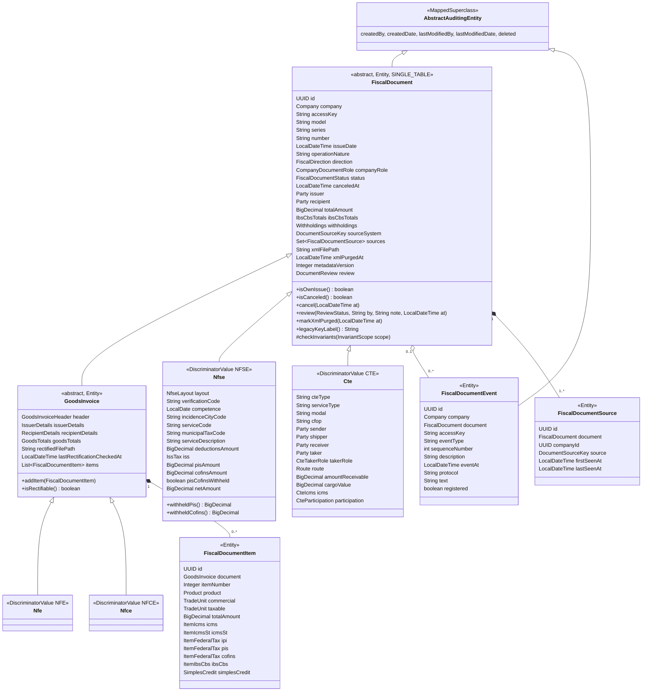

# Remodelagem dos documentos fiscais: `fiscal_documents` com herança `SINGLE_TABLE`

> Spec técnica escrita pelo po-taxify em 2026-11-27, a partir de duas decisões do Tony do mesmo dia: (1) herança JPA
> `SINGLE_TABLE` com `FiscalDocument` e as subclasses `Nfe`, `Nfce`, `Nfse` e `Cte` numa tabela só; (2) fazer a
> remodelagem **agora**, antes de o volume crescer, avaliando uma troca única numa release. O texto está em português.
> Todos os identificadores (classes, tabelas, colunas, índices, enums, rotas, JSON) estão em inglês, como manda a
> [avaliação de padronização em inglês](2026-11-27-avaliacao-padronizacao-ingles.md).
>
> Specs relacionadas: [Gestão de documentos fiscais](2026-11-26-gestao-de-documentos-fiscais.md),
> [NFS-e](2026-11-26-nfse-notas-de-servico.md), [Captura SIEG e SEFAZ](2026-11-26-captura-xml-sieg-e-sefaz.md),
> [Captura ampliada: NFC-e e CT-e](2026-11-27-captura-nfce-cte.md),
> [Crédito de estoque](2026-11-27-credito-estoque-cbs-levantamento.md),
> [Painel da captura](2026-11-27-painel-captura-xml.md), [Pendências](2026-11-26-pendencias.md),
> [Retenções](2026-11-26-retencoes.md), [Apuração](2026-11-26-apuracao-do-mes.md).

---

## 0. Status e decisões

| Item | Situação |
|---|---|
| Herança `SINGLE_TABLE`, tabela `fiscal_documents`, discriminador `document_type`, itens e eventos em tabelas próprias | **Decidido pelo Tony** (2026-11-27) |
| Fazer agora, antes do volume crescer | **Decidido pelo Tony** (2026-11-27) |
| **Plano principal: troca única numa release ("big-bang controlado")**, seção 6 | **Recomendado pelo PO** com o volume medido. Pronto para implementar. A janela de deploy precisa da aprovação do Tony (é produção) |
| Plano alternativo: gravação dupla e fases (seção 7) | Só se o volume na data do deploy passar do limite do FD-RN-30 ou se o Tony não aceitar a janela |
| `@SecondaryTable` para NFS-e ou CT-e | **Não usar.** A conta da seção 3.5 dá cerca de 26 KB declarados por linha, 40% do limite. Ver FD-RN-05 |
| Subclasse intermediária `GoodsInvoice` (abstrata, entre `FiscalDocument` e `Nfe`/`Nfce`) | Recomendação do PO (P-FD-01). Não contradiz a decisão: as quatro subclasses existem do mesmo jeito |
| Contrato da API e front | **Não mudam nesta release.** Mesmas rotas, mesmo JSON e mesmos ids (FD-RN-20) |
| Regra fiscal nova | **Nenhuma.** É uma troca de modelo com paridade de comportamento. Nenhum cálculo muda |
| Origens em tabela própria (`fiscal_document_sources`, T4), no lugar de `found_in_*_at` | **Entra nesta release** (seção 3.10, FD-RN-31). É a base da correção do `Skip` do SIEG (B1) e da deduplicação ABRASF x nacional (E2) |
| Contagens de captura por período em linhas (`capture_period_counts`, T2), no lugar dos contadores de `fiscal_xml_sync_control` | **Entra nesta release** (seção 3.11, FD-RN-32), com o mesmo comportamento de hoje. O ganho de comportamento (mês anterior, H1) fica para a spec irmã |
| Expurgo com marca e paginado (G1) | **Entra nesta release** (`xml_purged_at`, FD-RN-16) |
| **Provedor de XML plugável** (decisão do Tony, 2026-11-27): trocar o SIEG por outro serviço, ou usar mais de um, sem reescrever o núcleo | **Em duas partes.** Na troca única entra só o **modelo de dados neutro** (origem e canal como valor, nenhuma coluna `*_sieg`, FD-RN-40). O **contrato por capacidades**, o agendador por estratégia, a seleção por escritório, o limitador e os orçamentos por provedor, o painel genérico e o T1/T5 formam a **fase P**, uma release logo depois (seção 7B). Pronta para implementar; P-FP-01 a P-FP-04 têm recomendação |
| Bugs e desperdício da captura (B1, C1, E1, E2, D1/D2, H2, A1-A5) e as tabelas T1/T5 | **Spec irmã** [Capturas e controles](2026-11-27-capturas-e-controles.md). O B1 é recomendado como **correção antes** desta release (P-FD-07) |

| **Importação não perde nota** (decisão do Tony, 2026-11-28): decimal com mais casas e CNPJ/CPF curto | **Decidido.** I-17 arredonda `HALF_UP` e registra; I-06 completa com zeros à esquerda pelo tipo da tag e registra; o resto segue recusado com log (3.3, seção 11). Vale só para a importação nova: a V87 continua copiando o que as tabelas antigas têm |
| **CFOP efetivo no item** (decisão do Tony, 2026-11-28): o filtro de CFOP usa o CFOP retificado | **Decidido.** Coluna `effective_cfop` (3.6, FD-RN-57). O filtro de CFOP **múltiplo** fica para depois |

**Bloqueiam:** nada bloqueia a implementação. **P-FD-02 respondida pelo Tony (2026-11-27): janela em dia útil às 21h
(Recife); em 2026-11-28 o Tony autorizou subir assim que QA aprovasse.** O **go-live** depende da remedição de leitura
na EC2 (pré-check, seção 8, pré-requisito 1), do backup conferido (FD-RN-52) e da aprovação do Tony.

---

## 1. Problema e objetivo

### 1.1 Problema
1. **Três modelos para o mesmo conceito.** NF-e em `fiscal_xml_documents`, NFS-e em `service_invoices` e CT-e
   (proposto) em `transport_documents`. Cada um tem a própria chave, direção, cancelamento, precisão decimal e jeito de
   guardar o participante. Quem soma "tudo o que a empresa comprou" ou "toda nota com retenção" traduz entre os modelos
   à mão: `RetentionCalculator` tem dois caminhos (`"NFE"` e `"NFSE"`), o painel da captura tem duas consultas, e o
   confronto de origens tem pares de colunas diferentes (`found_in_sefaz_at` x `found_in_adn_at`).
2. **Nomes em português nas tabelas grandes.** A avaliação de inglês recomendou **nunca** renomear as colunas dessas
   três tabelas por causa do risco operacional, e deixou a porta aberta: "reavaliar só se uma dessas tabelas for
   reestruturada por outro motivo". Esta é a reestruturação. As tabelas novas já nascem em inglês, sem rename.
3. **NFC-e e CT-e sem lugar.** A NFC-e é hoje uma NF-e com `ide_modelo = '65'` (todo filtro precisa lembrar disso). O
   CT-e de upload cai em `fiscal_xml_documents` com campos de NF-e.
4. **Dívidas de modelo:** `issue_date` e `access_key` aceitam nulo; `status` nulo quer dizer "autorizada"; não existe
   `xml_purged_at`, então o expurgo relista todo mês todas as notas antigas (`FiscalXmlPurgeScheduler`).

### 1.2 Objetivo
- Uma visão única de documento fiscal (`FiscalDocument`), com consultas polimórficas: `from FiscalDocument` traz
  tudo, `from GoodsInvoice` traz NF-e e NFC-e, `from Nfse` só NFS-e.
- Conceitos normalizados uma vez só: direção, papel da empresa, participante, cancelamento, precisão e chave.
- Banco e Java em inglês nas tabelas mais importantes, sem rename de coluna.
- NFC-e e CT-e já existem como subclasses. A captura nova continua na spec de captura, desligada.

### 1.3 Como medir
| Medida | Meta |
|---|---|
| Paridade (contagem e somas por empresa, mês, tipo e direção) entre o antigo e o novo | 100%, diferença zero (FD-RN-25) |
| Pendências abertas antes x depois da primeira rodada do `PendencyFinder` | iguais, nenhum episódio novo no resumo por e-mail (FD-RN-21) |
| Respostas JSON das telas principais antes x depois, na mesma base | idênticas (Q-FD-2) |
| Captura parada | no máximo 30 min |
| Classes que importam `FiscalXmlDocument`, `ServiceInvoice` ou os repositórios antigos depois da release | zero |

---

## 2. Usuários e cenário

| Perfil | O que muda para ele |
|---|---|
| FISCAL e ADMIN do escritório | Nada visível. A captura fica parada por até 30 min na janela (fora do horário comercial). Telas, filtros, números e links continuam iguais |
| Plataforma (CS Hub) | Nada no console |
| Dev e QA | Modelo novo, consultas polimórficas, tabelas em inglês |
| Escritório bloqueado ou em teste grátis | Nada muda. Os dados dele são copiados como os de qualquer outro |

Frequência: é uma troca única. Depois dela, o comportamento diário é o de hoje.

---

## 3. Modelo de domínio e de dados

### 3.1 O que existe hoje (relido nas migrations em 2026-11-27)

| Tabela | Migrations | Colunas | Pontos de atenção |
|---|---|---|---|
| `fiscal_xml_documents` | V16, V23, V27, V33, V39, V78 (índice); V32 faz `UPDATE` | ~108 | `access_key varchar(44)` **nulo**; `issue_date` nulo; `direction` nulo (backfill); `own_issue` nulo; `status` nulo = autorizada; CNPJ em `issuer_cnpj`/`recipient_cnpj` e CPF em `emit_cpf`/`dest_cpf`; estrangeiro em `dest_id_estrangeiro`; totais `decimal(19,2)`, retenções `decimal(15,2)`; `document_type` `NFE` (inclui NFC-e, distinguida por `ide_modelo = '65'`) ou `CTE` |
| `fiscal_xml_document_items` | V17, V22, V25, V48, V55 | ~59 | Sem colunas de auditoria e sem `company_id`; alíquotas `decimal(7,4)`; índice de cobertura `(document_id, cfop, valor_total)` da apuração; consultas usam `trim(i.cfop)` |
| `service_invoices` | V37, V42, V78 (índice) | ~42 | `access_key varchar(80) not null` (nacional com 50 dígitos; ABRASF sintética `ABRASF-<município>-<prestador>-<número>`); `direction` `PRESTADA`/`TOMADA`/`TERCEIRO`; documento único `prestador_documento`/`tomador_documento`; `canceled bit` sem data; valores `decimal(15,2)`, alíquota `decimal(9,4)`; `found_in_adn_at` |
| `fiscal_xml_events` | V18 | 16 | `access_key varchar(44) not null`; `document_id` nulo até a nota chegar; único `(company_id, access_key, event_type, sequence_number)` |

**Quem aponta para essas tabelas:**
- FK de banco: só `fiscal_xml_document_items.document_id` e `fiscal_xml_events.document_id`.
- Referência por id **sem FK** (o motivo de os ids não poderem mudar, FD-RN-20):
  - `pendencies.object_id`, com `object_type` `NOTE` ou `SERVICE_NOTE` (`Pendency.java:32-35`);
  - `pendencies.natural_key` = `"<TYPE>:<chave ou id>"` (`PendencyFinder.java:270, 290`) e
    `"<TYPE>:NFE:<id>"`/`"<TYPE>:NFSE:<id>"` nas retenções (`PendencyFinder.java:250`);
  - `retention_reviews.natural_key` = `"NFE:<id>:<tributo>:<natureza>"` ou `"NFSE:<id>:..."` (`RetentionCalculator.java:230`);
  - links e favoritos do front (`/integrations/xmls/{id}`, notas de serviço por id).
- Por chave de acesso: `sefaz_note_summaries.access_key` (V34) e `efisco_memories.chave_acesso` (V53). Não mudam.
- SQL nativo com nome de tabela: `CapturePanelRepository.java:166/171` e `StockSurveySourceRepository.java:52/106`.
- JSON gravado: `fiscal_period_closings.snapshot` guarda o `TaxAssessmentDTO` (agregados, sem id de nota). Não muda
  porque nenhum DTO muda (FD-RN-22).

**Volume medido na EC2 (2026-11-27, só leitura, dado do coordenador):**

| Tabela | Linhas | Dados + índice | Média por linha |
|---|---|---|---|
| `fiscal_xml_documents` | 1.580 (todas NF-e modelo 55; 1.346 INBOUND, 234 OUTBOUND; emissão de 23/08 a 27/11/2026) | 2,5 + 0,8 MB | 2.041 B |
| `fiscal_xml_document_items` | 25.039 (~15,8 por nota) | 13,6 + 4,5 MB | 566 B |
| `service_invoices` | 11.976 | 12,2 + 6,0 MB | 1.134 B |
| `fiscal_xml_events` | 1.515 | pequeno | |

Tudo foi gravado em novembro de 2026 (ambiente novo). Só 59 das 306 empresas têm NF-e, porque a primeira volta do SIEG
ainda não terminou.

### 3.2 Diagrama de classes

**Pacote:** `domain/fiscaldocument/` (entidades e objetos de valor), `repository/FiscalDocumentRepository`,
`GoodsInvoiceRepository`, `NfseRepository`, `CteRepository`, `FiscalDocumentItemRepository`,
`FiscalDocumentEventRepository`. Repositórios estendem `AbstractJpaRepository` (padrão CRUD de `common/`). O pacote
`domain/xml/` perde `FiscalXmlDocument`, `FiscalXmlDocumentItem`, `FiscalXmlEvent`, `ServiceInvoice`,
`FiscalXmlHeaderExtras`, `FiscalIbsCbsTotals`, `FiscalItemTaxDetail` e `FiscalItemIbsCbs`. Continuam lá
`FiscalXmlSyncControl`, `SefazDistControl`, `SefazNoteSummary`, `NfseAdnControl` e `RetentionReview`.

**Objetos de valor (`@Embeddable`, imutáveis, `record` quando der):**

| Objeto | Campos | Colunas |
|---|---|---|
| `Party` | `document`, `documentType` (`TaxpayerDocumentType`: `CNPJ`, `CPF`, `FOREIGN`), `name`, `uf`, `cityCode` | prefixo `issuer_`, `recipient_`, `sender_`, `shipper_`, `receiver_`, `taker_` (`@AttributeOverrides`) |
| `PartyAddress` | `street`, `number`, `complement`, `district`, `cityName`, `zipCode`, `phone`, `countryCode`, `countryName` | `issuer_address_*`, `recipient_address_*` |
| `IssuerDetails` | `tradeName`, `stateRegistration`, `stStateRegistration`, `municipalRegistration`, `cnae`, `taxRegimeCode`, `address` | `issuer_*` |
| `RecipientDetails` | `stateRegistration`, `stateRegistrationIndicator`, `email`, `address` | `recipient_*` |
| `GoodsInvoiceHeader` | `ufCode`, `exitEntryAt`, `operationType`, `destinationType`, `taxableEventCityCode`, `environment`, `purpose`, `finalConsumer`, `presenceIndicator`, `printType`, `emissionType`, `checkDigit`, `emissionProcess`, `emissionProcessVersion` | `header_*` (ver 3.4) |
| `GoodsTotals` | `icmsBase`, `icmsAmount`, `icmsReliefAmount`, `fcpAmount`, `icmsStBase`, `icmsStAmount`, `fcpStAmount`, `productsAmount`, `freightAmount`, `insuranceAmount`, `discountAmount`, `importTaxAmount`, `ipiAmount`, `pisAmount`, `cofinsAmount`, `otherExpensesAmount`, `approximateTaxesAmount` | sem prefixo |
| `IbsCbsTotals` | `base`, `ibsStateAmount`, `ibsCityAmount`, `ibsAmount`, `cbsAmount` | `ibs_cbs_base`, `ibs_state_amount`... |
| `Withholdings` | `pis`, `cofins`, `csll`, `irrf`, `inss` | `withheld_*_amount` |
| `DocumentReview` | `status` (`ReviewStatus`), `reviewedAt`, `reviewedBy`, `note` | `review_*` |
| `IssTax` (NFS-e) | `base`, `rate`, `amount`, `withheld`, `withheldAmount` | `iss_*` |
| `CteIcms` | `group`, `cst`, `base`, `rate`, `amount` | `cte_icms_group`, `cte_icms_cst`, `icms_base` (compartilhada), `cte_icms_rate`, `icms_amount` (compartilhada) |
| `Route` (CT-e) | `originCityCode`, `originUf`, `destinationCityCode`, `destinationUf` | `cte_origin_*`, `cte_destination_*` |
| `CteParticipation` | `issuer`, `sender`, `shipper`, `receiver`, `recipient`, `taker` (booleanos) | `cte_is_*` |

**Enums novos** (`enumerated/`): `CompanyDocumentRole` (`ISSUER`, `RECIPIENT`, `TAKER`, `SENDER`, `SHIPPER`,
`RECEIVER`, `THIRD_PARTY`), `TaxpayerDocumentType` (`CNPJ`, `CPF`, `FOREIGN`), `NfseLayout` (`NATIONAL`, `ABRASF`),
`CteTakerRole` (`SENDER`, `SHIPPER`, `RECEIVER`, `RECIPIENT`, `OTHER`), `FiscalDocumentType` (`NFE`, `NFCE`, `NFSE`,
`CTE`; os valores são os do discriminador). Reaproveitados: `FiscalDirection`, `FiscalDocumentStatus`, `ReviewStatus`. `FiscalXmlSource` (enum fechado
`SIEG`, `SEFAZ_DIST`, `UPLOAD`; o `ADN` é texto solto em `NfseAdnService.SOURCE`) é substituído pelo objeto de valor
`DocumentSourceKey` (FD-RN-40).

### 3.3 Invariantes no domínio (DDD)

As colunas de subtipo aceitam nulo no banco. Quem garante o obrigatório é o domínio: cada subclasse implementa
`checkInvariants(InvariantScope)`, chamado num `@PrePersist`/`@PreUpdate`. Violação lança
`FiscalDocumentInvariantException` (código interno, sem dado sensível na mensagem).

Duas intensidades (`InvariantScope`):
- **`CREATE`** (documento novo da captura, do upload ou do parser): todas as regras abaixo.
- **`UPDATE`** (documento já gravado, inclusive os copiados das tabelas antigas): só as regras marcadas "sempre". O
  motivo é que linhas antigas podem ter nulos que o modelo novo não aceita mais em documento novo (por exemplo,
  `issue_date`). A remedição da véspera (seção 8) conta essas linhas.

| # | Regra | Subtipo | Escopo |
|---|---|---|---|
| I-01 | `company`, `documentType`, `sourceSystem`, `status`, `companyRole` e `metadataVersion` preenchidos | todos | sempre |
| I-02 | `status = AUTHORIZED` ⇒ `canceledAt` nulo | todos | sempre |
| I-03 | `status = CANCELED` ⇒ `canceledAt` preenchido, **exceto** `Nfse` (o leiaute atual não traz a data) | todos | CREATE |
| I-04 | `direction` nulo ⇔ `companyRole` ∈ {`THIRD_PARTY`, `SENDER`, `SHIPPER`, `RECEIVER`} | `Nfe`, `Nfce`, `Nfse` | sempre |
| I-04-T | No `Cte`, a direção é **derivada** do papel (FD-RN-08): `ISSUER` → `OUTBOUND`, `TAKER` → `INBOUND`, os demais (inclusive `RECIPIENT`) → nulo. Na atualização de CT-e copiado (`metadataVersion = 0`), `RECIPIENT` aceita também a direção que veio da linha antiga (`INBOUND`), por paridade | `Cte` | CREATE estrito; UPDATE com a exceção |
| I-05 | `companyRole = ISSUER` ⇔ documento do emitente igual ao CNPJ da empresa (14 dígitos), quando os dois existem | todos | CREATE |
| I-06 | `documentType` do participante coerente com o tamanho: `CNPJ` = 14 dígitos, `CPF` = 11 dígitos, `FOREIGN` = até 20 caracteres. Documento sem tipo e tipo sem documento são incoerentes. "Tem texto" é o `FiscalText.hasText` (só o espaço comum é branco, como o `TRIM` da V87). **Na importação nova (2026-11-28):** o tipo vem da tag (`CNPJ`/`CPF`); só dígitos e curto demais é completado com zeros à esquerda até 14/11 (log `fiscal.document.party.padded`); mais longo que a tag, com algo além de dígitos ou com as duas tags preenchidas (ambíguo) fica como veio e a nota é recusada (log `fiscal.document.party.refused` e `fiscal.document.invariant.violated`) | todos | sempre |
| I-07 | `accessKey` preenchida | todos, exceto `GoodsInvoice` com `sourceSystem = UPLOAD` (o "arquivo estranho" de hoje, `accessKeyOrId()`) | CREATE |
| I-08 | `issueDate` preenchida | todos | CREATE |
| I-09 | `xmlFilePath` preenchido enquanto `xmlPurgedAt` é nulo, exceto `Cte` copiado sem arquivo (`metadataVersion = 0`) | todos | CREATE |
| I-10 | `model = "55"`; chave, **quando presente**, com 44 dígitos (sem chave só no upload, I-07) | `Nfe` | CREATE |
| I-11 | `model = "65"`; chave, quando presente, com 44 dígitos | `Nfce` | CREATE |
| I-12 | `model = "57"` e chave com 44 dígitos | `Cte` | CREATE |
| I-13 | `layout` preenchido; `NATIONAL` ⇒ chave com 50 dígitos; `ABRASF` ⇒ chave começa com `ABRASF-` (sintética) | `Nfse` | sempre |
| I-14 | `iss.withheld` e `pisCofinsWithheld` não nulos (falso por padrão) | `Nfse` | sempre |
| I-15 | `participation` coerente com `companyRole`: pelo menos um booleano verdadeiro, **exceto** com `companyRole = THIRD_PARTY` (CT-e de upload em que o CNPJ da empresa não aparece em nenhum grupo; hoje o upload aceita, e a recusa é da captura fase 3, CX-RN-31) | `Cte` | CREATE |
| I-16 | Item só existe em `GoodsInvoice`. `items` não existe em `Nfse` e `Cte` | `GoodsInvoice` | sempre (pelo tipo) |
| I-17 | **Dinheiro** com escala 2 e **alíquota/percentual** com escala 4, gravados como vieram quando cabem. **Valor com mais casas (decisão de 2026-11-28): arredondado `HALF_UP` para a escala da coluna, como o MySQL fazia, e registrado** (log `fiscal.document.decimal.rounded` com empresa, tipo, campo e casas originais, nunca o valor; métrica `fiscal.document.import.adjustments`, tag `kind`). Nenhuma nota é perdida por isso. **Não vale** para quantidade e preço unitário (`commercial_*`/`taxable_*`, `decimal(19,4)`): o leiaute permite até 10 casas em `vUnCom`/`qCom`, hoje o upload aceita e o MySQL arredonda na gravação. O domínio faz esse arredondamento explícito (`setScale(4, HALF_UP)`, o mesmo resultado do MySQL para valores positivos), para não depender do banco | todos | sempre |

`legacyKeyLabel()` devolve `"NFE"` para `Nfe` e `Nfce`, `"NFSE"` para `Nfse` e `"CTE"` para `Cte`. É o texto que
entra nas chaves naturais (FD-RN-21). **Não** é o discriminador: a NFC-e já é `"NFE"` nas chaves gravadas hoje.

### 3.4 Tabela `fiscal_documents`, coluna a coluna

Todas as colunas, exceto as do bloco comum marcadas `not null`, aceitam nulo. Charset da tabela: `utf8mb4` (padrão do
banco). Os ids seguem `varchar(36)`, igual ao resto do schema, porque a FK para `companies.id` exige o mesmo charset e
o `pendencies.object_id` compara texto com texto. Usar `ascii` foi considerado e descartado.

Legenda de subtipo: **C** = comum, **G** = `Nfe` e `Nfce`, **S** = `Nfse`, **T** = `Cte`. "Origem" indica a coluna
antiga copiada (`fxd` = `fiscal_xml_documents`, `si` = `service_invoices`).

**Bloco comum (C)**

| Coluna | Tipo | Nulo | Origem fxd | Origem si |
|---|---|---|---|---|
| `id` | varchar(36) PK | não | `id` (mesmo valor) | `id` (mesmo valor) |
| `company_id` | varchar(36) FK `companies` | não | `company_id` | `company_id` |
| `document_type` | varchar(10) | não | `NFE` + `ide_modelo = '65'` → `NFCE`; `NFE` → `NFE`; `CTE` → `CTE` | `NFSE` |
| `access_key` | varchar(80) | sim (I-07) | `access_key` | `access_key` |
| `model` | varchar(2) | sim | `ide_modelo` (`CTE` sem modelo → `57`) | nulo |
| `series` | varchar(5) | sim | `ide_serie` | nulo |
| `number` | varchar(20) | sim | `ide_numero` | `numero` |
| `issue_date` | datetime(6) | sim (I-08) | `issue_date` | `issue_date` |
| `operation_nature` | varchar(60) | sim | `ide_natureza_operacao` | nulo |
| `direction` | varchar(10) | sim (I-04) | `direction` | `PRESTADA` → `OUTBOUND`; `TOMADA` → `INBOUND`; `TERCEIRO` → nulo |
| `company_role` | varchar(12) | não | `own_issue = true` → `ISSUER`; senão → `RECIPIENT` | `PRESTADA` → `ISSUER`; `TOMADA` → `TAKER`; `TERCEIRO` → `THIRD_PARTY` |
| `status` | varchar(12) | não | `status`, nulo → `AUTHORIZED` | `canceled = 1` → `CANCELED`, senão `AUTHORIZED` |
| `canceled_at` | datetime(6) | sim | `canceled_at` | nulo |
| `issuer_document` | varchar(14) | sim | `coalesce(issuer_cnpj, emit_cpf)` | `prestador_documento` |
| `issuer_document_type` | varchar(10) | sim | `CNPJ` se `issuer_cnpj`, `CPF` se `emit_cpf` | pelo tamanho (I-06) |
| `issuer_name` | varchar(200) | sim | `emit_nome` | `prestador_nome` |
| `issuer_uf` | char(2) | sim | `emit_end_uf` | nulo |
| `issuer_city_code` | varchar(10) | sim | `emit_end_codigo_municipio` | `prestador_municipio` |
| `recipient_document` | varchar(20) | sim | `coalesce(recipient_cnpj, dest_cpf, dest_id_estrangeiro)` | `tomador_documento` |
| `recipient_document_type` | varchar(10) | sim | `CNPJ`, `CPF` ou `FOREIGN` | pelo tamanho |
| `recipient_name` | varchar(200) | sim | `dest_nome` | `tomador_nome` |
| `recipient_uf` | char(2) | sim | `dest_end_uf` | nulo |
| `recipient_city_code` | varchar(10) | sim | `dest_end_codigo_municipio` | nulo |
| `total_amount` | decimal(19,2) | sim | `total_valor_total_nota` | `valor_servico` |
| `ibs_cbs_base`, `ibs_state_amount`, `ibs_city_amount`, `ibs_amount`, `cbs_amount` | decimal(19,2) | sim | `total_ibscbs_base_calculo`, `total_valor_ibs_uf`, `total_valor_ibs_mun`, `total_valor_ibs`, `total_valor_cbs` | nulo |
| `withheld_pis_amount`, `withheld_cofins_amount`, `withheld_csll_amount`, `withheld_irrf_amount`, `withheld_inss_amount` | decimal(19,2) | sim | `ret_pis`, `ret_cofins`, `ret_csll`, `ret_irrf`, `ret_inss` | pis e cofins: nulo (ver `pis_amount`); `valor_csll`, `valor_irrf`, `valor_inss` |
| `source_system` | varchar(30) | não | `source_system` (primeira origem; o painel usa), com a tradução do FD-RN-40 | `source_system`, idem |
| `xml_file_path` | varchar(1000) | sim (I-09) | `xml_file_path` | `xml_file_path` |
| `xml_purged_at` | datetime(6) | sim | nulo (o expurgo preenche daqui em diante) | nulo |
| `metadata_version` | int | não | `metadata_version`, nulo → 0 | 0 |
| `review_status` | varchar(12) | sim | `review_status` | nulo |
| `reviewed_at` | datetime(6) | sim | `reviewed_at` | nulo |
| `reviewed_by` | varchar(50) | sim | `reviewed_by` | nulo |
| `review_note` | varchar(500) | sim | `review_note` | nulo |
| `created_by`, `created_date`, `last_modified_by`, `last_modified_date`, `deleted` | como `AbstractAuditingEntity` | | copiados **sem alterar** (o painel e o plano de volta usam `created_date`) | idem |

As datas de origem (`found_in_sieg_at`, `found_in_sefaz_at`, `found_in_adn_at`) **saem do documento** e vão para
`fiscal_document_sources` (3.10). O contrato da API continua com `foundInSiegAt`, `foundInSefazAt` e `foundInAdnAt`:
o DTO lê o `first_seen_at` da origem correspondente.

**Bloco G (NF-e e NFC-e)**

| Coluna | Tipo | Origem fxd |
|---|---|---|
| `rectified_file_path` | varchar(1000) | `rectified_file_path` |
| `last_rectification_checked_at` | datetime(6) | `last_rectification_checked_at` |
| `header_uf_code`, `header_operation_type`, `header_destination_type`, `header_environment`, `header_purpose`, `header_final_consumer`, `header_presence_indicator`, `header_print_type`, `header_emission_type`, `header_check_digit`, `header_emission_process` | varchar(5) | `ide_codigo_uf`, `ide_tipo_operacao`, `ide_destino_operacao`, `ide_ambiente`, `ide_finalidade_emissao`, `ide_consumidor_final`, `ide_indicador_presenca`, `ide_tipo_impressao`, `ide_tipo_emissao`, `ide_digito_verificador`, `ide_processo_emissao` |
| `header_emission_process_version` | varchar(30) | `ide_versao_processo_emissao` |
| `header_exit_entry_at` | datetime(6) | `ide_data_saida_entrada` |
| `header_taxable_event_city_code` | varchar(10) | `ide_codigo_municipio_fato_gerador` |
| `issuer_trade_name` | varchar(200) | `emit_nome_fantasia` |
| `issuer_state_registration`, `issuer_st_state_registration`, `issuer_municipal_registration` | varchar(20) | `emit_inscricao_estadual`, `emit_inscricao_estadual_st`, `emit_inscricao_municipal` |
| `issuer_cnae` | varchar(10) | `emit_cnae` |
| `issuer_tax_regime_code` | varchar(5) | `emit_regime_tributario` |
| `recipient_state_registration` | varchar(20) | `dest_inscricao_estadual` |
| `recipient_state_registration_indicator` | varchar(5) | `dest_indicador_ie` |
| `recipient_email` | varchar(200) | `dest_email` |
| `issuer_address_street`, `recipient_address_street` | varchar(200) | `emit_end_logradouro`, `dest_end_logradouro` |
| `issuer_address_number`, `recipient_address_number` | varchar(20) | `*_end_numero` |
| `issuer_address_complement`, `recipient_address_complement` | varchar(100) | `*_end_complemento` |
| `issuer_address_district`, `recipient_address_district` | varchar(100) | `*_end_bairro` |
| `issuer_address_city_name`, `recipient_address_city_name` | varchar(100) | `*_end_municipio` |
| `issuer_address_zip_code`, `recipient_address_zip_code` | varchar(10) | `*_end_cep` |
| `issuer_address_phone`, `recipient_address_phone` | varchar(20) | `*_end_telefone` |
| `issuer_address_country_code`, `recipient_address_country_code` | varchar(10) | `*_codigo_pais` |
| `issuer_address_country_name`, `recipient_address_country_name` | varchar(60) | `*_pais` |
| `icms_base`, `icms_amount` | decimal(19,2) | `total_base_calculo_icms`, `total_valor_icms` (**compartilhadas com T**, `CteIcms`) |
| `icms_relief_amount`, `fcp_amount`, `icms_st_base`, `icms_st_amount`, `fcp_st_amount`, `products_amount`, `freight_amount`, `insurance_amount`, `discount_amount`, `import_tax_amount`, `ipi_amount`, `other_expenses_amount`, `approximate_taxes_amount` | decimal(19,2) | `total_valor_icms_desonerado`, `total_valor_fcp`, `total_base_calculo_icms_st`, `total_valor_icms_st`, `total_valor_fcp_st`, `total_valor_produtos`, `total_valor_frete`, `total_valor_seguro`, `total_valor_desconto`, `total_valor_importacao`, `total_valor_ipi`, `total_valor_outras_despesas`, `total_valor_aproximado_tributos` |
| `pis_amount`, `cofins_amount` | decimal(19,2) | `total_valor_pis`, `total_valor_cofins` (**compartilhadas com S**) |

**Bloco S (NFS-e)**

| Coluna | Tipo | Origem si |
|---|---|---|
| `nfse_layout` | varchar(10) | `layout` |
| `nfse_verification_code` | varchar(60) | `codigo_verificacao` |
| `nfse_competence` | date | `competence` |
| `nfse_incidence_city_code` | varchar(7) | `municipio_incidencia` |
| `nfse_service_code` | varchar(20) | `codigo_servico` |
| `nfse_municipal_tax_code` | varchar(30) | `codigo_tributacao_municipal` |
| `nfse_service_description` | **TEXT** | `descricao_servico` (ver 3.5) |
| `nfse_deductions_amount` | decimal(19,2) | `valor_deducoes` |
| `iss_base`, `iss_amount`, `withheld_iss_amount` | decimal(19,2) | `base_calculo`, `valor_iss`, `valor_iss_retido` |
| `iss_rate` | decimal(9,4) | `aliquota_iss` |
| `iss_withheld` | bit | `iss_retido` |
| `pis_amount`, `cofins_amount` | decimal(19,2) (compartilhadas com G) | `valor_pis`, `valor_cofins` |
| `nfse_pis_cofins_withheld` | bit | `pis_cofins_retidos` |
| `nfse_net_amount` | decimal(19,2) | `valor_liquido` |

Na NFS-e, PIS e COFINS ficam como vieram (informados) junto com a marca `nfse_pis_cofins_withheld`, exatamente como
hoje. `Nfse.withheldPis()` devolve `pisAmount` só quando a marca é verdadeira. Assim o cálculo de retenções
(`RetentionCalculator`) não muda de semântica.

**Bloco T (CT-e)**, os campos da [spec de captura](2026-11-27-captura-nfce-cte.md) (CX-RN-31 a 33), com prefixo
`cte_`:

| Coluna | Tipo |
|---|---|
| `cte_type`, `cte_service_type`, `cte_modal` | varchar(2) |
| `cte_cfop` | varchar(4) |
| `sender_document`, `shipper_document`, `receiver_document`, `taker_document` | varchar(14) |
| `sender_document_type`, `shipper_document_type`, `receiver_document_type`, `taker_document_type` | varchar(10) |
| `sender_name`, `shipper_name`, `receiver_name`, `taker_name` | varchar(200) |
| `sender_uf`, `taker_uf` | char(2) |
| `cte_taker_role` | varchar(10) |
| `cte_origin_city_code`, `cte_destination_city_code` | varchar(7) |
| `cte_origin_uf`, `cte_destination_uf` | char(2) |
| `cte_amount_receivable`, `cte_cargo_value` | decimal(19,2) |
| `cte_icms_group` | varchar(12) |
| `cte_icms_cst` | varchar(3) |
| `cte_icms_rate` | decimal(9,4) |
| `icms_base`, `icms_amount` | compartilhadas com G |
| `cte_is_issuer`, `cte_is_sender`, `cte_is_shipper`, `cte_is_receiver`, `cte_is_recipient`, `cte_is_taker` | bit |

O total do CT-e (`vTPrest`) vai em `total_amount`; o destinatário (`dest`), em `recipient_*`; o emitente
(transportadora), em `issuer_*`.

**Colunas compartilhadas entre subtipos** (`icms_base`, `icms_amount`, `pis_amount`, `cofins_amount`): o mesmo nome
físico, mapeado em mais de uma subclasse com o mesmo tipo. O Hibernate aceita isso em `SINGLE_TABLE`. O significado é o
mesmo (valor do tributo destacado no documento). Nenhuma outra coluna é compartilhada.

### 3.5 Conta do tamanho de linha no MySQL

**Limites que importam:**
1. **65.535 bytes por linha**, limite do servidor: soma do tamanho **máximo declarado** de todas as colunas, exceto
   `TEXT`/`BLOB`, que contam 9 a 12 bytes (o conteúdo fica fora da linha). Com `utf8mb4`, `varchar(n)` conta `4n`
   bytes, mais 1 byte de comprimento se `4n` ≤ 255, ou 2 bytes se passar.
2. **~8.126 bytes por registro dentro da página** do InnoDB (metade da página de 16 KB). No formato `DYNAMIC` (padrão
   do MySQL 8), coluna variável longa vai para fora da página e deixa um ponteiro de 20 bytes. O que precisa caber
   dentro da página são as colunas curtas, e uma linha real com valores grandes vai para fora sozinha.
3. Nulo não ocupa espaço além de 1 bit no mapa de nulos. É por isso que `SINGLE_TABLE` com colunas esparsas é barato.

**Pesos usados:** `varchar(2)`/`char(2)` = 9; `varchar(3)` = 13; `varchar(4)` = 17; `varchar(5)` = 21; `varchar(7)` =
29; `varchar(10)` = 41; `varchar(12)` = 49; `varchar(14)` = 57; `varchar(20)` = 81; `varchar(30)` = 121;
`varchar(36)` = 145; `varchar(50)` = 202; `varchar(60)` = 242; `varchar(80)` = 322; `varchar(100)` = 402;
`varchar(200)` = 802; `varchar(500)` = 2.002; `varchar(1000)` = 4.002; `decimal(19,2)` = 9; `decimal(9,4)` = 5;
`datetime(6)` = 8; `date` = 3; `int` = 4; `bit` = 1; `TEXT` = 12.

| Bloco | Conta resumida | Bytes declarados |
|---|---|---|
| Comum | ids e tipo (145 + 145 + 41) + chave e número (322 + 9 + 21 + 81) + datas e situação (8 + 8 + 41 + 49 + 49) + natureza (242) + participantes (57 + 41 + 802 + 9 + 41 + 81 + 41 + 802 + 9 + 41) + 11 valores (99) + origem e arquivo (81 + 8 + 8 + 4.002 + 8 + 4) + conferência (49 + 8 + 202 + 2.002) + auditoria (202 + 8 + 202 + 8 + 1) | ≈ 9.980 |
| G | `rectified_file_path` 4.002 + `header_*` 401 + emitente sem endereço 1.107 + destinatário sem endereço 904 + 2 endereços × 2.494 + 15 totais 135 | ≈ 11.540 |
| S | 41 + 242 + 3 + 29 + 81 + 121 + **12 (TEXT)** + 4 valores 36 + 5 + 2 bits + 9 | ≈ 580 |
| T | tipos e CFOP 44 + 4 participantes extras (57 + 41 + 802) × 4 + UFs 18 + papel 41 + rota 76 + 2 valores 18 + ICMS 67 + 6 bits | ≈ 3.870 |
| **Total** | | **≈ 25.970 bytes, cerca de 40% de 65.535** |

**Decisões que saem da conta:**
- **FD-RN-05: sem `@SecondaryTable`.** Mesmo com os quatro subtipos, a linha declarada fica em 40% do limite. A
  tabela secundária traria um join em toda leitura de NFS-e ou CT-e e uma segunda escrita por documento, sem ganho.
- **`TEXT` só para `nfse_service_description`.** A descrição da NFS-e nacional pode passar de 1.000 caracteres, e hoje
  ela é cortada em `varchar(1000)` (4.002 bytes declarados). Com `TEXT`, ela sai da conta e não é mais truncada no
  modelo novo (nas linhas copiadas, o texto é o mesmo de hoje). As outras colunas longas (`xml_file_path`,
  `rectified_file_path`, `review_note`) ficam `varchar`, porque são lidas em listas e filtros e cabem na conta.
- **Limite de página:** as colunas curtas (até `varchar(60)`, números e datas) somam cerca de 4.300 bytes no pior caso,
  abaixo dos 8.126. A migration cria a tabela com `ROW_FORMAT=DYNAMIC` explícito, e o CA-FD-01 exige que o `CREATE`
  passe com `innodb_strict_mode=ON` no MySQL local.
- **Linha real esperada:** NF-e ~2,1 KB (hoje 2.041 B; o mapa de nulos cresce ~10 bytes); NFS-e ~1,2 KB (hoje 1.134 B,
  mais ~25 bytes de mapa de nulos para as ~190 colunas). Folga: ~190 colunas, contra o limite de 1.017 do InnoDB.

### 3.6 `fiscal_document_items` (1:N, só `GoodsInvoice`)

Mesmo conteúdo de hoje, com nomes em inglês e alíquotas `decimal(9,4)` (alargamento sem perda). Sem colunas de
auditoria, como hoje: o item é parte do agregado da nota (`cascade = ALL`, `orphanRemoval`).

| Coluna | Tipo | Origem (`fiscal_xml_document_items`) |
|---|---|---|
| `id` | varchar(36) PK | `id` (mesmo valor) |
| `document_id` | varchar(36) not null, FK `fiscal_documents` | `document_id` |
| `item_number` | int | `numero_item` |
| `product_code` | varchar(60) | `codigo` |
| `barcode` | varchar(20) | `codigo_barras` |
| `description` | varchar(500) | `descricao` |
| `ncm`, `cest`, `benefit_code` | varchar(10) | `ncm`, `cest`, `codigo_beneficio` |
| `cfop` | varchar(10) | `trim(cfop)`: **gravado sem espaço** (as consultas deixam de usar `trim()` e passam a usar o índice) |
| `effective_cfop` | varchar(10) | **FD-RN-57**: o CFOP da versão da nota em vigor. Nota sem XML retificado (e toda nota nova) = `cfop`. Nota retificada = o CFOP que a tela de notas já mostrava como retificado: a regra do produto (a do fornecedor, senão a geral), conferida depois da última mudança da regra, com o primeiro dígito pelo `idDest`; item sem CFOP fica sem. Índice `idx_fdi_document_effective_cfop (document_id, effective_cfop)` para o filtro |
| `commercial_unit`, `taxable_unit` | varchar(10) | `unidade_comercial`, `unidade_tributavel` |
| `commercial_quantity`, `commercial_unit_price`, `taxable_quantity`, `taxable_unit_price` | decimal(19,4) | `quantidade_comercial`, `valor_unitario_comercial`, `quantidade_tributavel`, `valor_unitario_tributavel` |
| `total_amount` | decimal(19,2) | `valor_total` |
| `goods_origin` | varchar(1) | `origem_mercadoria` |
| `icms_cst` | varchar(5) | `cst_icms` |
| `icms_csosn` | varchar(4) | `csosn` |
| `icms_base_modality`, `icms_st_base_modality` | varchar(1) | `modalidade_bc_icms`, `modalidade_bc_icms_st` |
| `icms_base`, `icms_amount`, `icms_relief_amount`, `icms_st_base`, `icms_st_amount` | decimal(19,2) | `base_calculo_icms`, `valor_icms`, `valor_icms_desonerado`, `base_calculo_icms_st`, `valor_icms_st` |
| `icms_rate`, `icms_base_reduction`, `icms_st_mva`, `icms_st_rate` | decimal(9,4) | `aliquota_icms`, `reducao_bc_icms`, `mva_icms_st`, `aliquota_icms_st` |
| `ipi_cst`, `pis_cst`, `cofins_cst` | varchar(5) | `cst_ipi`, `cst_pis`, `cst_cofins` |
| `ipi_base`, `ipi_amount`, `pis_base`, `pis_amount`, `cofins_base`, `cofins_amount` | decimal(19,2) | `base_calculo_ipi`, `valor_ipi`, `base_calculo_pis`, `valor_pis`, `base_calculo_cofins`, `valor_cofins` |
| `ipi_rate`, `pis_rate`, `cofins_rate` | decimal(9,4) | `aliquota_ipi`, `aliquota_pis`, `aliquota_cofins` |
| `ibs_cbs_cst` | varchar(3) | `ibscbs_cst` |
| `ibs_cbs_class_code` | varchar(6) | `ibscbs_class_trib` |
| `ibs_cbs_base`, `ibs_state_amount`, `ibs_city_amount`, `ibs_amount`, `cbs_amount` | decimal(19,2) | `ibscbs_base_calculo`, `ibs_uf_valor`, `ibs_mun_valor`, `ibs_valor`, `cbs_valor` |
| `ibs_state_rate`, `ibs_state_rate_reduction`, `ibs_city_rate`, `ibs_city_rate_reduction`, `cbs_rate`, `cbs_rate_reduction` | decimal(9,4) | `ibs_uf_aliquota`, `ibs_uf_reducao_aliquota`, `ibs_mun_aliquota`, `ibs_mun_reducao_aliquota`, `cbs_aliquota`, `cbs_reducao_aliquota` |
| `ibs_cbs_deferral_or_refund` | bit | `ibscbs_diferimento_devolucao` |
| `simples_credit_rate` | decimal(9,4) | `aliquota_credito_sn` |
| `simples_credit_amount` | decimal(19,2) | `valor_credito_sn` |

Conta da linha: cerca de 4.600 bytes declarados (a `description` `varchar(500)` pesa 2.002). Real: ~570 B (hoje
566 B).

Índices:
- `idx_fdi_document_cfop_amount (document_id, cfop, total_amount)`: índice de cobertura da apuração
  (`sumByCompanyMonthAndCfop`) e do crédito de estoque (filtro `cfop IN`, soma de `total_amount`). É o mesmo
  desenho do V55, que mediu cerca de 2,5x mais rápido. Também atende a FK e o detalhe da nota (`document_id`).
- Nenhum outro. `product_code` é filtrado sempre depois do join pela empresa (`findDistinctProductsByCompany`,
  `findRectifiableDocumentIdsWithProduct`). Um índice só se o Q-FD-4 mostrar lentidão (fora do escopo).

### 3.7 `fiscal_document_events` (todos os tipos)

| Coluna | Tipo | Nulo | Origem (`fiscal_xml_events`) |
|---|---|---|---|
| `id` | varchar(36) PK | não | `id` |
| `company_id` | varchar(36) FK `companies` | não | `company_id` |
| `document_id` | varchar(36) FK `fiscal_documents` | sim (o evento pode chegar antes do documento) | `document_id` |
| `access_key` | varchar(80) | não | `access_key` (CT-e com 44, NFS-e nacional com 50) |
| `event_type` | varchar(6) | não | `event_type` |
| `sequence_number` | int | não | `sequence_number` |
| `description` | varchar(120) | sim | `description` |
| `event_at` | datetime(6) | sim | `event_at` |
| `protocol` | varchar(30) | sim | `protocol` |
| `event_text` | TEXT | sim | `event_text` |
| `registered` | bit | não | `registered` |
| auditoria e `deleted` | | | copiados sem alterar |

Índices: `uk_fiscal_document_events (company_id, access_key, event_type, sequence_number)` (idempotência, igual ao
V18; também atende "eventos desta chave" e o `not exists` da manifestação) e `idx_fde_document (document_id)` (FK).

A coluna `fiscal_xml_events.transport_document_id` da spec de captura (V95) **deixa de existir**: o evento do CT-e
aponta para o `Cte` por `document_id`.

### 3.8 Índices e chaves de `fiscal_documents`, justificados pelas consultas

Com `SINGLE_TABLE`, o Hibernate acrescenta `document_type in (...)` em toda consulta sobre uma subclasse
(`GoodsInvoice` → `in ('NFE','NFCE')`, `Nfse` → `= 'NFSE'`). Por isso o tipo vem logo depois da empresa nos índices.

| Índice | Colunas | Consultas que atende (hoje em) |
|---|---|---|
| `uk_fiscal_documents_company_key` (único) | `company_id, access_key` | idempotência da gravação (`DuplicateKeys`), `findFirstByCompany_IdAndAccessKey`, ligação do evento à nota, `existsByCompany_IdAndAccessKey`. A chave não colide entre tipos: NF-e, NFC-e e CT-e têm 44 dígitos com o modelo dentro da chave (55, 65 e 57), a NFS-e nacional tem 50 e a ABRASF começa com `ABRASF-` |
| `idx_fd_company_type_issue` | `company_id, document_type, issue_date` | lista de notas (`search`), lista de NFS-e, `findForRetentions`, `findActiveInPeriod`, contagens por período, `totalsByDirection`, Fronteira (`issuer_document` + `number` filtrados depois) |
| `idx_fd_company_type_direction_issue` | `company_id, document_type, direction, issue_date` | apuração (`sumByCompanyMonthAndCfop`, `sumIbsCbsByCompanyAndDirection`), `countOutboundByCompany`, `firstOutboundByCompany`, `countPendingReviewByCompany`, curva ABC, crédito de estoque |
| `idx_fd_company_type_source_created` | `company_id, document_type, source_system, created_date` | painel da captura: última nota gravada por origem (substitui os dois índices do V78) |
| `idx_fd_purge` | `xml_purged_at, issue_date` | expurgo: `xml_purged_at is null and issue_date < :cutoff`, sem varrer a tabela (hoje não há índice nenhum para isso) |
| `idx_fd_type_metadata_version` | `document_type, metadata_version` | releitura de XML por versão do parser (`findIdsParsedBefore`) |
| FK `fk_fiscal_documents_company` | `company_id` | coberta pelo único |

O confronto SIEG x SEFAZ e SIEG x ADN (`countOnlySieg`, `findOnlySefaz` e os filtros `onlySiegBefore`/`onlyAdnBefore`
das NFS-e) passa a ler `fiscal_document_sources` (3.10), com `EXISTS`/`NOT EXISTS` por documento. Os nomes das constraints são novos e não colidem com os das tabelas antigas
renomeadas (FK é única por schema no MySQL).

### 3.9 Normalização dos conceitos divergentes

| Conceito | Hoje | Modelo novo | Regra |
|---|---|---|---|
| Direção | NF-e `INBOUND`/`OUTBOUND` + `own_issue`; NFS-e `PRESTADA`/`TOMADA`/`TERCEIRO`; CT-e com papéis | `direction` (`FiscalDirection`, nulo só sem lançamento) + `company_role` (`CompanyDocumentRole`) | FD-RN-08 |
| "Emissão própria" | coluna `own_issue` | `company_role = ISSUER` (`isOwnIssue()`); a coluna deixa de existir | FD-RN-08 |
| Participante | NF-e: CNPJ e CPF em colunas separadas + id estrangeiro; NFS-e: documento único | `*_document` + `*_document_type` | FD-RN-09 |
| Cancelamento | NF-e: `status` (nulo = autorizada) + `canceled_at`; NFS-e: `canceled bit` | `status not null` + `canceled_at` | FD-RN-10 |
| Precisão | NF-e `decimal(19,2)` e retenções `(15,2)`; NFS-e `(15,2)`; alíquotas `(7,4)` e `(9,4)` | dinheiro `decimal(19,2)`, alíquota e percentual `decimal(9,4)` | FD-RN-11 |
| Chave | NF-e `varchar(44)` nulo; NFS-e `varchar(80)` (ABRASF sintética) | `access_key varchar(80)`, obrigatória em documento novo (I-07) | FD-RN-12 |
| Origens | `found_in_sieg_at`, `found_in_sefaz_at`, `found_in_adn_at` em cada tabela | uma linha por documento e fonte em `fiscal_document_sources` | FD-RN-13, FD-RN-31 |
| NFC-e | `document_type = 'NFE'` + `ide_modelo = '65'` | subclasse `Nfce` (`document_type = 'NFCE'`) | FD-RN-14 |
| XML expurgado | não registrado | `xml_purged_at` | FD-RN-16 |
| Contadores da captura | colunas fixas em `fiscal_xml_sync_control` (`total_sieg`, `total_importado`, `issued_*`, `*_prev_*`) | uma linha por empresa, canal, tipo, lado e mês em `capture_period_counts` | FD-RN-32 |

### 3.10 `fiscal_document_sources` (T4): em que fonte cada documento foi visto

Hoje cada tabela tem uma coluna por fonte, e as fontes não são as mesmas (SEFAZ na NF-e, ADN na NFS-e). Ninguém sabe
quantas notas o SIEG trouxe de fato, e é isso que o `Skip` precisa (B1, na spec irmã).

| Coluna | Tipo | Nulo | Nota |
|---|---|---|---|
| `id` | varchar(36) PK | não | |
| `document_id` | varchar(36) FK `fiscal_documents` | não | |
| `company_id` | varchar(36) | não | redundante de propósito (é a empresa do documento), para os índices por empresa e fonte |
| `source` | varchar(30) | não | **valor aberto**, não enum fechado (FD-RN-40): a chave do provedor (`SIEG`, `SEFAZ_DFE`, `NFSE_ADN` e futuros) ou uma origem interna (`UPLOAD`) |
| `retrieval_mode` | varchar(10) | não | como a fonte entregou: `PERIOD` (contagem + paginação), `NSU`, `CURSOR` (SEFAZ DF-e, ADN), `NONE` (upload). Exigido pela [captura SIEG por NSU](2026-11-27-captura-sieg-nsu.md): o `Skip` do modo atual conta só `SIEG` + `PERIOD`, porque uma nota trazida pelo NSU não ocupa posição na lista do `baixar-xmls` (contá-la repetiria o B1) |
| `first_seen_at` | datetime(6) | não | primeira vez que a fonte entregou o documento (Recife, como as datas de hoje) |
| `last_seen_at` | datetime(6) | não | última vez (a fonte trouxe de novo) |

Sem colunas de auditoria (a linha é parte do agregado do documento, como o item). Índices:
- `uk_fiscal_document_sources (document_id, source, retrieval_mode)`: uma linha por documento, fonte e modo (o
  confronto entre fontes conta documentos distintos por `source`); idempotência da marca (a
  gravação concorrente da mesma fonte trata a chave única como "já existia" e só atualiza `last_seen_at`);
- `idx_fds_company_source_seen (company_id, source, first_seen_at)`: confronto entre fontes ("vistas pelo SIEG antes
  de X") e a contagem por fonte da spec irmã.

Copiado na migration: `found_in_sieg_at` → linha `SIEG`; `found_in_sefaz_at` → `SEFAZ_DFE`; `found_in_adn_at` →
`NFSE_ADN`, com `first_seen_at = last_seen_at =` a data antiga e `retrieval_mode` = `PERIOD` (SIEG), `CURSOR`
(SEFAZ DF-e e ADN) ou `NONE` (upload). A mesma tradução vale para `fiscal_documents.source_system`
(`SEFAZ_DIST` → `SEFAZ_DFE`, `ADN` → `NFSE_ADN`). A API continua aceitando e devolvendo `SEFAZ_DIST` e `ADN` onde hoje
aparecem (por exemplo, o filtro `origem` de `XmlSearchFilterDTO`), pela tradução no mapper. Documento com `source_system = 'UPLOAD'` ganha a linha
`UPLOAD` com `created_date`. Documento sem nenhuma data de origem e sem upload (nota anterior ao V33/V42) fica sem
linha, como hoje fica sem data (fora do confronto). Volume: no máximo ~2 linhas por documento, ~60 B por linha real.

### 3.11 `capture_period_counts` (T2): contagens da captura por período

Substitui os contadores de `fiscal_xml_sync_control` (V19, V79). É também o lugar das contagens da fase 1 da captura
ampliada, que deixa de criar `sieg_document_counts` (seção 9).

| Coluna | Tipo | Nulo | Nota |
|---|---|---|---|
| `id` | varchar(36) PK | não | |
| `company_id` | varchar(36) FK `companies` | não | |
| `channel` | varchar(30) | não | **chave do provedor**, valor aberto (FD-RN-40): `SIEG`, `SEFAZ_DFE`, `NFSE_ADN` e futuros |
| `document_type` | varchar(10) | não | o discriminador (`NFE`, `NFCE`, `NFSE`, `CTE`) |
| `side` | varchar(10) | não | `ISSUED`, `RECEIVED`, `TAKER` |
| `period_month` | char(7) | não | `yyyy-MM` de Recife |
| `window_start`, `window_end` | date | sim | janela pedida ao provedor |
| `provider_total` | int | sim | o que o provedor contou (nulo = nunca contado) |
| `provider_counted_at` | datetime(6) | sim | |
| `imported_total` | int | não, padrão 0 | o que **este provedor** entregou do período (regra do B1, já no master pela `fix/sieg-call-savings`): é o `Skip` |
| `stored_any_source_total` | int | sim | o que o Taxify tem do período por **qualquer** origem (o "qualquer origem" que o painel mostra ao lado do "vindas do provedor"; hoje `*_stored_any_source`) |
| `known_gap` | int | sim | diferença conhecida que o provedor conta mas nunca entrega (hoje `*_known_gap`); a pendência do período considera `provider_total − known_gap` |
| `imported_counted_at` | datetime(6) | sim | |
| `closed_at` | datetime(6) | sim | período encerrado (hoje: o "mês anterior" do V79 quando a janela vira) |
| auditoria e `deleted` | | | |

Índices: `uk_capture_period_counts (company_id, channel, document_type, side, period_month)` (idempotência:
`INSERT ... ON DUPLICATE KEY UPDATE`, seguro com duas instâncias) e `idx_cpc_channel_period (channel, document_type,
period_month)` (painel e fila por período). Volume: ~306 empresas × 2 lados × 12 meses ≈ 7.300 linhas por ano por
canal e tipo. Pequena.

Copiado na migration, de cada linha de `fiscal_xml_sync_control` (canal `SIEG`, tipo `NFE`):
- lado `RECEIVED`, mês de `data_emissao_inicio`: `provider_total = total_sieg`, `imported_total = total_importado`,
  `provider_counted_at = imported_counted_at = ultima_verificacao_em`, janela = `data_emissao_inicio`/`data_emissao_fim`;
- lado `ISSUED`, mesmo mês: `issued_total_sieg`, `issued_total_imported`, `issued_checked_at`;
- mês anterior (V79): `received_prev_month`/`received_prev_total_sieg`/`received_prev_imported` e o equivalente
  `issued_prev_*`, com `closed_at` = data da cópia;
- V85 (`fix/sieg-call-savings`, já no master, **10 colunas**, conferidas no arquivo da migration):
  - `received_stored_any_source`/`issued_stored_any_source` → `stored_any_source_total` da linha do mês corrente do lado;
  - **duas vagas de diferença conhecida por lado**: `*_known_gap_month`/`*_known_gap` (vaga 1) e
    `*_earlier_gap_month`/`*_earlier_gap` (vaga 2, o mês anterior conferido nos primeiros dias). Cada vaga vira o
    `known_gap` da linha (`SIEG`, `NFE`, lado, **mês da vaga**). Mês da vaga que não tem linha (nem o corrente nem o
    anterior) cria a linha com `closed_at` preenchido. Vaga com mês nulo não é copiada. As duas vagas com o mesmo mês
    (não deveria acontecer): vale a vaga 1, e o caso é contado no log da cópia;
  - no modelo novo não há limite de duas vagas: cada mês tem a própria linha. A regra da fix ("a reconciliação só roda
    de novo quando a diferença do mesmo mês aumenta") continua, lendo `known_gap` da linha do mês.
- Mês anterior igual ao corrente (`*_prev_month` = mês de `data_emissao_inicio`, dado inconsistente): não é copiado,
  para não colidir na chave única; contado no log.
- Lado emitido: usa a **mesma janela** (`data_emissao_inicio`/`data_emissao_fim`) do recebido, porque a tabela antiga
  só tem uma janela por empresa.

**O que fica e o que sai de `fiscal_xml_sync_control` nesta release** (a V89 remove, FD-RN-53):

| Fica (a fila e as datas de rotina dependem delas) | Sai (migrada para `capture_period_counts`) |
|---|---|
| `id`, `company_id`, `last_attempt_at` (ordem e reserva da fila, `FiscalXmlSyncScheduler.reserve`), `issued_events_checked_on`, `received_events_checked_on` (eventos uma vez por dia), `service_invoices_checked_on` (NFS-e), auditoria e `deleted` | `total_sieg`, `total_importado`, `ultima_verificacao_em`, `issued_total_sieg`, `issued_total_imported`, `issued_checked_at`, `data_emissao_inicio`, `data_emissao_fim`, `received_prev_month`, `received_prev_total_sieg`, `received_prev_imported`, `issued_prev_month`, `issued_prev_total_sieg`, `issued_prev_imported`; e as 10 da V85 da `fix/sieg-call-savings`: `received_known_gap_month`, `received_known_gap`, `issued_known_gap_month`, `issued_known_gap`, `received_earlier_gap_month`, `received_earlier_gap`, `issued_earlier_gap_month`, `issued_earlier_gap`, `received_stored_any_source`, `issued_stored_any_source` |

A data da última verificação, que hoje a fila usa para saber se o lado está "em dia hoje" (`SideState.checkedAt`), passa
a ser `provider_counted_at`/`imported_counted_at` da linha do mês em `capture_period_counts`. As 10 colunas
da V85 (`fix/sieg-call-savings`) seguem a mesma regra: migram e saem na V89. Qualquer outra coluna de contador que
entrar nessa tabela antes da remodelagem também. O
resto da tabela é substituído pela `capture_stream` (T1) na fase P.

### 3.12 Decisões de implementação (revisão do PO em 2026-11-27, a partir da branch `feature/fiscal-documents-domain`)

O dev do domínio encontrou pontos omissos ou contraditórios e decidiu. O PO avaliou cada um. O que está aqui **vale como
regra** para o dev das migrations (V86 a V89) e para a integração.

| # | Ponto | Decisão do dev | Avaliação do PO | Regra |
|---|---|---|---|---|
| D-01 | Entidades novas sem tabela até a V86 (o `ddl-auto: validate` falharia) | `StagedEntitiesConfig` (`ManagedClassNameFilter`) tira as entidades novas do contexto JPA; o filtro sai no commit da V86 | **Concordo.** Permite entregar o domínio sozinho (B-FD-01) com o master verde | O filtro **não pode** chegar à release: o reviewer barra o PR da V86 que não o remova, e um teste confere que todas as entidades de `domain/fiscaldocument` estão no metamodelo depois da V86 |
| D-02 | Tamanho de `source_system` | `varchar(30)` | **Concordo.** A 3.4 estava errada (20); vale o FD-RN-40 | Corrigido na 3.4 |
| D-03 | CT-e com papel `RECIPIENT`: o FD-RN-08 diz sem direção, e o I-04 exigia direção | `RECIPIENT` aceita com ou sem direção; `ISSUER` e `TAKER` exigem; os outros proíbem | **Corrijo em parte.** "Com ou sem" deixa duas verdades para o mesmo caso. No CT-e, a direção é **derivada** do papel (`RECIPIENT` → nula) em todo CT-e novo; a única tolerância é para CT-e copiado (`metadataVersion = 0`), que mantém a direção antiga por paridade | I-04 passa a valer para NF-e, NFC-e e NFS-e; I-04-T para o CT-e (3.3) |
| D-04 | Expedidor e recebedor do CT-e (a 3.4 não tem cidade nem UF para eles) | `CteParty` (documento, tipo, nome) para expedidor e recebedor; `sender_uf` e `taker_uf` como campos do `Cte` | **Concordo.** Bate com as colunas da 3.4; `Party` (com UF e cidade) fica para emitente e destinatário | `Cte.shipper` e `Cte.receiver` são `CteParty`; `Cte.sender` e `Cte.taker` são `CteParty` + `senderUf`/`takerUf` |
| D-05 | I-10/I-11 no upload sem chave | Só o modelo é exigido; a chave, se presente, tem 44 dígitos | **Concordo.** É coerente com a exceção do I-07 | Corrigido na 3.3 |
| D-06 | I-06 com documento sem tipo | Documento sem tipo e tipo sem documento são incoerentes | **Concordo** | Corrigido na 3.3 |
| D-07 | I-17 e o `vUnCom` com 10 casas | I-17 só para dinheiro e alíquota | **Concordo**, com arredondamento explícito de quantidade e preço unitário para 4 casas | Corrigido na 3.3 |
| D-08 | O SQL da V87 precisa repetir regras do tradutor Java | `NULLIF(TRIM(x), '')` na escolha do documento; `AUTHORIZED` sem `canceled_at`; CT-e antigo leva do bloco G só a base e o valor do ICMS; lado emitido com a mesma janela do recebido; mês anterior igual ao corrente não é copiado | **Concordo com as cinco.** Sobre o `canceled_at` com status autorizado: a data é descartada (I-02), e a V87 conta esses casos no log. Os outros totais de mercadoria de um CT-e antigo não existem no CT-e (o parser atual não os preenche). A medição mostra zero CT-e | FD-RN-55 |
| D-09 | Colunas da V85 no tradutor e na cópia | As 10 colunas entram | **Concordo.** O mapeamento, inclusive da segunda vaga (`earlier_gap`), está na 3.11 | 3.11 |
| D-10 | Origem nova da SEFAZ no CT-FD-27 | `SEFAZ_DFE` | **Concordo.** O CT-FD-27 estava desatualizado | Corrigido |
| D-11 | Nomes de FK | `fk_<tabela>_<alvo>` | **Concordo**, com o alvo no singular, como o padrão atual (`fk_fiscal_xml_documents_company`) | `fk_fiscal_documents_company`, `fk_fiscal_document_items_document`, `fk_fiscal_document_events_company`, `fk_fiscal_document_events_document`, `fk_fiscal_document_sources_document`, `fk_capture_period_counts_company` |

**Riscos apontados pelo dev, transformados em regra:**
- **R-a. Nota antiga sem direção.** Uma linha antiga com `direction` nula e papel `RECIPIENT` falharia em qualquer
  `UPDATE` pelo I-04 até o `FiscalDirectionBackfill` rodar. Regra **FD-RN-56**.
- **R-b. Upload de CT-e e o I-15.** O parser atual não extrai os participantes do CT-e, e o upload passaria a falhar.
  Regra: a B-FD-04 extrai o documento (CNPJ ou CPF) dos seis grupos (`emit`, `rem`, `exped`, `receb`, `dest`,
  `toma3`/`toma4`) para calcular `participation` e o papel (FD-RN-08). Se nenhum grupo casar com a empresa, o CT-e é
  gravado como `THIRD_PARTY` (I-15 revisto), como o upload aceita hoje.

---

## 4. Regras de negócio

| RN | Regra |
|---|---|
| **FD-RN-01 Herança** | `FiscalDocument` é `@Entity` abstrata com `@Inheritance(strategy = SINGLE_TABLE)`, `@Table(name = "fiscal_documents")` e `@DiscriminatorColumn(name = "document_type", length = 10)`. `GoodsInvoice` é `@Entity` abstrata, sem valor de discriminador. Valores: `Nfe` = `NFE`, `Nfce` = `NFCE`, `Nfse` = `NFSE`, `Cte` = `CTE`. Discriminador desconhecido na leitura é erro (nunca acontece com o `CHECK` abaixo) |
| **FD-RN-02 Restrição no banco** | `CHECK (document_type IN ('NFE','NFCE','NFSE','CTE'))` em `fiscal_documents` (MySQL 8.0.16+ aplica `CHECK`). Tipo novo exige migration |
| **FD-RN-03 Invariantes** | As da seção 3.3, no domínio, com `CREATE` e `UPDATE`. O parser e o upload montam o documento pela fábrica da subclasse (`Nfe.fromParsed(...)`, `Nfse.fromParsed(...)`). Documento que viola um invariante `CREATE` não é gravado: no upload, conta como arquivo com erro no pacote (mesmo campo de hoje); na captura, conta como falha de leitura, sem derrubar o lote. Log com `id`, tipo e código do invariante |
| **FD-RN-04 Consultas polimórficas** | Toda consulta escolhe a classe certa: `FiscalDocument` (todos), `GoodsInvoice` (NF-e + NFC-e), `Nfe`, `Nfce`, `Nfse`, `Cte`. Nunca `document_type = '...'` escrito à mão em JPQL. Em SQL nativo, o filtro de tipo é obrigatório e explícito. O reviewer barra SQL nativo sobre `fiscal_documents` sem filtro de tipo |
| **FD-RN-05 Sem tabela secundária** | Ver 3.5. Revisar só se uma coluna nova fizer a linha declarada passar de 50.000 bytes |
| **FD-RN-06 Itens** | Só `GoodsInvoice` tem itens. `FiscalDocumentItem.document` é `GoodsInvoice`. A FK aponta para `fiscal_documents.id` |
| **FD-RN-07 Eventos** | Um `FiscalDocumentEvent` por (`company_id`, `access_key`, `event_type`, `sequence_number`). O evento sem documento fica guardado pela chave e é ligado quando o documento da mesma empresa chega, para qualquer tipo. Cancelamento registrado aplica `cancel(eventAt)`. É a regra de hoje (`FiscalXmlEventService`), estendida ao CT-e e, quando houver evento, à NFS-e |
| **FD-RN-08 Direção e papel** | NF-e e NFC-e: `direction` como hoje (`FiscalDirection`); `company_role = ISSUER` quando a empresa é a emitente, senão `RECIPIENT`. NFS-e: prestada = `OUTBOUND` + `ISSUER`; tomada = `INBOUND` + `TAKER`; terceiro = sem direção + `THIRD_PARTY`. CT-e: o papel principal pela precedência `ISSUER` > `TAKER` > `RECIPIENT` > `SENDER` > `SHIPPER` > `RECEIVER`, e todos os papéis em `cte_is_*`. A direção do CT-e (`ISSUER` → `OUTBOUND`, `TAKER` → `INBOUND`, os demais sem direção) é **só informativa**: nenhuma rotina fiscal lê CT-e (CX-RN-40, P-FD-04) |
| **FD-RN-09 Participante** | Um documento e um tipo por participante. Na cópia: CNPJ antes de CPF antes de id estrangeiro (o XML só traz um deles). Busca por participante na tela compara `issuer_document`/`recipient_document` e os nomes, como hoje |
| **FD-RN-10 Cancelamento** | `status` nunca é nulo. `cancel(at)` muda para `CANCELED` e grava `canceled_at`. Na NFS-e, o cancelamento vindo do leiaute (sem evento) grava `CANCELED` com `canceled_at` nulo (I-03). Toda soma e contagem que hoje exclui cancelada usa `status <> 'CANCELED'`, e o `status is null or` some das consultas |
| **FD-RN-11 Precisão e arredondamento** | Dinheiro em `decimal(19,2)` e `BigDecimal` de escala 2; alíquota e percentual em `decimal(9,4)`. A cópia é exata: `(15,2)` → `(19,2)` e `(7,4)` → `(9,4)` só alargam, **sem arredondar**. Nenhum cálculo muda nesta spec |
| **FD-RN-12 Chave** | Única por empresa (`uk_fiscal_documents_company_key`). A mesma chave em duas empresas do mesmo escritório gera duas linhas, como hoje (V16). Linhas antigas com chave nula são copiadas como estão (identificadas pelo id, `accessKeyOrId()`) |
| **FD-RN-13 Origens** | As origens ficam em `fiscal_document_sources` (FD-RN-31). O confronto de origens da NF-e (SIEG x SEFAZ) e da NFS-e (SIEG x ADN) passa a ser uma consulta só, filtrada pelo tipo, com o mesmo resultado de hoje. A API continua com os nomes de hoje |
| **FD-RN-14 NFC-e** | Linha antiga `document_type = 'NFE'` com `ide_modelo = '65'` vira `Nfce`. O parser grava modelo 65 como `Nfce` daqui em diante. **Paridade:** toda consulta que hoje filtra `documentType = 'NFE'` sem olhar o modelo passa a usar `GoodsInvoice` (NF-e + NFC-e). Só as que filtram também `modelo = '55'` (manifestação, e o CX-RN-13 da captura) usam `Nfe`. A tabela da seção 6.4 lista cada caso |
| **FD-RN-15 CT-e** | Linha antiga `document_type = 'CTE'` vira `Cte`, com os campos comuns e `metadata_version = 0` (o parser de CT-e da captura fase 3 relê depois). O upload de CT-e grava `Cte` com os campos que o parser atual extrai. Onde a linha `CTE` aparece hoje (lista de XMLs, DANFE, expurgo), continua aparecendo: esconder o CT-e das telas de NF-e é a CX-RN-38, da captura fase 3 |
| **FD-RN-16 Expurgo (G1)** | O expurgo (`FiscalXmlPurgeScheduler`) lê `GoodsInvoice` e `Cte` com `xml_purged_at is null and issue_date < :cutoff` (índice `idx_fd_purge`), **em páginas de 500 por id** (keyset, sem carregar tudo na memória como o `findByIssueDateBeforeAndDeletedIsFalse` de hoje), apaga o arquivo e grava `xml_purged_at` (Recife) numa transação curta por página. Falha num arquivo não marca o documento e não para a página. **NFS-e fica fora, como hoje** (P-FD-05). O documento nunca é apagado, só o arquivo. Com duas instâncias: a rotina usa a trava diária de `routine_runs` (V82), e a marca é idempotente (apagar arquivo já apagado não é erro) |
| **FD-RN-17 Isolamento** | Igual ao de hoje: toda leitura por empresa passa pela verificação de carteira (`users_companies` para o FISCAL, escritório inteiro para o ADMIN). Documento de outra empresa, de outro escritório ou de outro tipo na rota responde 404 com o code de hoje (por exemplo, o id de uma NFS-e em `GET /integrations/xmls/{id}` responde 404, nunca a NFS-e) |
| **FD-RN-18 Escritório bloqueado** | Somente leitura, como hoje. A cópia da migration inclui os dados de todos os escritórios, bloqueados e em teste |
| **FD-RN-19 Duas instâncias** | Depois da troca, nada muda nas proteções: idempotência pela chave única, reserva atômica nas filas, locks das rotinas. A migration roda uma vez (Flyway segura a trava do schema). O deploy desta release é com **uma instância só** (seção 6.2) |
| **FD-RN-20 Ids preservados** | Todo documento, item e evento copiado mantém o **mesmo id** da tabela antiga. Antes de copiar, a migration confere que nenhum id de `service_invoices` existe em `fiscal_xml_documents`. Se existir, ela para e informa a contagem, sem copiar nada |
| **FD-RN-21 Chaves naturais intactas** | `pendencies.natural_key`, `pendencies.object_type`/`object_id` e `retention_reviews.natural_key` não são alterados por nenhuma migration. O código passa a montar as chaves com `legacyKeyLabel()` e o id, produzindo **o mesmo texto** de hoje (`"NFE:<id>"` também para a NFC-e, `"NFSE:<id>"`). Os tipos de pendência e os códigos de auditoria não mudam |
| **FD-RN-22 Snapshot JSON** | Nenhum DTO gravado em `fiscal_period_closings.snapshot` muda de nome ou forma. Mês fechado antes da troca abre com os mesmos números depois dela |
| **FD-RN-23 Contrato da API** | Rotas, query params, corpo e valores de enum no JSON iguais aos de hoje. Os DTOs fazem a tradução (`companyRole` → `ownIssue`, `PRESTADA`/`TOMADA`/`TERCEIRO`, `foundInSefazAt`/`foundInAdnAt`, CNPJ e CPF nos campos de hoje). A tradução fica nos mappers, nunca no domínio |
| **FD-RN-24 Cópia** | A cópia é `INSERT ... SELECT` dentro da migration, em ordem fixa (documentos não NFS-e, NFS-e, itens, eventos), e idempotente: insere só o id que ainda não existe no destino (`NOT EXISTS` pela PK). Rodar de novo depois de uma falha completa o que faltou, sem duplicar. Os mapeamentos de coluna são os da seção 3 |
| **FD-RN-25 Paridade** | Depois da cópia, a migration compara, antigo x novo, por empresa × mês de `issue_date` (sem data = balde próprio) × tipo × direção: quantidade, quantidade cancelada e as somas de `total_amount`, ICMS, ICMS-ST, IPI, PIS, COFINS, retenções (5), IBS e CBS. NFS-e: quantidade, canceladas, somas de serviço, ISS, ISS retido, IRRF, PIS, COFINS, CSLL, INSS e líquido. Itens: quantidade e soma de `total_amount`, ICMS, IBS e CBS por empresa × mês × CFOP (aparado). Eventos: quantidade por empresa × tipo de evento × `registered`. Origens: por empresa × fonte, quantidade de documentos com a data antiga preenchida x quantidade de linhas em `fiscal_document_sources`, e o mínimo e o máximo das datas. Contagens: cada linha de `fiscal_xml_sync_control` x as linhas correspondentes em `capture_period_counts`, campo a campo. **Tolerância zero.** Qualquer diferença lança erro e a migration falha, com log só de contagens e ids de empresa |
| **FD-RN-26 Tabelas antigas** | Na troca, as quatro tabelas antigas são renomeadas num `RENAME TABLE` atômico para `legacy_fiscal_xml_documents`, `legacy_fiscal_xml_document_items`, `legacy_service_invoices` e `legacy_fiscal_xml_events`, e não são mais escritas. O rename faz uma imagem antiga que subir por engano falhar no `ddl-auto: validate` em vez de gravar no lugar errado. **Decisão do Tony (2026-11-27, P-FD-03): as `legacy_*` são apagadas na mesma release**, pela V89, que só roda depois de a V88 (paridade) passar. A única forma de volta é o backup do passo 1 do runbook (FD-RN-52) |
| **FD-RN-52 Backup obrigatório** | Antes do deploy: `mysqldump --single-transaction --routines=false --triggers=false` de `fiscal_xml_documents`, `fiscal_xml_document_items`, `service_invoices`, `fiscal_xml_events` e `fiscal_xml_sync_control` (estrutura + dados), com a captura já parada (passo 2). O arquivo é gravado **fora do container** (no host da EC2 e copiado para um bucket S3 privado da conta, com criptografia), com o SHA-256 anotado. **Conferência:** restaurar o arquivo num schema descartável e comparar `COUNT(*)` e a soma de `total_valor_total_nota`/`valor_servico` com a origem. Sem backup conferido, o deploy não começa. O arquivo tem dado de cliente: acesso só do Tony e do dev da janela, apagado depois do prazo da P-FD-08 |
| **FD-RN-53 V89: remoção do legado** | `V89__DropLegacyFiscalDocuments` apaga `legacy_fiscal_xml_events`, `legacy_fiscal_xml_document_items`, `legacy_fiscal_xml_documents` e `legacy_service_invoices`, nessa ordem (as FKs dos filhos primeiro), e remove de `fiscal_xml_sync_control` as colunas migradas para `capture_period_counts` (3.11). Só roda depois da V88 (o Flyway aplica em ordem e para no primeiro erro, então paridade falhando = V89 nunca roda). Idempotente: `DROP TABLE IF EXISTS` e remoção de coluna só se existir. Num ambiente sem as tabelas antigas (teste, CI, ambiente novo), não faz nada e não dá erro. Colunas removidas com `ALGORITHM=INSTANT` quando o servidor aceitar (MySQL 8.0.29+), senão `INPLACE` (tabela pequena, ~306 linhas) |
| **FD-RN-27 Nada lê o legado** | Depois da troca, nenhum código Java, SQL nativo ou script lê ou escreve `legacy_*` ou os nomes antigos, exceto as migrations V87 a V89 e o script de volta em `scripts/sql/`. Um teste de arquitetura falha se encontrar os nomes antigos em `src/main` fora das migrations |
| **FD-RN-28 Backfills de inicialização** | `FiscalDirectionBackfill`, `FiscalXmlTaxDetailBackfill` e `FiscalXmlStorageMigration` passam a operar sobre o modelo novo, com a mesma lógica e a mesma paginação por id. Se a remedição mostrar zero linhas pendentes para algum deles, ele é removido nesta release, e o PR registra o número |
| **FD-RN-29 Datas e fuso** | Datas copiadas como estão (`datetime` local de Recife, sem conversão). O mês da paridade é o de `issue_date` como gravado. `xml_purged_at` e as datas novas seguem o relógio de Recife do projeto |
| **FD-RN-31 Origens do documento (T4)** | Toda gravação ou nova entrega de um documento por uma fonte faz o upsert de (`document_id`, `source`): cria com `first_seen_at = last_seen_at = agora` ou só atualiza `last_seen_at`. É o que hoje faz o `markFoundIn` (`FiscalXmlIntegrationService:452, 464`), estendido a todas as fontes, inclusive `UPLOAD`. A primeira origem continua também em `source_system` |
| **FD-RN-32 Contagens por período (T2)** | O SIEG grava o que conta e o que tem em `capture_period_counts` (canal `SIEG`, tipo `NFE`, lado, mês), com o **mesmo cálculo do master na data da troca** (já com a `fix/sieg-call-savings`: `updateSyncControl`, `closePreviousMonth`, `SiegReconciliationService`): mesma janela, mesmo `imported_total` (entregues pelo SIEG), mesmo `stored_any_source_total`, mesmo `known_gap`, mesma reconciliação e mesmo encerramento do mês anterior. **Painel:** o campo `storedAnySource` do contrato atual (o "qualquer origem" ao lado do "vindas do SIEG") continua com o mesmo nome e valor, lido de `stored_any_source_total`. Leitores: o agendador do SIEG (`SideState`), o painel da captura (`CaptureSituationRules`) e a tela de situação. Upsert pela chave única, seguro com duas instâncias. Mudança de comportamento (mês anterior aberto por alguns dias, contagem por fonte) é da spec irmã |
| **FD-RN-40 Modelo de dados neutro quanto ao provedor** | Nenhuma tabela ou coluna nova desta spec leva nome de provedor: nada de `found_in_sieg_at`, `total_sieg` ou `*_sieg`. Origem (`fiscal_document_sources.source`, `fiscal_documents.source_system`) e canal (`capture_period_counts.channel`) são **valores abertos** `varchar(30)`, validados no Java contra os provedores registrados mais as origens internas (`UPLOAD`). No Java, são objetos de valor (`DocumentSourceKey`, `ProviderKey`) e não enums: um provedor novo não exige migration nem mudar enum. Os valores gravados hoje que entram em chave natural (`PendencyType.SOURCE_ONLY_SIEG`, FD-RN-21) **não mudam** |
| **FD-RN-55 O SQL da cópia repete o tradutor** | A V87 aplica, em SQL, exatamente as regras do tradutor Java usado nos testes (um teste compara as duas saídas na mesma massa): (1) a escolha do documento do participante ignora texto vazio (`COALESCE(NULLIF(TRIM(issuer_cnpj), ''), NULLIF(TRIM(emit_cpf), ''))`, e o mesmo para destinatário e id estrangeiro); (2) `status` `AUTHORIZED` (ou nulo) grava `canceled_at` nulo (I-02), contando no log os casos descartados; (3) CT-e antigo leva do bloco G só `icms_base` e `icms_amount`; (4) lado emitido com a mesma janela do recebido (3.11); (5) mês anterior igual ao corrente não é copiado (3.11) |
| **FD-RN-57 CFOP efetivo** (decisão de 2026-11-28) | O filtro de CFOP da tela de notas procura o `effective_cfop` dos itens (3.6). A importação grava `effective_cfop = cfop`; o `FiscalXmlRectificationService` atualiza os itens quando aplica uma retificação (o CFOP do XML retificado) e quando a desfaz (o próprio `cfop`). A V87 preenche os itens das notas com `rectified_file_path` pela mesma regra, em SQL (`CopyMappings.rectifiedEffectiveCfop`), e a V88 compara contagem por empresa × CFOP efetivo; o teste FD-RN-55 compara Java × SQL coluna a coluna. As somas da apuração e do levantamento continuam pelo `cfop` emitido. O índice é separado do `idx_fdi_document_cfop_amount` porque este cobre as somas por CFOP emitido (com `total_amount`) e trocar a coluna dele faria as somas perderem o índice de cobertura |
| **FD-RN-56 Direção nula das linhas antigas** | A remedição da véspera (seção 8) conta as linhas de `fiscal_xml_documents` com `direction` nula. **Se houver alguma**, o `FiscalDirectionBackfill` (que já roda na subida da versão atual) precisa terminar antes da janela: reiniciar a imagem atual e conferir a contagem zerada. Como rede, a V87 preenche a direção que ainda faltar pela mesma regra do backfill (`FiscalDirection`: recebida → `INBOUND`; própria com `ide_tipo_operacao` 0 → `INBOUND`, 1 → `OUTBOUND`) e loga a contagem; nesse caso a paridade (FD-RN-25) compara o lado antigo com a direção derivada. Linha que nem a regra resolve (sem `ide_tipo_operacao`) faz a V87 falhar com a contagem, para o Tony decidir. Com isso, o `FiscalDirectionBackfill` é removido nesta release (FD-RN-28) |
| **FD-RN-30 Limite do big-bang** | O plano principal vale enquanto a remedição da véspera mostrar até **1 milhão de itens** e até **200 mil documentos** e a cópia local com esse volume levar até **5 minutos**. Passando disso, vale o plano alternativo da seção 7 |

---

## 5. Contrato da API

**Nenhuma rota, parâmetro, campo de JSON ou code de erro muda nesta release** (FD-RN-23). Em especial:
- `/api/v1/integrations/xmls/**` (lista, detalhe, XML, DANFE, retificação, conferência, exportação);
- as rotas das notas de serviço, das retenções, dos relatórios, da Fronteira, da apuração, das pendências e do painel
  da captura.

O que o dev precisa garantir em cada recurso:

| Situação | Resposta |
|---|---|
| Id de documento de outro tipo na rota de um tipo (NFS-e em `/integrations/xmls/{id}`, NF-e na rota de NFS-e) | 404 com o code de "não encontrado" usado hoje por aquela rota |
| Id de outra empresa fora da carteira ou de outro escritório | 404, como hoje |
| Lista de XMLs | Os mesmos tipos de hoje (NF-e, NFC-e e CT-e de upload), mesma ordenação e paginação |
| Lista de NFS-e | Só `Nfse`, mesmos filtros (`direction` em `PRESTADA`/`TOMADA`/`TERCEIRO`, traduzido para `company_role`) |

Codes novos: **nenhum**. `FiscalDocumentInvariantException` é interna e nunca chega ao corpo da resposta com texto
próprio.

**Front:** sem mudança de código. Nenhum `*.model.ts` muda.

---

## 6. Plano principal: troca única numa release (big-bang controlado)

### 6.1 Por que agora e por que de uma vez
- **Volume.** São ~40 mil linhas no total (1.580 + 25.039 + 11.976 + 1.515). Um `INSERT ... SELECT` desse tamanho
  leva segundos. A paridade, também.
- **Projeção, se esperarmos** (hipótese fictícia de 100 NF-e por empresa por mês, ~16 itens por nota): com as 306
  empresas, são ~30.600 notas e ~490 mil itens por mês, ou ~370 mil notas e ~5,9 milhões de itens em 12 meses. Com
  2,1 KB e 570 B por linha, dá ~0,8 GB + ~3,4 GB. Num SaaS com 5.000 empresas, multiplique por ~16. Com esse volume, a
  cópia numa transação só fica inviável, e a migração exige gravação dupla, lotes e semanas de convivência (seção 7).
  Hoje cabe numa janela de minutos.
- **Custo de código.** Fasear por tipo obriga a manter dois modelos lado a lado (por exemplo, `RetentionCalculator`
  lendo `Nfse` e `FiscalXmlDocument`) e a escrever adaptadores que vão para o lixo. Na troca única, cada classe muda
  uma vez.

### 6.2 Sequência da release (runbook)
Tudo no horário de Recife. **Janela: dia útil às 21h** (P-FD-02, decidida pelo Tony em 2026-11-27).

| Passo | O quê | Quem | Volta, se falhar aqui |
|---|---|---|---|
| 0 | Véspera: remedição de leitura na EC2 (seção 8), com aprovação do Tony. Confirma o FD-RN-30 e as contagens de nulos. Rodar também `scripts/fiscal-documents/precheck.sql` (só leitura): `regras_fornecedor_com_caractere_fora_da_mascara` **tem de dar 0** (corrigir as regras na tela antes); as demais linhas (regras com máscara, regras duplicadas, notas sem `own_issue` e sem direção, notas retificadas) vão para o registro da release | Tony + dev | Não segue |
| 1 | **Backup obrigatório (FD-RN-52)**, feito depois do passo 2 (rotinas paradas, nada mais entra) e antes do passo 3: dump das 4 tabelas + `fiscal_xml_sync_control`, gravado fora do container, SHA-256 anotado, restauração conferida num schema descartável. É a **única** forma de volta | dev, com aprovação | Não segue |
| 2 | Pausar as rotinas no compose: `FISCAL_XML_SYNC_ENABLED`, `SEFAZ_DIST_ENABLED`, `NFSE_ADN_ENABLED`, `FISCAL_XML_RECTIFICATION_ENABLED`, `FISCAL_XML_PURGE_ENABLED`, `AUDIT_ENABLED`, `PENDENCIES_ENABLED`, `TAXIFY_CAPTURE_PRIORITY_ENABLED` e `TAXIFY_PENDENCY_ALERTS_ENABLED` em `false`; `TAXIFY_STOCK_SURVEY_ENABLED` continua `false` | dev | Religar as flags |
| 3 | **Parar** a versão atual (todas as instâncias) antes de subir a nova. Nunca as duas juntas | dev | Subir a imagem anterior |
| 4 | Subir **uma** instância da imagem nova. O Flyway roda V86 (cria as tabelas), V87 (rename + cópia), V88 (paridade) e V89 (apaga o legado e as colunas migradas). Em caso de erro, a aplicação não sobe. Erro na V87 ou na V88 deixa as `legacy_*` intactas | automático | Seção 6.5 |
| 5 | Smoke com as rotinas paradas: login, lista e detalhe de NF-e, NFS-e, retenções do mês, apuração de uma empresa, um mês fechado, pendências, painel. Conferir o log `fiscal.documents.cutover.parity.ok` da V88 e comparar as contagens das tabelas novas com as do backup (passo 1) | QA + dev | Seção 6.5, item 1 (sem perda) |
| 6 | Religar as flags do passo 2 e recriar o container. Acompanhar o primeiro tick do SIEG, da SEFAZ e do ADN e a primeira rodada do `PendencyFinder` (nenhuma pendência nova por troca de chave). **Daqui em diante, voltar custa perder o que entrou** (6.5) | dev | Seção 6.5, item 2 |
| 7 | Voltar à quantidade normal de instâncias, se houver mais de uma | dev | |
| 8 | Apagar o arquivo de backup no prazo da P-FD-08 e tirar o `FD_BACKUP_SHA256` do compose da EC2 | Tony | — |

**Detalhes do passo 1 para o 4 (2026-11-28):**
- O `backup.sh` termina com a linha `FD_BACKUP_SHA256=<64 hex>`. Esse valor vai no **env inline** do serviço da aplicação
  no compose **da EC2** (`/home/ec2-user/docker-compose.yml`, bloco `environment`), nunca no `docker-compose.yml` do
  repositório (lá o padrão fica vazio) nem num `.env`. Conferir com `docker compose config | grep FD_BACKUP_SHA256`.
- Permissões: o usuário do `backup.sh` precisa de `SELECT` nas cinco tabelas do dump, `CREATE` + `INSERT` em
  `fiscal_documents_backup_checks` (criada pelo `backup-checks.sql` na primeira vez) e `CREATE`/`DROP` nos schemas
  `fd_*` da conferência; o usuário da aplicação só lê `fiscal_documents_backup_checks` na V89. Na EC2, os dois são o
  root do `taxify-mysql`.
- **Se a V89 recusar** (a aplicação não sobe com `V89 refused: ...`; V86 a V88 já aplicadas e as `legacy_*` intactas):
  com o SHA-256 ausente ou errado, corrigir o valor no compose da EC2, apagar a linha da V89 que falhou
  (`flyway repair`, ou `DELETE FROM flyway_schema_history WHERE version = '89' AND success = 0`) e subir de novo -
  nada foi apagado. Com as contagens das `legacy_*` diferentes das registradas (algo gravou depois do backup) ou sem
  backup registrado, o backup não serve e não dá para refazê-lo depois do rename: voltar pelo `rollback.sql`
  (estado B), subir a imagem anterior e refazer a release desde o passo 1.

Captura parada: do passo 2 ao 6, meta de 30 minutos. **SIEG:** nenhuma chamada extra. O `Skip` da paginação usa a
contagem do que já foi importado na janela (`countByCompany_IdAndOwnIssueAndIssueDateBetween`), e a nova contagem tem
de dar **o mesmo número** (FD-RN-25, CT-FD-05). Senão, o SIEG pula ou repete páginas. As notas emitidas durante a pausa
chegam no tick seguinte, como depois de qualquer reinício.

### 6.3 Migrations
Numeração (atualizada em 2026-11-27): o backend da Onda 1 ocupou V80 a V84 (`IbsCbsRateStatus`, `IbsCbsRateChanges`,
`RoutineRuns`, `StockCreditSurveys`, `StockCreditSurveyEvents`), e a `fix/sieg-call-savings`, que entra no master antes,
ocupou a V85 (`SyncControlSiegGapAndStoredCount`). **A remodelagem fica com V86, V87, V88 e V89.** As specs que
reservavam V85 em diante (F1a validador IBS/CBS com V85 a V87, F2 NCM com V88 e captura NFC-e/CT-e com V89 a V95)
precisam ser **renumeradas depois da V89** quando forem implementadas. Na captura, V93 (`transport_documents`) e V95 (`transport_document_id`) deixam de
existir (seção 9).

| Migration | Conteúdo |
|---|---|
| **V86__FiscalDocuments** | `CREATE TABLE fiscal_documents`, `fiscal_document_items`, `fiscal_document_events`, `fiscal_document_sources` e `capture_period_counts` com colunas, `ROW_FORMAT=DYNAMIC`, `CHECK`, índices e FKs da seção 3. Idempotente (pula a tabela que já existe com as mesmas colunas), no padrão do `TableMigration` |
| **V87__FiscalDocumentsCutover** | (a) Confere a colisão de ids (FD-RN-20). (b) `RENAME TABLE fiscal_xml_documents TO legacy_fiscal_xml_documents, fiscal_xml_document_items TO legacy_fiscal_xml_document_items, service_invoices TO legacy_service_invoices, fiscal_xml_events TO legacy_fiscal_xml_events` num comando só (atômico; pula se já renomeadas). (c) Copia na ordem do FD-RN-24, com `NOT EXISTS`; depois as origens (3.10) e as contagens de `fiscal_xml_sync_control` (3.11), que **não** é renomeada (continua em uso pela fila). Num ambiente novo (teste, CI), as tabelas antigas não existem, e o passo é pulado |
| **V88__FiscalDocumentsParity** | Roda as comparações do FD-RN-25 entre `legacy_*` e as novas e falha com erro se houver diferença. Sem `legacy_*` (ambiente novo), não faz nada. Como o legado some na V89, a paridade só existe aqui e no ensaio local (Q-FD-1/Q-FD-5): o relatório dela (contagens por bloco, sem valores) vai para o log `fiscal.documents.cutover.parity.ok` e é anexado ao registro da release |
| **V89__DropLegacyFiscalDocuments** | FD-RN-53 |

O MySQL não desfaz DDL em transação. Por isso cada passo é idempotente e retomável: se a V87 cair no meio, corrige-se a
causa, faz-se `flyway repair` e sobe-se de novo; ela continua de onde parou. As FKs das tabelas antigas seguem as
tabelas renomeadas (o InnoDB atualiza as referências no rename).

### 6.4 O que muda no código (inventário para o dev)

| Área | Hoje | Depois |
|---|---|---|
| Entidades | `FiscalXmlDocument`, `FiscalXmlDocumentItem`, `FiscalXmlEvent`, `ServiceInvoice` + 4 embeddables | as da seção 3.2 (removidas as antigas) |
| Repositórios | `FiscalXmlDocumentRepository` (14 JPQL, 20 classes), `FiscalXmlDocumentItemRepository` (8 JPQL, 10 classes), `ServiceInvoiceRepository` (3 classes), `FiscalXmlEventRepository` | `FiscalDocumentRepository`, `GoodsInvoiceRepository`, `NfseRepository`, `CteRepository`, `FiscalDocumentItemRepository`, `FiscalDocumentEventRepository`, com as mesmas consultas reescritas (sem `status is null`, sem `trim(cfop)`, sem `coalesce(issuerCnpj, emitenteCpf)`) |
| Filtros por tipo que mudam de semântica de escrita (não de resultado, FD-RN-14) | `documentType = 'NFE'` em `FiscalXmlDocumentRepository:87, 215`, `FiscalXmlDocumentItemRepository:34`, `FiscalXmlQueryService:339`, `FiscalXmlRectificationScheduler:103`, `FiscalXmlRectificationService:114`, `IbsCbsDocumentCheck:58`, `IcmsTotalsCheck:27`, `FiscalXmlTaxDetailBackfill:129` | `GoodsInvoice` (`instanceof` ou a consulta na classe). A manifestação (`:87`, com `modelo = '55'`) usa `Nfe`. `"CTE"` em `DanfePdfService:371` vira `instanceof Cte` |
| Motor e serviços | `service/fiscalcheck/*`, `assessment/TaxAssessmentService`, `fronteira/*`, `audit/AuditEngine`, `pendency/PendencyFinder`, `report/ReportService`, `retention/RetentionCalculator`, SEFAZ e manifestação, retificação, expurgo, parser `integration/sieg/FiscalXmlMetadataParser`, NFS-e (`ServiceInvoiceService`, ADN) | usam o modelo novo. **Sem mudança de regra.** `RetentionCalculator` mantém os dois caminhos e só troca o tipo de entrada (unificar é fase posterior, seção 10) |
| SQL nativo | `CapturePanelRepository:166/171` (duas consultas, uma por tabela) | uma consulta em `fiscal_documents` agrupando por `company_id, document_type, source_system`, separando no Java NF-e (`NFE`, `NFCE`, `CTE`, como hoje) e NFS-e |
| SQL nativo | `StockSurveySourceRepository:52/106` | `fiscal_documents`/`fiscal_document_items`, colunas novas, filtro explícito `document_type IN ('NFE','NFCE')` e `cfop` sem `TRIM` no `WHERE`. Paridade: hoje a consulta sem itens (`inboundMonths`) não filtra tipo e contaria um CT-e de entrada. A medição mostra zero CT-e, então o resultado é o mesmo |
| Testes | ~34 arquivos | reescritos no modelo novo; os testes de migration ganham a cópia e a paridade |
| Front | | nada |

### 6.5 Plano de volta
Com o legado apagado na V89 (decisão do Tony), **o backup do passo 1 é a única forma de volta**.

0. **Falha na V87 ou na V88** (a aplicação não sobe): as `legacy_*` ainda existem e nada novo foi gravado. Opções:
   corrigir e subir de novo (`flyway repair`, a cópia é retomável); ou voltar com o item 1. O backup nem é necessário
   neste caso: basta desfazer o rename (o script cobre os dois casos).
1. **Antes do passo 6** (rotinas ainda paradas, nada novo foi gravado): parar a imagem nova e rodar
   `scripts/sql/fiscal-documents-rollback.sql`, que:
   - apaga `fiscal_documents`, `fiscal_document_items`, `fiscal_document_events`, `fiscal_document_sources` e
     `capture_period_counts`;
   - restaura o backup (as 4 tabelas antigas com os nomes originais e `fiscal_xml_sync_control` inteira, com as colunas
     que a V89 removeu);
   - apaga do `flyway_schema_history` as linhas V86 a V89.

   Depois, subir a imagem anterior, conferir as contagens contra as do backup e religar as flags. **Perda: nenhuma**,
   porque nada foi gravado entre o backup e a volta. Script testado no MySQL local antes da release (Q-FD-5).
2. **Depois do passo 6** (a captura já gravou no modelo novo). Há duas saídas, e quem escolhe é o Tony:

   | Saída | Como | Ganha | Perde |
   |---|---|---|---|
   | **(a) Correção para a frente** (recomendada) | corrigir o defeito na imagem nova e subir de novo; os dados continuam no modelo novo | nada se perde; nenhuma outra janela | o defeito fica no ar até a correção (pode ser pausar só a rotina afetada) |
   | **(b) Restaurar o backup** | item 1 | volta ao estado exato de antes da release | **tudo o que entrou depois do backup**: notas capturadas, eventos (cancelamentos), conferências e retificações feitas pelo Fiscal, origens, contadores. A captura traz as notas de novo (idempotente), ao custo de chamadas ao SIEG (o `Skip` volta ao valor do backup, então a janela é rebaixada) e de SEFAZ/ADN a partir do NSU do backup. **O trabalho manual do Fiscal (revisões, retificações) se perde e não volta sozinho** |

   Por isso o smoke do passo 5 é feito **com as rotinas paradas** e sem uso do Fiscal: é a última hora em que a volta
   não custa nada. Recomendação: só religar (passo 6) depois do smoke completo e do relatório da V88 conferido. Depois
   disso, o padrão é (a).

O script de "delta reverso" da versão anterior desta spec **sai**: sem as tabelas antigas, não há onde aplicá-lo, e
restaurar o backup e recapturar é mais simples e testável.

---

## 7. Plano alternativo: gravação dupla e fases

Use se o FD-RN-30 estourar ou se o Tony não aceitar a janela.

| Fase | O quê | Compatibilidade com a versão antiga no deploy | Volta |
|---|---|---|---|
| A. Tabelas | V86 cria as três tabelas; nada lê | a antiga ignora as tabelas novas | apagar as tabelas |
| B. NFS-e (ensaio barato) | Gravação dupla (`service_invoices` e `Nfse` na mesma transação); backfill em lotes de 1.000 por id (keyset), idempotente, com trava de rotina (`routine_runs`, V82) para duas instâncias e cursor gravado para retomar; paridade diária; troca de leitura por área (NFS-e → retenções → relatórios); depois, para de gravar no antigo | a antiga continua gravando só no antigo; um "reconciliador" copia o que entrou pelo antigo durante o deploy (`created_date`/`last_modified_date` maiores que a marca da fase) | ler do antigo de novo (flag `TAXIFY_FD_READ_NFSE`) |
| C. CT-e | nasce em `Cte` (a fase 3 da captura espera por isso) | | |
| D. NF-e, NFC-e, itens e eventos | igual à B, por área: tela de notas → conferência e motor → apuração → Fronteira → relatórios → auditoria → pendências → crédito de estoque → painel | igual à B | flag por área `TAXIFY_FD_READ_<AREA>` |
| E. Remoção | rename para `legacy_*` e, depois, drop com aprovação | | backup |

Custo estimado: duas a três vezes o do plano principal, pelos adaptadores, pelas flags por área e por semanas de
paridade diária. Por isso não é o recomendado com o volume de hoje.

---

## 7B. Fase P: provedor de XML plugável (release logo depois da troca)

Decisão do Tony (2026-11-27): trocar o SIEG por outro serviço, ou usar mais de um, sem reescrever o sistema.

**Por que numa release separada:** a troca única é paridade pura, e o teste dela é "nada mudou". A fase P reescreve o
caminho da captura (agendador, limitador, painel). O teste dela é outro: o mesmo número de chamadas por finalidade ao
SIEG antes e depois (métrica `provider.requests`), e um provedor falso capturando de ponta a ponta. Juntar as duas
tiraria o oráculo das duas. O modelo de dados já sai neutro na troca (FD-RN-40), então a fase P **não mexe nas tabelas
grandes**.

**Junta-se a ela, vindo da [spec irmã](2026-11-27-capturas-e-controles.md):** T1 (`capture_stream`), T5
(`provider_request_budget`, `provider_rate_slots`) e D1/D2 (limite e reserva no banco). Os três são a mesma peça: fila,
orçamento e limite **por provedor**. Fazer separado seria refazer duas vezes.

### 7B.1 O que existe hoje (conferido no código)
- `integration/fiscalxml/FiscalXmlProvider`: `sync`, `refreshEvents`, `syncServiceInvoices` e `recoverPage`. O bean é
  escolhido por nome em `fiscal-xml.sync.provider` (padrão `sieg`, `FiscalXmlSyncProperties:30`), **um só para o
  sistema inteiro**. O contrato pressupõe "contar + paginar com skip" (`FiscalXmlSyncRequest.alreadyImportedCount`,
  `knownPending`).
- Chamadas ao SIEG fora do provedor: `FiscalXmlIntegrationService.syncFromSieg` (`:133-221`, contagem, skip, persistência
  e contadores juntos), `ServiceInvoiceService.syncFromSieg` (`:77`), `FiscalXmlResource.sincronizarComSieg`
  (`POST /integrations/xmls/sincronizar`, `:160`) e `ServiceInvoiceResource.fetch` (`POST .../sincronizar`, `:78`).
- `integration/sieg/SiegRateLimiter`: 2 req/min em memória, por instância.
- Credenciais do SIEG: o par de parceiro (`client-id`/`client-secret`) é **global**, em `SiegProperties`, com um JWT
  guardado em memória (`SiegTokenService`). A API key é **por escritório**, em `firm_integrations`
  (`IntegrationType.SIEG`, `FirmIntegrationService.getApiKey`).
- Enums com o SIEG cravado: `CaptureChannel {SIEG, SEFAZ, ADN}`, `CaptureStage` (`SIEG_RECEIVED`... gravado em
  `capture_stage_status`), `CaptureFailureCode`, `RecoveryTaskSource {SIEG_NFE_RECEIVED, SIEG_NFE_ISSUED, SIEG_NFSE,
  EFISCO}` (gravado em `recovery_tasks.source`), `PendencyType.SOURCE_ONLY_SIEG` (entra na `natural_key`),
  `PlanServiceEnum.SIEG_INTEGRATION` (gravado nos planos) e `IntegrationType.SIEG`.
- SEFAZ DF-e (`SefazDistService`/`Scheduler`) e ADN (`NfseAdnService`/`Scheduler`) são serviços à parte, com cursor por
  NSU em `sefaz_dist_control` e `nfse_adn_control`, protegidos só por `AtomicBoolean`.
- A branch `fix/sieg-call-savings` (entra no master antes da troca; não li o código dela, a descrição é do
  coordenador) traz: skip pelas notas entregues pelo próprio SIEG; `SiegReconciliationService` (passada de
  reconciliação e "diferença conhecida" por lado e mês); `ProviderCallContext` + `SiegRequestMeter` (contador
  `sieg.requests{purpose}`); a contagem de NFS-e reaproveitada do `contar-xmls` com o modo
  `TAXIFY_SIEG_NFSE_COUNT_GATE=off|shadow|on`; e a `V85__SyncControlSiegGapAndStoredCount` (6 colunas, migradas pela
  troca única para `capture_period_counts`).

### 7B.2 O contrato: `CaptureProvider` com capacidades

`FiscalXmlProvider` evolui para `CaptureProvider` (pacote `integration/capture/`). O provedor só **busca e entrega
bytes**. O núcleo faz o resto (parse, invariantes, gravação, origens, contadores, eventos, pendências).

| Elemento | Conteúdo |
|---|---|
| `ProviderDescriptor descriptor()` | `key` (`ProviderKey`, por exemplo `SIEG`), `displayName` (texto da tela, por exemplo "SIEG"), `capabilities` |
| `ProviderCapabilities` | `documentTypes` (subconjunto de `NFE`, `NFCE`, `CTE`, `NFSE`); `sides` (`ISSUED`, `RECEIVED`, `TAKER`); `retrieval` (`PERIOD_COUNT_AND_OFFSET`, `OFFSET_UNTIL_EMPTY`, `CURSOR`); `countByDocumentType` (a contagem de um período devolve o total por tipo, como o `contar-xmls`); `events` (`INLINE`, `BY_PERIOD`, `NONE`); `periodRecovery` (pode buscar um período passado); `maxPageSize`; `rateLimit` (`requestsPerMinute`, `scope` = `PLATFORM` ou `CREDENTIAL`); `credentialScope` (`PLATFORM`, `FIRM`, `COMPANY_CERTIFICATE`) |
| Operações | `count(PeriodQuery)` → `PeriodCount` (total e por tipo); `fetchPage(PeriodQuery, offset, size)` → `FetchedPage`; `fetchSince(CursorQuery)` → `FetchedBatch` (com `nextCursor` e `hasMore`); `fetchEvents(PeriodQuery)` → `FetchedPage`. Operação fora das capacidades declaradas lança `UnsupportedCapabilityException`, e o núcleo nunca a chama |
| `PeriodQuery` | empresa (CNPJ), escritório, tipo, lado, janela (datas de Recife; o provedor converte para o fuso dele), credencial resolvida |
| Saída | lista de `RawDocument(bytes, providerDocumentId?, kind = DOCUMENT ou EVENT)`. **Nunca** texto cru do provedor para log ou tela; falha vira `ProviderFailure(code)` de uma lista fechada, como o `CaptureFailureCode` de hoje |

**Estratégias no núcleo** (`service/capture/strategy/`), escolhidas pelas capacidades, nunca pela chave do provedor:

| Estratégia | Quando | O que faz |
|---|---|---|
| `PeriodCountOffsetStrategy` | `retrieval = PERIOD_COUNT_AND_OFFSET` (SIEG) | conta o período, compara com o que **esse provedor** entregou (`fiscal_document_sources.source = <key>`, B1), pagina com `offset` = entregues e faz a passada de reconciliação com `offset = 0` quando sobra diferença depois de uma página vazia (o que a `fix/sieg-call-savings` fez, agora genérico). Lado com 0 contado hoje = em dia (A3) |
| `OffsetUntilEmptyStrategy` | `OFFSET_UNTIL_EMPTY` | pagina até a página vazia, sem contagem; o cursor é o offset do período em `capture_stream` |
| `CursorStrategy` | `CURSOR` (SEFAZ DF-e e ADN, NSU) | pede a partir do cursor gravado em `capture_stream.cursor_value` e avança na mesma transação curta que grava a página |
| Eventos | `events = BY_PERIOD` | varre só o que a regra do A2 manda; `INLINE` não gasta chamada extra |
| NFS-e | `NFSE ∈ documentTypes` | com `countByDocumentType`, baixa só quando a contagem de NFS-e difere do entregue (A1) |

**SIEG por NSU.** Detalhado na spec [Captura SIEG por NSU](2026-11-27-captura-sieg-nsu.md) (decisão do Tony de
2026-11-27), que substitui as fases 2 e 3 da captura ampliada. O que segue é o encaixe no modelo. O material que o
coordenador repassou cita os endpoints `baixar-xml/nsu` e `consultar-nsu`, 3.000 req/min, NF-e, NFC-e, CT-e, NFS-e,
CF-e e eventos, com 90 dias de alcance. No modelo da fase P, isso é **o mesmo provedor `SIEG` em outro modo**, não um
provedor nem uma origem nova:
- o descriptor do SIEG passa a ter dois modos, `PERIOD` (o de hoje: `PERIOD_COUNT_AND_OFFSET`) e `NSU` (`CURSOR`,
  eventos `INLINE`), escolhidos por `TAXIFY_PROVIDER_SIEG_MODE` (padrão `PERIOD`) e, depois, por escritório em
  `firm_capture_providers`;
- a origem gravada continua `SIEG` (`fiscal_document_sources.source`), e o confronto entre fontes e o `Skip` não mudam
  de significado;
- o cursor fica em `capture_stream.cursor_value` (linha `SIEG` × tipo × lado), e o modo em uso fica numa coluna
  `retrieval_mode` do próprio `capture_stream` (que nasce na fase P, então não é mudança de modelo). Trocar de modo
  posiciona o cursor pelo `consultar-nsu`;
- limite e orçamento seguem o FD-RN-45, com o `rateLimit` declarado pelo modo;
- CF-e não tem subtipo no modelo: documento CF-e entregue pelo NSU é ignorado e contado em
  `provider.requests`/log até existir uma spec do CF-e;
- **nenhuma tabela nem coluna desta spec muda** por causa do NSU. A regra de 90 dias (o que fazer com empresa parada
  há mais tempo) é decisão do detalhamento, que deve passar pelo Tony.

SEFAZ DF-e e ADN são **descritos** no mesmo modelo (`retrieval = CURSOR`, `credentialScope = COMPANY_CERTIFICATE`,
`rateLimit` próprio). Mover os dois serviços para `CaptureProvider` faz parte desta fase (B-FP-06), com paridade de
comportamento (mesmo NSU, mesmos códigos de falha).

### 7B.3 Regras

| RN | Regra |
|---|---|
| **FD-RN-41 Núcleo sem provedor** | Fora de `integration/<provedor>/`, nenhuma classe importa um provedor específico nem compara com a chave de um (`"SIEG".equals`, `CaptureChannel.SIEG`). Um teste de arquitetura (ArchUnit) falha se `service/`, `rest/`, `domain/` ou `repository/` importarem `integration.sieg`. Exceções: os valores legados que estão em chave natural ou no banco (FD-RN-46) |
| **FD-RN-42 Capacidades** | O agendador escolhe a estratégia só pelas capacidades (7B.2). Provedor novo = um pacote `integration/<key>/` com um `@Component` que implementa `CaptureProvider`, mais as propriedades dele. Nenhuma linha do núcleo muda (CA-FP-01) |
| **FD-RN-43 Seleção por escritório** | Tabela `firm_capture_providers` (7B.5): para cada escritório, quais provedores capturam quais tipos e lados, com prioridade. Sem linha = **padrão global** `TAXIFY_CAPTURE_DEFAULT_PROVIDERS` (padrão `SIEG`, que é o comportamento de hoje). Quem altera: só a plataforma (`@PlatformAdminOnly`, P-FP-01). O ADMIN do escritório vê os provedores ativos na tela de integrações. Dois provedores para o mesmo tipo e lado são permitidos (migração gradual): os dois capturam, a gravação é idempotente pela chave (FD-RN-12), e cada um ganha a sua linha em `fiscal_document_sources` |
| **FD-RN-44 Credenciais** | `credentialScope = PLATFORM`: segredo global em variável de ambiente do provedor (`TAXIFY_PROVIDER_<KEY>_*`; o SIEG mantém `client-id`/`client-secret` como hoje). `FIRM`: em `firm_integrations`, com `IntegrationType` = a chave do provedor (o SIEG já é assim, com a API key por escritório). `COMPANY_CERTIFICATE`: o A1 da empresa (SEFAZ e ADN, como hoje). Escritório sem a credencial que o provedor exige: o fluxo fica `CREDENTIAL_MISSING` no painel e não gasta chamada. Nada de credencial em log |
| **FD-RN-45 Limite e orçamento por provedor (D1, T5)** | `provider_rate_slots (provider_key, scope_key, slot_minute, used; único)`: antes de cada chamada, `INSERT IGNORE` da linha do minuto e `UPDATE ... SET used = used + 1 WHERE ... AND used < :limit`. Zero linhas afetadas = espera o próximo minuto, **fora de transação** (C1). `scope_key` = `GLOBAL` (`rateLimit.scope = PLATFORM`; é o SIEG hoje, 2 req/min) ou o id da credencial (`CREDENTIAL`). Vale com duas instâncias. `provider_request_budget (budget_date, provider_key, lane, scope_key, used; único)` generaliza o `sieg_request_budgets` da captura ampliada, com o mesmo consumo atômico. `SiegRateLimiter` é removido. Linhas de minuto com mais de 2 dias são apagadas pela rotina de limpeza |
| **FD-RN-46 Valores legados** | Não mudam, porque estão em chave natural ou no banco de outra tabela: `PendencyType.SOURCE_ONLY_SIEG` (o título passa a usar o `displayName` do provedor: "Nota só no {provedor}"); `PlanServiceEnum.SIEG_INTEGRATION`, que passa a significar "captura por provedor de terceiros" (P-FP-02); `IntegrationType.SIEG`. `RecoveryTaskSource` ganha a coluna `recovery_tasks.provider_key` (padrão `SIEG` nas linhas `SIEG_*`), e as tarefas novas usam `source` genérico (`NFE_RECEIVED`, `NFE_ISSUED`, `NFSE`, `EFISCO`) mais o `provider_key` |
| **FD-RN-47 Painel e situações** | `CaptureChannel` (enum) vira `ProviderKey`. As situações, os códigos de falha e os textos do painel (`CaptureSituationRules`, `CapturePanelQueryService`, `CaptureFailureClassifier`) usam o `displayName` do descriptor, sem "SIEG" no texto fixo. **Contrato atual compatível:** o parâmetro `canal` e o campo de canal no JSON continuam com `SIEG`, `SEFAZ` e `ADN` para esses provedores (o mapper traduz `SEFAZ` ↔ `SEFAZ_DFE` e `ADN` ↔ `NFSE_ADN`). Provedor novo aparece com a própria chave. Os campos de painel que hoje têm "sieg" no nome no JSON continuam até a Onda 2 de inglês |
| **FD-RN-48 Rotas manuais** | `POST /integrations/xmls/sincronizar` e `POST .../notas-servico/sincronizar` continuam com a mesma rota, corpo e resposta, mas pedem **ao provedor configurado** para o escritório, o tipo e o lado. Escritório sem provedor com a capacidade: 409 `error.capture.provider.unsupported` com `documentType` e `side`. Mais de um provedor: usa o de maior prioridade, ou o do parâmetro opcional novo `provider` (chave) |
| **FD-RN-54 Reconciliação e porteira de contagem genéricas** | O `SiegReconciliationService` vira `PeriodReconciliationService` no núcleo, usado pela `PeriodCountOffsetStrategy` de qualquer provedor com `retrieval = PERIOD_COUNT_AND_OFFSET`: passada com `offset = 0` quando `imported_total < provider_total − known_gap` depois de uma página vazia; quando a passada não traz nada novo, a diferença vira `known_gap` do período (em `capture_period_counts`), e a pendência deixa de pedir página. O modo `TAXIFY_SIEG_NFSE_COUNT_GATE` vira `TAXIFY_PROVIDER_<KEY>_COUNT_GATE` (`off`, `shadow`, `on`), aplicável a qualquer tipo cujo provedor declare `countByDocumentType`: `off` baixa como antes, `shadow` baixa e registra se a contagem teria evitado a chamada (`provider.count_gate{provider, documentType, decision}`), `on` só baixa com diferença. Na fase P, `TAXIFY_PROVIDER_SIEG_COUNT_GATE` herda o valor de `TAXIFY_SIEG_NFSE_COUNT_GATE`, que continua aceito como alias por uma release |
| **FD-RN-49 Métrica** | `provider.requests{provider, purpose}` (Micrometer, no interceptor HTTP de cada provedor) substitui `sieg.requests{purpose}` da `fix/sieg-call-savings`: o `ProviderCallContext` (que marca a finalidade da chamada) vai para o núcleo, e o `SiegRequestMeter` vira `ProviderRequestMeter`, com a chave do provedor como tag. `purpose` ∈ `COUNT`, `PAGE`, `EVENTS`, `NFSE`, `RECOVERY`, `CURSOR`, `TOKEN`. Sem CNPJ nem escritório nas tags |
| **FD-RN-50 Fila e cursor (T1)** | `capture_stream` (spec irmã, T1) com `provider_key` no lugar de "canal fixo": uma linha por empresa (ou escritório) × provedor × tipo × lado. Substitui `fiscal_xml_sync_control` (fila e datas), `sefaz_dist_control`, `nfse_adn_control` e `capture_stage_status`. Reserva atômica por `UPDATE` condicional em `next_eligible_at`/`last_attempt_at` (D2). Sem `last_detail` em texto livre. Migration copia os controles atuais, com paridade |
| **FD-RN-51 Origem `RECOVERY`** | Recuperação de período é **finalidade**, não origem: o documento recuperado pelo SIEG ganha a origem `SIEG`, e a métrica registra `purpose = RECOVERY` (P-FP-03) |

### 7B.4 Arquivos com "sieg" fora de `integration/sieg` (conferido em 2026-11-27)

O grep acha 102 arquivos com "sieg" em `src/main/java/br/com/cshub/taxify` (671 ocorrências), 14 deles dentro de
`integration/sieg`. Dos 88 de fora, estes têm uso real (os demais só citam o SIEG em comentário: atualizar o
comentário quando o arquivo for tocado).

| Ação | Arquivos |
|---|---|
| **Mover para fora de `integration/sieg`** (não são do SIEG) | `integration/sieg/FiscalXmlFileStorage`, `FiscalXmlMetadata` e `FiscalXmlMetadataParser` → `integration/fiscalxml/` (são de qualquer XML) |
| **Mover para dentro de `integration/sieg`** | a lógica de contagem, skip e janela UTC de `service/FiscalXmlIntegrationService` (`syncFromSieg`, `syncSideOutcome`, `countPendingNfe`, `startOfDayUtc`/`endOfDayUtc`) e de `service/ServiceInvoiceService.syncFromSieg` → `SiegCaptureProvider`; `dto/sieg/XmlDownloadFilterDTO` e `XmlDownloadResultDTO` → `dto/capture/` (mesmo JSON); `exception/SiegIntegrationException` → fica no pacote do SIEG e passa a estender `ProviderIntegrationException` (codes `error.sieg.*` mantidos) |
| **Generalizar** | `service/FiscalXmlIntegrationService` (o que sobra vira `FiscalDocumentIngestionService`: parse, gravação, origens, eventos), `service/FiscalXmlSyncScheduler` → `CaptureScheduler` por estratégia; `integration/sieg/SiegRateLimiter` → `ProviderRateLimiter` (FD-RN-45); `integration/fiscalxml/FiscalXmlProvider`, `FiscalXmlSyncRequest`, `FiscalXmlSyncResult`, `FiscalXmlSyncProperties` → contrato da 7B.2; `domain/xml/FiscalXmlSyncControl` → `capture_stream`; `enumerated/CaptureChannel`, `CaptureStage`, `CaptureFailureCode`, `RecoveryTaskSource`, `FiscalXmlSource`; `service/capture/CaptureSituationRules`, `CapturePanelQueryService`, `CaptureFailureClassifier`, `CaptureEntitlement`, `CapturePriorityService`, `CaptureStageRecorder`, `CaptureQueueClock`, `CaptureQueueMath`; `repository/CapturePanelRepository`; `dto/capture/CaptureCompanyDTO`, `CapturePanelResponseDTO`; `config/CapturePanelProperties`; `service/firmaccess/BlockedPeriodRecoveryService`, `RecoveryPlan`, `domain/firmaccess/RecoveryTask`; `rest/FiscalXmlResource` e `ServiceInvoiceResource` (FD-RN-48); `rest/CapturePanelResource`; `service/SefazNotesService` e `dto/company/SefazNotesDTO` (confronto "provedor x fonte oficial"); `service/SefazDistService`/`Scheduler`, `NfseAdnService`/`Scheduler` → provedores de cursor; `service/pendency/PendencyFinder` (título da `SOURCE_ONLY_SIEG`); `rest/exception/GlobalExceptionHandler` (trata `ProviderIntegrationException`) |
| **Remover** | `rest/FiscalXmlSyncControlResource`, `service/FiscalXmlSyncControlService` e `dto/fiscalxml/FiscalXmlSyncControlDTO` (endpoint obsoleto, já marcado `@Deprecated` e sem uso no front, Onda 0 da avaliação de inglês) |
| **Manter** (o SIEG é um valor legítimo ou só texto) | `enumerated/IntegrationType`, `PlanServiceEnum`, `PendencyType`, `AccessProfile`; `domain/billing/FirmIntegration`, `domain/accountingfirm/AccountingFirm`; `service/FirmIntegrationService`, `rest/FirmIntegrationResource`, `dto/integration/FirmIntegrationStatusDTO`; `config/FirmIntegrationMigration`, `AccessProfileMigration`; os DTOs de nota com campos `foundInSieg*` no JSON (`FiscalXmlDetailDTO`, `FiscalXmlSummaryDTO`, `ServiceInvoiceDTOs`, `XmlSearchFilterDTO`), cujo contrato fica para a Onda 2 e cujo valor sai de `fiscal_document_sources` |

### 7B.5 Modelo de dados da fase P (tabelas pequenas)

| Tabela | Colunas | Únicos e índices |
|---|---|---|
| `firm_capture_providers` | `id`, `accounting_firm_id` FK, `provider_key` varchar(30), `document_type` varchar(10), `side` varchar(10), `priority` int, `enabled` bit, `valid_from` date, auditoria, `deleted` | `uk_firm_capture_providers (accounting_firm_id, provider_key, document_type, side)` |
| `capture_stream` (T1) | ver spec irmã, com `provider_key` | `uk_capture_stream (company_id, provider_key, document_type, side)` e índice de fila `(provider_key, next_eligible_at)` |
| `provider_rate_slots` | `provider_key`, `scope_key` varchar(36), `slot_minute` datetime, `used` int | `uk_provider_rate_slots (provider_key, scope_key, slot_minute)` |
| `provider_request_budget` | `budget_date`, `provider_key`, `lane`, `scope_key`, `used` | `uk_provider_request_budget (budget_date, provider_key, lane, scope_key)` |
| `recovery_tasks` (existente) | + `provider_key` varchar(30), padrão `SIEG` | — |

Migrations: os próximos números livres depois da V89.

### 7B.6 Variáveis de ambiente

| Variável | Padrão | Quem liga |
|---|---|---|
| `TAXIFY_CAPTURE_DEFAULT_PROVIDERS` | `NFE:RECEIVED=SIEG,NFE:ISSUED=SIEG,NFSE:*=SIEG` (o comportamento de hoje) | Tony |
| `TAXIFY_PROVIDER_<KEY>_ENABLED` | `true` para `SIEG`, `SEFAZ_DFE` e `NFSE_ADN` (hoje ligados pelas flags atuais, que continuam valendo); `false` para qualquer provedor novo | Tony |
| `TAXIFY_PROVIDER_<KEY>_COUNT_GATE` | `off` (para o SIEG, herda `TAXIFY_SIEG_NFSE_COUNT_GATE`, aceito como alias por uma release) | Tony |
| `TAXIFY_PROVIDER_<KEY>_REQUESTS_PER_MINUTE` | o `rateLimit` do descriptor (SIEG: 2) | dev, com aprovação |

### 7B.7 Critérios de aceite

| CA | Dado / Quando / Então | RN |
|---|---|---|
| CA-FP-01 | Dado um `FakeCursorProvider` só de teste (`retrieval = CURSOR`, `NFE` e `NFCE`, eventos `INLINE`, 10 req/min por credencial, credencial `FIRM`) habilitado para o escritório F1, quando o agendador roda, então os documentos são gravados, cada um com a origem `FAKE`, o cursor avança em `capture_stream`, o painel mostra o canal `FAKE` com o `displayName`, e o diff da mudança só tem arquivos do pacote de teste do provedor | FD-RN-41, 42 |
| CA-FP-02 | Dado um `FakeOffsetProvider` sem contagem (`OFFSET_UNTIL_EMPTY`), quando captura 120 notas em páginas de 50, então faz 3 chamadas de página e 1 a mais (a vazia), e para | FD-RN-42 |
| CA-FP-03 | Dado o SIEG como provedor de F1, quando roda um dia com a massa de referência, então `provider.requests{provider=SIEG}` por finalidade é igual ao `sieg.requests` da `fix/sieg-call-savings` com a mesma massa, e o `Skip` usado é o mesmo | FD-RN-49, 7B.2 |
| CA-FP-04 | Dados F1 com SIEG e F2 com o provedor falso, quando as duas filas rodam, então cada escritório usa o seu, e o limite de um não consome o do outro | FD-RN-43, 45 |
| CA-FP-05 | Dados dois provedores para NF-e recebida em F1 (migração gradual), quando os dois entregam a chave K1, então há um documento e duas origens | FD-RN-43, FD-RN-12 |
| CA-FP-06 | Dadas duas instâncias e o SIEG com 2 req/min, quando as duas tentam 3 chamadas no mesmo minuto, então só 2 saem naquele minuto | FD-RN-45 |
| CA-FP-07 | Dado F2 sem a API key exigida pelo provedor, quando o agendador roda, então nenhuma chamada sai e o painel mostra `CREDENTIAL_MISSING` | FD-RN-44 |
| CA-FP-08 | Dado o painel de hoje, quando o front pede `canal=SIEG`, `SEFAZ` ou `ADN`, então a resposta é igual à anterior à fase P (mesmos campos e valores) | FD-RN-47 |
| CA-FP-09 | Dado o escritório sem provedor de NFS-e, quando chama `POST .../notas-servico/sincronizar`, então recebe 409 `error.capture.provider.unsupported` com `documentType = "NFSE"` | FD-RN-48 |
| CA-FP-10 | Dada a pendência aberta `SOURCE_ONLY_SIEG:<chave>`, quando o `PendencyFinder` roda depois da fase P, então ela continua a mesma, e o título vem do `displayName` | FD-RN-46, FD-RN-21 |
| CA-FP-11 | Dado o código da fase P, então o teste de arquitetura não acha import de `integration.sieg` em `service/`, `rest/`, `domain/` nem `repository/` | FD-RN-41 |
| CA-FP-13 | Dado o `FakeOffsetProvider` com contagem declarada e um período em que ele conta 50 e entrega 48 mesmo na passada com offset 0, quando a reconciliação roda, então `known_gap = 2` na linha do período, e o próximo tick não pede página; com `TAXIFY_PROVIDER_FAKE_COUNT_GATE=shadow`, a métrica `provider.count_gate` registra a decisão sem deixar de baixar | FD-RN-54 |
| CA-FP-12 | Dados SEFAZ DF-e e ADN migrados para `CaptureProvider`, quando rodam, então partem do mesmo NSU gravado antes e gravam os mesmos documentos e códigos de falha | 7B.2, FD-RN-50 |

### 7B.8 Casos de teste

| CT | Cenário | Esperado | CA |
|---|---|---|---|
| CT-FP-01 | `FakeCursorProvider`: cursor 0, lotes de 30, 30 e 7 documentos (67), `hasMore` falso no terceiro | 3 chamadas; cursor final = o do 3º lote; 67 documentos com origem `FAKE`; zero chamada ao SIEG | 01 |
| CT-FP-02 | `FakeOffsetProvider`: 120 notas, página de 50 | Chamadas com offset 0, 50, 100 e 150 (vazia); 120 gravadas | 02 |
| CT-FP-03 | SIEG, E1, mês com 40 notas recebidas no SIEG, das quais 5 já tinham chegado pela SEFAZ e 35 pelo SIEG | `offset` = **35** (entregues pelo SIEG), não 40; página traz 5; reconciliação não roda porque fechou 40 | 03 |
| CT-FP-04 | SIEG, E1: contagem 40, entregues 38, página vazia | Passada de reconciliação com offset 0; as 2 que faltavam entram; a pendência só fecha depois disso | 03 |
| CT-FP-05 | Duas instâncias, SIEG, minuto 21:00 Recife, 3 pedidos | 2 saem às 21:00 e a 3ª às 21:01 | 06 |
| CT-FP-06 | F1 com `SIEG` (prioridade 1) e `FAKE` (prioridade 2) para NF-e recebida; K1 chega pelos dois | 1 documento, origens `SIEG` e `FAKE`; a rota manual sem `provider` usa o SIEG | 05 |
| CT-FP-07 | F2 com `FAKE` e F1 com `SIEG`, ao mesmo tempo | `provider_rate_slots` com escopo `GLOBAL` para o SIEG e o id da credencial para o FAKE; sem interferência | 04 |
| CT-FP-08 | Escritório bloqueado com `FAKE` | Nenhuma chamada (rotinas paradas), como hoje | 01 |
| CT-FP-09 | Virada de mês: `FakeOffsetProvider` com nota de 31/10/2026 23:30 Recife | Fica em 2026-10, mesmo que o provedor trabalhe em UTC (a conversão é dele) | 02 |

### 7B.9 Tarefas

| Tarefa | Agente | Entrega | Depende de |
|---|---|---|---|
| B-FP-01 | backend | Contrato `CaptureProvider`, `ProviderDescriptor`, `ProviderCapabilities`, `ProviderKey`, `RawDocument`, `ProviderFailure`; `FiscalDocumentIngestionService` com o que é genérico de `FiscalXmlIntegrationService` | troca única em produção, `fix/sieg-call-savings` no master |
| B-FP-02 | backend | Estratégias (`PeriodCountOffsetStrategy`, `OffsetUntilEmptyStrategy`, `CursorStrategy`) e `CaptureScheduler`, com o B1, o `PeriodReconciliationService` (ex-`SiegReconciliationService`), a porteira de contagem por provedor (FD-RN-54), o `ProviderCallContext`/`ProviderRequestMeter` (FD-RN-49) e o A3 em forma genérica; HTTP fora de transação (C1) | B-FP-01 |
| B-FP-03 | backend | `SiegCaptureProvider` em `integration/sieg` (contagem, página, eventos, NFS-e, recuperação, janela UTC, token), com a métrica `provider.requests` (FD-RN-49) | B-FP-01 |
| B-FP-04 | backend | `ProviderRateLimiter` e orçamento no banco (`provider_rate_slots`, `provider_request_budget`), remoção do `SiegRateLimiter` | B-FP-01 |
| B-FP-05 | backend | `firm_capture_providers`, padrão global, resolução de credencial (FD-RN-43, 44), `recovery_tasks.provider_key` | B-FP-01 |
| B-FP-06 | backend | `capture_stream` (T1) com cópia de `fiscal_xml_sync_control`, `sefaz_dist_control`, `nfse_adn_control` e `capture_stage_status`; SEFAZ DF-e e ADN como `CaptureProvider` de cursor | B-FP-02 |
| B-FP-07 | backend | Painel, situações, falhas e pendências com `displayName` e `ProviderKey`, mapper do `canal` legado (FD-RN-47); rotas manuais (FD-RN-48) com o code novo em `errors_pt`/`errors_en`; remoção do endpoint obsoleto; classificação da 7B.4 aplicada; teste ArchUnit | B-FP-03, B-FP-06 |
| B-FP-08 | backend | `FakeCursorProvider` e `FakeOffsetProvider` em `src/test`, com os CA-FP-01, 02 e 04 | B-FP-02 |
| F-FP-01 | frontend | Tela de integrações: lista os provedores ativos do escritório pela API (sem "SIEG" fixo), mantendo o cadastro da API key do SIEG como hoje | B-FP-05 |
| F-FP-02 | frontend | Console da plataforma: provedor por escritório, tipo e lado (só `@PlatformAdminOnly`) | B-FP-05 |
| F-FP-03 | frontend | Painel: textos de canal vindos da API; nenhum "SIEG" cravado no template, exceto em dado | B-FP-07 |
| Q-FP-1 | QA | Paridade de chamadas: a mesma massa, um dia simulado, `sieg.requests` (antes) x `provider.requests{SIEG}` (depois), por finalidade | B-FP-03 |
| Q-FP-2 | QA | CA-FP-01 a 12 e CT-FP-01 a 09, com duas instâncias reais no local | B-FP-08 |

Code novo: `error.capture.provider.unsupported` (409), "Nenhum provedor de captura deste escritório busca este tipo
de documento." Campos extras: `documentType`, `side`.

### 7B.10 Perguntas da fase P (todas com recomendação; nenhuma bloqueia)

| P | Pergunta | Recomendação | Se for diferente |
|---|---|---|---|
| P-FP-01 | Quem escolhe o provedor do escritório | A plataforma (é contrato e custo da CS Hub com o provedor); o ADMIN vê | Se o ADMIN escolher, entra permissão nova e a conta de custo por escritório |
| P-FP-02 | `PlanServiceEnum.SIEG_INTEGRATION` passa a significar "captura por provedor de terceiros"? | Sim, sem renomear o valor gravado (renomear fica para a Onda 3 da avaliação de inglês) | Um serviço por provedor no plano: mais linhas de plano e de cobrança |
| P-FP-03 | `RECOVERY` como origem | Não: é finalidade (FD-RN-51). A origem é o provedor que entregou | Como origem, o B1 deixaria de contar as notas recuperadas pelo SIEG como entregues por ele, e o `Skip` voltaria a errar |
| ~~P-FP-04~~ | Escopo do limite do SIEG | **Decidida pelo Tony (2026-11-27): por API key do escritório (`CREDENTIAL`)**, com uma faixa por endpoint: `baixar-xmls` 2/min, `contar-xmls` 5/min, `nsu/lote` 60/min, `nsu` 3.000/min (NSU-RN-11 e NSU-RN-29 da [captura por NSU](2026-11-27-captura-sieg-nsu.md)) | — |

### 7B.11 Riscos da fase P
- **Mudar a quantidade de chamadas ao SIEG sem querer.** Mitigação: Q-FP-1 e CA-FP-03, e o deploy acompanhado do
  `provider.requests`.
- **SEFAZ e ADN mudarem de NSU.** Mitigação: CA-FP-12, porque um NSU errado custa rejeição 656 e bloqueio do CNPJ.
- **Conflito com a `fix/sieg-call-savings`.** Mitigação: ela entra no master antes, e a fase P parte dela.
- **Tamanho.** É a maior parte do esforço (7B.12). Fasear dentro dela (B-FP-01 a 05 primeiro, com o SIEG; depois
  B-FP-06 com SEFAZ e ADN) é aceitável, desde que cada release tenha a paridade de chamadas.

### 7B.12 Impacto no esforço

| Parte | Antes | Com o provedor plugável |
|---|---|---|
| Troca única (seções 3 a 6) | G | **G, com quase nada a mais** (o FD-RN-40 é só nome e tipo de coluna, mais o mapper de `SEFAZ_DIST`/`ADN`) |
| Fase P | não existia | **G**: cerca de 40 arquivos generalizados (7B.4), 4 tabelas pequenas, SEFAZ e ADN migrados. Absorve o T1, o T5 e o D1/D2 da spec irmã, que já estavam previstos (M + M); o acréscimo real é o contrato, as estratégias, a seleção por escritório e os provedores falsos (~M) |
| Front | nada | **P a M** (F-FP-01 a 03) |

## 8. Pré-requisitos de go-live
1. **Remedição na véspera** (só leitura, aprovação do Tony), com as consultas de `scripts/sql/fiscal-documents-premeasure.sql`:
   - linhas por tabela (`information_schema.tables`) e o limite do FD-RN-30;
   - `fiscal_xml_documents`: nulos de `access_key`, `issue_date`, `direction`, `own_issue`, `status` e
     `metadata_version`; distribuição de `document_type` × `ide_modelo`; tamanho máximo de `xml_file_path` e
     `rectified_file_path`;
   - `direction` nula (FD-RN-56: se maior que zero, deixar o `FiscalDirectionBackfill` terminar antes da janela);
   - `canceled_at` preenchido com `status` nulo ou `AUTHORIZED` (FD-RN-55);
   - documentos com CNPJ ou CPF em branco (`''`) em vez de nulo;
   - `own_issue` nulo com `direction` preenchida (se houver, os casos vão para o Tony: a cópia vira `RECIPIENT`, e
     `countOnlySieg`, que hoje exige `own_issue = false`, passaria a contá-las; ver CT-FD-11);
   - `service_invoices`: distribuição de `direction` e `layout`; tamanho de `prestador_documento` e `tomador_documento`
     (11 ou 14); maior `descricao_servico`;
   - itens: `cfop` com espaço ou com mais de 4 caracteres;
   - colisão de ids entre `fiscal_xml_documents` e `service_invoices`.
2. **Cópia ensaiada** no MySQL local com um dump anonimizado no mesmo volume (ou com o gerador de massa do Q-FD-1),
   medindo o tempo. Meta: menos de 1 minuto para o volume de hoje.
3. Backup do passo 1 conferido (restaurado num schema local).
4. Janela marcada num dia útil às 21h (P-FD-02, decidida).
5. Branches e specs em andamento ajustadas (seção 9).

**Tempo estimado da cópia com o volume de hoje:** documentos e eventos em menos de 2 s, NFS-e em ~2 s, itens em ~5 s,
paridade em ~3 s. Com folga, menos de 1 minuto de migration. O resto da janela é o smoke.

---

## 9. Impacto nas specs e branches em andamento

| Trabalho | O que muda |
|---|---|
| **Alíquotas IBS/CBS por ano (F1a-0) e crédito de estoque (F5a)**, backend em andamento | Terminam como estão, nas tabelas atuais. A remodelagem começa depois que os dois estiverem no master. A tarefa B-FD-06 reescreve o `StockSurveySourceRepository` (consultas nativas) e roda de novo os testes do crédito de estoque. O cálculo do crédito não muda. O motor (`FiscalCheckEngine`, hoje modificado no working tree) entra na B-FD-05 |
| **Branch `fix/sieg-call-savings`** (skip pelas notas do próprio provedor, reconciliação, `sieg.requests{purpose}` via `ProviderCallContext`, contagem de NFS-e reaproveitada) | Entra no master **antes** da troca única: ela é o B1 da spec irmã (P-FD-07, opção a). Na troca única, o skip dela passa a ler `fiscal_document_sources` com a mesma semântica (CA-FD-18). Na fase P, tudo vira genérico: `PeriodCountOffsetStrategy`, `provider.requests{provider, purpose}` e a capacidade `countByDocumentType` (7B) |
| **Numeração das migrations** | V85 é da `fix/sieg-call-savings`. Esta spec usa V86 a V89. As specs F1a (validador IBS/CBS, B-TO-1 cita V85 a V87), F2 (NCM, reservava V88) e a captura ampliada (V89 a V95) são **renumeradas depois da V89** na implementação |
| **Spec irmã [Capturas e controles](2026-11-27-capturas-e-controles.md)** | Os bugs e o desperdício da captura e as tabelas `capture_stream` (T1) e `provider_request_budget`/`provider_rate_slots` (T5). Ordem: B1 como correção **antes** desta release (P-FD-07); o resto **depois** dela e **antes** da fase 2 da captura ampliada |
| **Captura ampliada (`2026-11-27-captura-nfce-cte.md`)** | Fase 1 (contagens): **não cria `sieg_document_counts`** (V89); as contagens por tipo vão para `capture_period_counts` (T2), uma linha por canal `SIEG`, tipo (`NFE`, `NFCE`, `CTE`, `NFSE`), lado e mês; o CX-RN-13 vira consulta em `Nfe`. Fase 2: **não cria `document_capture_status`** (V91); a fila e o resultado por etapa vão para `capture_stream` (T1, spec irmã) e o pendente vem de `capture_period_counts`; `sieg_request_budgets` (V92) vira `provider_request_budget` (T5). **Fase 2 (NFC-e):** grava `Nfce`; o filtro `models` da lista (CX-RN-28) vira filtro por subtipo; `imported_total` = `Nfce` com `company_role = ISSUER`; nenhuma coluna nova. **Fase 3 (CT-e): fica parada até a remodelagem.** Saem `transport_documents` (V93) e `fiscal_xml_events.transport_document_id` (V95). O CT-e é `Cte` em `fiscal_documents`, com o bloco T da seção 3.4, já criado por esta spec. `transport_document_nfe_refs` (V94) vira `fiscal_document_references` (`id`, `company_id`, `document_id` FK, `referenced_access_key` char(44), `referenced_document_id` FK nulo, `reference_kind` = `CTE_CARRIED_NFE`, com os mesmos índices), criada na própria fase 3. O CX-RN-38 (copiar o CT-e antigo) some: a V87 já faz `CTE` → `Cte`. As rotas `/api/v1/transport-documents` continuam como estão, lendo `CteRepository`. O PO atualiza essa spec quando a fase 3 for retomada |
| **Branch `refactor/english-naming-wave1`** | **Não** renomear nada de `domain/xml/FiscalXmlDocument`, `FiscalXmlDocumentItem`, `FiscalXmlEvent`, `ServiceInvoice`, dos 4 embeddables, dos 4 repositórios e de seus JPQL, nem `CapturePanelRepository` e `StockSurveySourceRepository`: todos são substituídos aqui. Se o lote `xml` já foi feito na branch, reverter esse lote antes do merge. Os outros lotes (`certidao` → `taxclearance`, `fronteira`, `fiscalrule`, DTOs internos de `fiscalxml` sem mudar o JSON) seguem. Ordem: merge da wave1 sem o lote `xml` → remodelagem, a partir do master atualizado. Os nomes da seção 3 entram no glossário da avaliação de inglês |
| **Avaliação de inglês** | A linha "nunca renomear as colunas das 3 tabelas grandes" fica resolvida: as tabelas foram substituídas. Os DTOs e rotas pt continuam para a Onda 2 |

---

## 10. Variáveis de ambiente

Nenhuma variável nova. A troca não pode nascer desligada por flag, porque o `ddl-auto: validate` exige que as
entidades batam com um único schema. A proteção vem da janela, das rotinas paradas (flags existentes, passo 2), do
rename das tabelas antigas e do plano de volta. **Ligar** a release na EC2 = aprovação do Tony para a janela.

## 11. Logs

| Evento | Conteúdo (sem CNPJ, chave, nome ou valor) |
|---|---|
| `fiscal.documents.cutover.copied` | por etapa: tabela, linhas copiadas, linhas já existentes, ms |
| `fiscal.documents.cutover.parity.ok` | quantidade de grupos comparados por bloco |
| `fiscal.documents.cutover.parity.mismatch` | bloco, quantidade de grupos divergentes e até 20 pares (`company_id`, mês, tipo); nunca os valores |
| `fiscal.documents.cutover.id.collision` | quantidade de ids repetidos |
| `fiscal.document.invariant.violated` | `companyId`, tipo, código do invariante, origem (`SIEG`, `SEFAZ_DFE`, `NFSE_ADN`, `UPLOAD`), posição no lote (no upload, a ordem do arquivo) e os 10 primeiros hex do SHA-256 da chave (`keyHash`); nunca a chave nem o CNPJ |
| `fiscal.document.decimal.rounded` | I-17: `companyId`, tipo, campo (`Tipo.campo`), casas originais, origem, posição no lote |
| `fiscal.document.party.padded` / `fiscal.document.party.refused` | I-06: `companyId`, tipo, participante e tag, quantidade de dígitos (ou caracteres), origem, posição no lote |
| `fiscal.documents.cutover.effective.cfop` | V87: itens de notas retificadas, itens com CFOP efetivo diferente do emitido, regras com documento de fornecedor fora do padrão (só dígitos) |
| `fiscal.xml.purge.page.failed` / `fiscal.xml.purge.document.refused` | expurgo: página cuja transação falhou (a rotina segue depois dela) e documento recusado pelas invariantes (fica com os arquivos) |
| expurgo | o log atual, mais a quantidade de `xml_purged_at` gravados |

---

## 12. Critérios de aceite

| CA | Dado / Quando / Então | RN |
|---|---|---|
| CA-FD-01 | Dado o MySQL 8 local com `innodb_strict_mode=ON`, quando a V86 roda, então as cinco tabelas são criadas com todas as colunas, índices, `CHECK` e FKs da seção 3, e o Hibernate sobe com `validate` | FD-RN-01, 02, 05 |
| CA-FD-02 | Dado um banco com as tabelas antigas populadas, quando V86 a V88 rodam (antes da V89), então todo documento, item e evento existe no novo com o mesmo id e a paridade passa com diferença zero | FD-RN-20, 24, 25 |
| CA-FD-03 | Dado que a V87 caiu depois de copiar só os documentos, quando ela roda de novo, então copia o resto sem duplicar e a paridade passa | FD-RN-24 |
| CA-FD-04 | Dado um id repetido entre `fiscal_xml_documents` e `service_invoices`, quando a V87 roda, então ela para antes do rename, sem copiar nada, e loga a contagem | FD-RN-20 |
| CA-FD-05 | Dada uma NF-e modelo 65 antiga, quando copiada, então vira `Nfce`, aparece onde aparecia, e as somas de `GoodsInvoice` do mês são iguais às de hoje | FD-RN-14 |
| CA-FD-06 | Dada uma NFS-e tomada com ISS retido, quando o FISCAL abre a lista de NFS-e e as retenções do mês, então os campos JSON (`direction = "TOMADA"`, valores, `issRetido`) e os totais são idênticos aos de antes da troca | FD-RN-08, 23 |
| CA-FD-07 | Dadas pendências abertas de nota e de retenção antes da troca, quando o `PendencyFinder` roda depois, então nenhuma pendência é fechada nem aberta por mudança de chave e nenhum episódio novo entra no resumo por e-mail | FD-RN-21 |
| CA-FD-08 | Dado um mês fechado antes da troca, quando o FISCAL o abre depois, então os números (incluindo o bloco IBS/CBS) são os mesmos | FD-RN-22 |
| CA-FD-09 | Dado um FISCAL sem a empresa E2 na carteira, quando ele pede o id de uma NF-e ou NFS-e de E2, então recebe 404; e o id de uma NFS-e na rota de NF-e responde 404 | FD-RN-17 |
| CA-FD-10 | Dado um XML de NF-e sem chave de acesso vindo do SIEG, quando o parser o grava, então o documento não é criado e a falha conta no lote, com o log `fiscal.document.invariant.violated` | FD-RN-03 |
| CA-FD-11 | Dada uma linha antiga com `issue_date` nula, quando o FISCAL a revisa, então a revisão é gravada (o `UPDATE` não exige I-08) | FD-RN-03 |
| CA-FD-12 | Dada a imagem anterior subindo depois da V87, então ela falha no `validate` e não grava nada | FD-RN-26 |
| CA-FD-13 | Dado o backup do passo 1 e o banco depois de V86 a V89 no MySQL local, quando o script de volta roda, então as 4 tabelas antigas e `fiscal_xml_sync_control` voltam idênticas ao backup (contagens e somas), as 5 tabelas novas e as linhas V86 a V89 do `flyway_schema_history` somem, e a imagem anterior sobe | 6.5, FD-RN-52 |
| CA-FD-23 | Dado um banco com as tabelas antigas populadas, quando V86 a V89 rodam, então ao final `fiscal_xml_documents`, `fiscal_xml_document_items`, `service_invoices`, `fiscal_xml_events` e todas as `legacy_*` não existem, e `fiscal_xml_sync_control` não tem mais as colunas de contador | FD-RN-53 |
| CA-FD-24 | Dado um banco novo sem as tabelas antigas (CI, ambiente novo), quando V86 a V89 rodam, então V87 a V89 terminam sem erro e sem efeito, e a aplicação sobe | FD-RN-53 |
| CA-FD-25 | Dada uma diferença de paridade, quando a V88 falha, então a V89 não roda e as `legacy_*` continuam com todos os dados | FD-RN-25, 53 |
| CA-FD-26 | Dado o runbook, quando o backup não foi conferido (restauração de teste não bate), então o deploy não passa do passo 1 | FD-RN-52 |
| CA-FD-14 | Dado o expurgo, quando roda duas vezes no mesmo mês, então a segunda rodada não lista documento já expurgado e não toca em NFS-e | FD-RN-16 |
| CA-FD-15 | Dadas duas instâncias depois da troca gravando a mesma chave ao mesmo tempo, então existe uma linha só e nenhuma falha é logada | FD-RN-12, 19 |
| CA-FD-16 | Dado o código da release, então nenhuma classe em `src/main` (fora de `db/migration`) cita `fiscal_xml_documents`, `service_invoices`, `fiscal_xml_events`, `fiscal_xml_document_items`, `legacy_*` ou as entidades antigas | FD-RN-27 |
| CA-FD-17 | Dado o painel da captura e o crédito de estoque, quando rodam depois da troca, então devolvem os mesmos números de antes na mesma base | 6.4 |
| CA-FD-18 | Dada a contagem de importados usada no `Skip` do SIEG, quando calculada depois da troca para cada empresa e lado, então é igual à de antes (se o B1 já estiver em produção, a contagem comparada é a "vista pelo SIEG", agora lida de `fiscal_document_sources`) | 6.2, FD-RN-25, FD-RN-32 |
| CA-FD-19 | Dados documentos com `found_in_sieg_at`, `found_in_sefaz_at` e `found_in_adn_at` antes da troca, quando o FISCAL filtra "só no SIEG" e "só na SEFAZ/ADN" e abre o detalhe depois, então as listas e as datas no JSON são as mesmas | FD-RN-31 |
| CA-FD-20 | Dada a mesma nota entregue pelo SIEG e pela SEFAZ em duas instâncias ao mesmo tempo, então existem um documento e duas linhas de origem, sem erro | FD-RN-31 |
| CA-FD-21 | Dado `fiscal_xml_sync_control` com mês corrente e mês anterior preenchidos, quando a migration roda, então `capture_period_counts` tem as linhas correspondentes, e o painel e o próximo tick do SIEG se comportam como antes (mesmo `Skip`, mesmo "em dia") | FD-RN-32 |
| CA-FD-22 | Dado o expurgo com 1.200 documentos candidatos, quando roda, então processa em 3 páginas, marca `xml_purged_at` em cada um, e uma falha de arquivo deixa só aquele documento sem marca | FD-RN-16 |

---

## 13. Casos de teste

Empresas fictícias: **E1** CNPJ 11.222.333/0001-81 e **E2** CNPJ 12.345.678/0001-95, no escritório **F1**; **E3** no
escritório **F2**. Chaves fictícias K1 a K9 (44 dígitos, modelo 55, salvo indicação). Usuários `fiscal1@exemplo.test`
(carteira: E1) e `admin1@exemplo.test` (ADMIN de F1).

| CT | Cenário | Esperado | CA |
|---|---|---|---|
| CT-FD-01 | E1, out/2026, antigo: NF-e INBOUND K1 = 1.000,00, K2 = 2.500,50, K3 = 499,50 e K4 = 300,00 cancelada; NF-e OUTBOUND K5 = 750,25 | Paridade (E1, 2026-10, NFE, INBOUND): quantidade 4, canceladas 1, soma 1.000,00 + 2.500,50 + 499,50 = **4.000,00** nos dois lados; (OUTBOUND): 1 e **750,25** | 02 |
| CT-FD-02 | E1, out/2026, NFS-e tomada S1: serviço 1.200,00, ISS retido 24,00, IRRF 18,00; S2: serviço 800,00, sem retenção; S3 prestada cancelada 500,00 | Paridade NFSE: (INBOUND) 2, soma de serviço **2.000,00**, ISS retido **24,00**, IRRF **18,00**; (OUTBOUND) 1, cancelada 1. S1 sai com `company_role = TAKER`, S3 com `status = CANCELED` e `canceled_at` nulo | 02, 06 |
| CT-FD-03 | Itens de K1: CFOP `"1102 "` (com espaço) 600,00 e `"1102"` 400,00 | Novo: `cfop = "1102"` nos dois; paridade por CFOP aparado: **1.000,00** | 02 |
| CT-FD-04 | NF-e K6 de E1, modelo 65, 89,90 | Vira `Nfce`; `from GoodsInvoice` do mês de E1 inclui K6; `from Nfe` não; a manifestação não a lista | 05 |
| CT-FD-05 | `Skip` do SIEG: E1 com 37 notas próprias no mês (36 NF-e e 1 NFC-e) e 12 recebidas | Contagem por lado depois da troca: emitidas **37**, recebidas **12** (iguais às de antes) | 18 |
| CT-FD-06 | Retenção revisada em `retention_reviews` com a chave `"NFSE:<id S1>:IRRF:WITHHELD"` (forma ilustrativa) | Depois da troca, a linha aparece como revisada; a chave gerada é o mesmo texto | 07 |
| CT-FD-07 | Pendência aberta `MANIFESTATION_DEADLINE:K2` em E1 | Depois da troca e de uma rodada do `PendencyFinder`: mesma linha, aberta, `first_seen_at` inalterado; zero itens novos no resumo | 07 |
| CT-FD-08 | Mês 2026-09 de E1 fechado com IBS/CBS informativo (crédito CBS 12,34) | Abre igual depois da troca | 08 |
| CT-FD-09 | `fiscal1@exemplo.test` pede o detalhe de uma NF-e de E2 e de E3 | 404 e 404 | 09 |
| CT-FD-10 | `admin1@exemplo.test` pede `GET /integrations/xmls/{id de S1}` | 404 | 09 |
| CT-FD-11 | Linha antiga de E1 com `own_issue` nulo e `direction = INBOUND` | Vira `RECIPIENT`. Se a remedição achar casos reais, o Tony decide antes do go-live (seção 8) | 02 |
| CT-FD-12 | Retomada: V87 interrompida depois de 1.580 documentos e 10.000 de 25.039 itens | Segunda execução copia 15.039 itens e mais nada; paridade ok | 03 |
| CT-FD-13 | Colisão: id U1 existe nas duas tabelas antigas | V87 para; `fiscal.documents.cutover.id.collision count=1`; tabelas não renomeadas | 04 |
| CT-FD-14 | Concorrência: duas instâncias gravam K7 de E1 no mesmo milissegundo | Uma linha; a perdedora trata a chave única como "já existia" | 15 |
| CT-FD-15 | Mesma chave K8 em E1 (emitente) e E2 (destinatária) | Duas linhas, `ISSUER` em E1 e `RECIPIENT` em E2 | 15 |
| CT-FD-16 | Virada de mês: K9 emitida em 31/10/2026 23:59:59 e outra em 01/11/2026 00:00:00 (Recife) | Paridade: uma em 2026-10 e outra em 2026-11, nos dois lados; nenhuma conversão de fuso | 02 |
| CT-FD-17 | Documento com `issue_date` nula | Cai no balde "sem data" nos dois lados da paridade | 02, 11 |
| CT-FD-18 | Escritório F2 bloqueado | Dados de E3 copiados; telas em somente leitura como antes | 02 |
| CT-FD-19 | Precisão: NFS-e com serviço 9.999.999.999.999,99 (máximo de `decimal(15,2)`) e alíquota 5,0000 | Copiado igual em `decimal(19,2)` e `decimal(9,4)`, sem arredondar | 02 |
| CT-FD-20 | Expurgo com corte em 60 meses: documento de 2020 de E1 e NFS-e de 2020 | NF-e: arquivo apagado e `xml_purged_at` gravado; 2ª rodada: zero candidatos; NFS-e intocada | 14 |
| CT-FD-21 | Parser recebe NFC-e com chave de 43 dígitos | Não grava (I-11) e conta como falha | 10 |
| CT-FD-22 | Revisar uma NF-e antiga sem `issue_date` | 200, revisão gravada | 11 |
| CT-FD-23 | Volta antes do passo 6: backup com 1.580 NF-e, 25.039 itens, 11.976 NFS-e e 1.515 eventos (números da medição; massa fictícia equivalente no local); V86 a V89 rodam; script de volta | Tabelas antigas restauradas com exatamente 1.580 / 25.039 / 11.976 / 1.515 linhas e as mesmas somas; `fiscal_xml_sync_control` com as colunas de contador de volta; imagem anterior sobe | 13 |
| CT-FD-32 | Volta depois do passo 6 (saída b): depois da troca, a captura grava 3 NF-e e o Fiscal revisa 2 notas; restaura o backup | As 3 NF-e e as 2 revisões **não existem**; a próxima rodada da captura traz as 3 NF-e de novo; as revisões não voltam (perda documentada) | 13 |
| CT-FD-33 | Ambiente novo (CI) sem tabelas antigas | V86 cria; V87, V88 e V89 logam "nada a fazer" e terminam com sucesso | 24 |
| CT-FD-34 | Banco com legado; paridade com 1 diferença (fictícia: soma de E1 em 2026-10 = 4.000,00 no antigo e 3.999,99 no novo) | V88 falha com `parity.mismatch` (1 grupo, E1, 2026-10); V89 não roda; `legacy_*` intactas | 25 |
| CT-FD-35 | Banco com legado; V86 a V89 com sucesso | Nenhuma tabela antiga nem `legacy_*`; `fiscal_xml_sync_control` só com `id`, `company_id`, `last_attempt_at`, `issued_events_checked_on`, `received_events_checked_on`, `service_invoices_checked_on`, auditoria e `deleted` | 23 |
| CT-FD-24 | Imagem anterior iniciada depois da V87 (ou da V89) | Falha no `validate` (tabela ausente) | 12 |
| CT-FD-25 | Painel: E1 com última NF-e SIEG em 20/11 10:00 e última NFS-e ADN em 21/11 08:00 | Mesmos valores antes e depois | 17 |
| CT-FD-26 | Crédito de estoque de E1 em 2026 com entradas em CFOP 1102 de 4.000,00 | Mesmo `purchases_total`, itens e notas antes e depois | 17 |
| CT-FD-27 | K1 com `found_in_sieg_at` = 05/11/2026 08:00 e `found_in_sefaz_at` = 05/11/2026 09:15; K2 só com SIEG; S1 só com ADN; K3 de upload sem datas | Origens: K1 → `SIEG` e `SEFAZ_DFE`; K2 → `SIEG`; S1 → `NFSE_ADN`; K3 → `UPLOAD` (`created_date`). "Só no SIEG" de E1 lista K2 e não K1 | 19 |
| CT-FD-28 | Duas instâncias marcam a origem `SIEG` de K2 ao mesmo tempo | Uma linha; `last_seen_at` = a maior das duas | 20 |
| CT-FD-29 | `fiscal_xml_sync_control` de E1: `data_emissao_inicio` 01/11/2026, `total_sieg` 40, `total_importado` 37, `issued_total_sieg` 12, `issued_total_imported` 12, `received_prev_month` 2026-10 com 55/55 | 3 linhas: (SIEG, NFE, RECEIVED, 2026-11, 40, 37), (SIEG, NFE, ISSUED, 2026-11, 12, 12), (SIEG, NFE, RECEIVED, 2026-10, 55, 55, `closed_at` preenchido). Próximo tick: lado RECEIVED com `Skip` 37 e pendência conhecida (37 < 40); ISSUED sem chamada se verificado hoje | 21 |
| CT-FD-31 | NF-e com `source_system = 'SEFAZ_DIST'` e NFS-e com `'ADN'`; filtro `origem=SEFAZ_DIST` na lista | Novo: `SEFAZ_DFE` e `NFSE_ADN` no banco; a lista filtrada e o JSON devolvem `SEFAZ_DIST` como antes | 19 |
| CT-FD-36 | `fiscal_xml_sync_control` de E1 com `received_known_gap_month` = 2026-10, `received_known_gap` = 2, `received_earlier_gap_month` = 2026-09, `received_earlier_gap` = 1, `received_stored_any_source` = 42, `issued_stored_any_source` = 12 (mês corrente 2026-11) | Linhas (SIEG, NFE, RECEIVED, 2026-10) com `known_gap` 2 e (…, RECEIVED, 2026-09) com `known_gap` 1 e `closed_at` preenchido; (…, RECEIVED, 2026-11) com `stored_any_source_total` 42; (…, ISSUED, 2026-11) com 12. Painel: `storedAnySource` = 42 e 12, como antes. Depois da V89, as 10 colunas não existem | 21 |
| CT-FD-37 | Upload de CT-e em E1 em que E1 é o destinatário e não é o tomador; outro em que E1 não aparece em nenhum grupo | 1º: `RECIPIENT`, `cte_is_recipient = 1`, direção nula; 2º: gravado como `THIRD_PARTY`, todos os `cte_is_*` falsos, sem erro | 10 |
| CT-FD-38 | Linha antiga de E1 recebida com `direction` nula; V87 roda | Direção `INBOUND` (regra do `FiscalDirectionBackfill`), log com a contagem 1, paridade comparando com a direção derivada; depois, revisar a nota funciona (I-04) | 02, 11 |
| CT-FD-39 | Linha antiga com `issuer_cnpj = ''` e `emit_cpf = '12345678909'` (CPF fictício) | `issuer_document = '12345678909'`, tipo `CPF` | 02 |
| CT-FD-40 | Item com `vUnCom` = 1,2345678901 no XML | Grava 1,2346 (`HALF_UP`); o upload não é recusado | 02 |
| CT-FD-30 | Virada para dez/2026 depois da troca | O mês 2026-11 recebe `closed_at`, e nasce a linha 2026-12, como o V79 faz hoje com as colunas `prev_*` | 21 |

---

## 14. Tarefas por agente

O dev começa assim que o backend atual (F1a-0 e F5a) estiver no master e a wave1 tiver entrado sem o lote `xml`.
Tudo numa branch só (`refactor/fiscal-documents`), mas em commits entregáveis na ordem abaixo. A release só sai com
todas as tarefas.

| Tarefa | Agente | Entrega | Depende de |
|---|---|---|---|
| B-FD-01 | backend | Domínio: `FiscalDocument`, `GoodsInvoice`, `Nfe`, `Nfce`, `Nfse`, `Cte`, `FiscalDocumentItem`, `FiscalDocumentEvent`, objetos de valor e enums da seção 3.2; invariantes da 3.3 com testes de unidade por subtipo | — |
| B-FD-02 | backend | V86 (tabelas, índices, `CHECK`, `ROW_FORMAT=DYNAMIC`) e teste de migration com `innodb_strict_mode=ON` | B-FD-01 |
| B-FD-03 | backend | V87 (colisão, rename, cópia idempotente), V88 (paridade) e V89 (remoção do legado e das colunas migradas, FD-RN-53), mais `scripts/sql/fiscal-documents-premeasure.sql`, `scripts/sql/fiscal-documents-rollback.sql` (restaura o backup, apaga as tabelas novas, limpa V86 a V89) e o roteiro do backup com a conferência (FD-RN-52); testes de retomada, colisão, ambiente novo e paridade falhando | B-FD-02 |
| B-FD-04 | backend | Repositórios novos com as consultas reescritas (seção 6.4); parser, captura SIEG/SEFAZ/ADN, upload e eventos gravando no modelo novo; NFC-e como `Nfce` e CT-e como `Cte`; no CT-e, o parser extrai o documento dos seis grupos de participante para `participation`, papel e direção derivada (3.12, R-b; I-04-T, I-15) | B-FD-01 |
| B-FD-05 | backend | Migrar os consumidores: motor `fiscalcheck/*`, apuração, Fronteira, auditoria, pendências (chaves com `legacyKeyLabel()`), relatórios, retenções, manifestação, retificação, expurgo com `xml_purged_at`, DANFE e backfills de inicialização (FD-RN-28). Remover as entidades e os repositórios antigos | B-FD-04 |
| B-FD-06 | backend | SQL nativo: `CapturePanelRepository` (uma consulta) e o **crédito de estoque**: `StockSurveySourceRepository` (`PURCHASE_BASE`, `monthlyPurchases`, `groups` com `TRIM(i.cst_pis)`/`TRIM(i.ncm)` → `i.pis_cst`/`i.ncm`, `inboundMonths`; colunas novas, filtro `document_type IN ('NFE','NFCE')`, `cfop` sem `TRIM`, `i.valor_total` → `i.total_amount`). `StockSurveyCalculator`, `StockSurveyScheduler` e `StockSurveyService` (`service/reform/`) não citam tabela, mas os testes deles rodam de novo com a mesma massa e os mesmos números (CT-FD-26). Atualizar o javadoc que cita `idx_fxd_company_direction_issue` para `idx_fd_company_type_direction_issue`. Testes do painel e do crédito de estoque iguais aos de antes | B-FD-04 |
| B-FD-07 | backend | Mappers dos DTOs mantendo o JSON (FD-RN-23); teste de arquitetura do FD-RN-27; reescrever os ~34 arquivos de teste | B-FD-05, B-FD-06 |
| B-FD-08 | backend | Origens (T4): entidade `FiscalDocumentSource`, upsert do FD-RN-31 no lugar do `markFoundIn` (SIEG, SEFAZ, ADN, upload), confronto entre fontes reescrito, DTOs com `foundIn*` lidos das origens; cópia e paridade na V87/V88. Origem e canal como valor aberto (`DocumentSourceKey`, `ProviderKey`, FD-RN-40), tradução `SEFAZ_DIST` → `SEFAZ_DFE` e `ADN` → `NFSE_ADN` na cópia e o inverso no mapper da API | B-FD-04 |
| B-FD-09 | backend | Contagens (T2): entidade `CapturePeriodCount`, `updateSyncControl`/`closePreviousMonth`/`SideState` e `CaptureSituationRules` lendo e gravando `capture_period_counts` com o mesmo cálculo (FD-RN-32); campos de contador removidos de `FiscalXmlSyncControl` (as colunas saem na V89, tabela da 3.11); cópia e paridade | B-FD-04 |
| B-FD-10 | backend | Expurgo paginado com `xml_purged_at` e trava de `routine_runs` (FD-RN-16) | B-FD-05 |
| F-FD-01 | frontend | **Sem código.** Confirmar que nenhum `*.model.ts` precisa mudar e acompanhar o smoke visual das telas da seção 6.2 (passo 5) no ambiente local | B-FD-07 |
| Q-FD-1 | QA | Gerador de massa fictícia (E1, E2, E3; NF-e, NFC-e, NFS-e nacional e ABRASF, CT-e de upload, itens e eventos, canceladas, nulos antigos) no MySQL local; rodar V86 a V88 e os CT-FD-01 a 05, 11 a 13 e 16 a 19 | B-FD-03 |
| Q-FD-2 | QA | **Paridade HTTP:** com a mesma massa, gravar as respostas JSON de ~25 rotas (listas, detalhes, totais, retenções, apuração, mês fechado, relatórios, pendências, painel, Fronteira) na imagem anterior e comparar com a nova. Diferença só aceita em ordem de desempate documentada | B-FD-07 |
| Q-FD-3 | QA | Isolamento e tipo na rota (CT-FD-09, 10), concorrência (CT-FD-14, 15), invariantes (CT-FD-21, 22), expurgo (CT-FD-20) | B-FD-07 |
| Q-FD-4 | QA | `EXPLAIN` das consultas principais (lista, apuração, retenções, painel, crédito de estoque, expurgo) mostrando o índice da seção 3.8; cópia com 10x o volume de hoje medida | B-FD-07 |
| Q-FD-5 | QA | Ensaio do runbook completo no local: pausa, backup com conferência, V86 a V89, smoke, religar; e as duas voltas (antes e depois do passo 6), CT-FD-23, 24, 32 a 35 | B-FD-03, B-FD-07 |

---

## 15. Riscos

| Risco | Mitigação |
|---|---|
| Consulta reescrita com semântica diferente (NFC-e entrando ou saindo de uma soma; `own_issue` nulo; `status` nulo) | FD-RN-14 e a tabela da 6.4; paridade na migration; Q-FD-2 compara JSON |
| `Skip` do SIEG errado depois da troca (pula ou repete páginas) | CA-FD-18 e CT-FD-05; acompanhar o primeiro tick (passo 6) |
| Chave natural mudando sem querer (surto de pendências e de e-mails) | FD-RN-21, `legacyKeyLabel()`, CA-FD-07; o alerta por e-mail fica pausado até a primeira rodada conferida |
| Imagem antiga subindo por engano depois da troca | Rename e remoção das tabelas (FD-RN-26, 53) e CA-FD-12 |
| **Sem rede de segurança no banco**: com a V89, o legado some na mesma release | Paridade com tolerância zero antes (V88; a V89 só roda se ela passar); backup obrigatório e conferido (FD-RN-52); ensaio completo no local (Q-FD-5); smoke com as rotinas paradas antes de religar |
| Volta depois de religar as rotinas perde dados (capturas, cancelamentos, revisões e retificações do Fiscal) | Recomendação de correção para a frente (6.5, item 2); religar só depois do smoke; a janela fora do expediente reduz o trabalho manual em risco |
| Backup inválido ou ilegível descoberto só na hora da volta | Restauração de teste obrigatória no passo 1 (CA-FD-26) e SHA-256 anotado |
| Arquivo de backup com dado de cliente vazando | Fora do container, bucket privado com criptografia, acesso restrito, apagado no prazo da P-FD-08 |
| Migration interrompida no meio (DDL sem transação no MySQL) | Passos idempotentes e retomáveis, `flyway repair`, CA-FD-03 |
| Volume maior que o esperado na data | FD-RN-30 e o plano alternativo |
| Conflito de merge com F1a-0/F5a e a wave1 | Ordem da seção 9; branch a partir do master atualizado |
| Colunas compartilhadas entre subtipos mal mapeadas | Só quatro, listadas; teste de mapeamento por subtipo (B-FD-01) |
| `CHECK` ignorado em MySQL anterior ao 8.0.16 | Remedição confere a versão; sem `CHECK`, o domínio e o discriminador continuam protegendo |

## 16. Fora do escopo
(Da troca única. A fase P tem o próprio escopo na seção 7B.)
- Unificar regras ou serviços entre tipos (por exemplo, um `RetentionCalculator` polimórfico ou uma tela única de
  documentos). A base fica pronta; cada unificação vem numa spec própria.
- Mudar rotas, JSON ou enums da API (Onda 2 da avaliação de inglês).
- Captura nova de NFC-e e CT-e, parser completo de CT-e, `fiscal_document_references` (spec de captura).
- Uso fiscal do CT-e (CX-RN-40) e da direção do CT-e.
- Expurgo de XML de NFS-e.
- Particionamento, arquivamento ou índice por `product_code`.
- Bloqueio otimista (`version`) nos documentos.
- Tudo o que está na spec irmã [Capturas e controles](2026-11-27-capturas-e-controles.md): `Skip` por fonte (B1),
  chamadas fora da transação (C1), duplicidade por nota (E1), deduplicação ABRASF x nacional (E2), limitador e
  reservas no banco (D1/D2), política de fuso (H2), economia de chamadas no SIEG (A1-A5), mês anterior aberto (H1),
  `capture_stream` (T1) e orçamentos (T5).

## 17. Perguntas em aberto

### Bloqueiam o go-live (não a implementação)
Nenhuma pergunta em aberto. P-FD-02 foi decidida:

| P | Pergunta | Decisão |
|---|---|---|
| ~~P-FD-02~~ | Janela da release, com a captura parada por até 30 min e uma instância só | **Tony, 2026-11-27: dia útil às 21h (Recife)** |

### Têm recomendação aceitável
| P | Pergunta | Opções | Recomendação | Se a resposta for outra |
|---|---|---|---|---|
| P-FD-01 | Subclasse intermediária `GoodsInvoice` entre `FiscalDocument` e `Nfe`/`Nfce` | (a) sim; (b) não, com `Nfce` estendendo `Nfe`; (c) não, e as consultas listam os dois tipos | **(a)**: os itens e o bloco G pertencem aos dois, e "toda nota de mercadoria" vira uma consulta só. (b) faria toda consulta em `Nfe` trazer NFC-e sem querer | (c) repete `type in (Nfe, Nfce)` em ~20 consultas |
| P-FD-03 | ~~Quanto tempo manter as `legacy_*`~~ | | **Decidida pelo Tony (2026-11-27): apagar na mesma release (V89).** A volta passa a ser só pelo backup (FD-RN-52, 6.5) | |
| P-FD-08 | Por quanto tempo guardar o arquivo de backup (tem dado de cliente) | 7, 30 ou 90 dias | **30 dias**: cobre um fechamento de mês; depois, apagar do host e do S3 | Menos tempo reduz a rede; mais tempo aumenta a exposição de dado sigiloso |
| P-FD-04 | A direção do CT-e (FD-RN-08) é só informativa até a spec de uso fiscal | (a) informativa; (b) já entra na apuração | **(a)**: é o que a CX-RN-40 decidiu | (b) exige uma regra fiscal com fonte e outra spec |
| P-FD-05 | Expurgo de XML de NFS-e | (a) continua fora; (b) entra com o mesmo prazo das NF-e | **(a)** nesta release (paridade). O tema volta numa spec de retenção de dados | (b) muda o comportamento e precisa do Fiscal (prazo de guarda) |
| P-FD-07 | O B1 (`Skip` do SIEG contando notas de qualquer fonte) sai antes ou junto com a remodelagem | (a) correção pequena **antes**, no modelo atual (`imported` = notas com `found_in_sieg_at` preenchido, mais a passada de reconciliação); (b) junto, nesta release; (c) depois | **(a)**: é perda de nota em produção hoje, a correção cabe em um dia, e esta release continua "só troca de modelo" (a paridade é o oráculo). Em (b), a paridade do `Skip` deixa de servir de teste | (b) mistura mudança de comportamento com a troca; (c) mantém o risco de nota perdida por mais tempo |
| P-FD-06 | `nfse_service_description` como `TEXT` (sem o corte de 1.000 caracteres) | (a) `TEXT`; (b) `varchar(1000)` como hoje | **(a)**: tira 4 KB da conta e para de truncar a descrição dali em diante | (b) mantém o corte |
